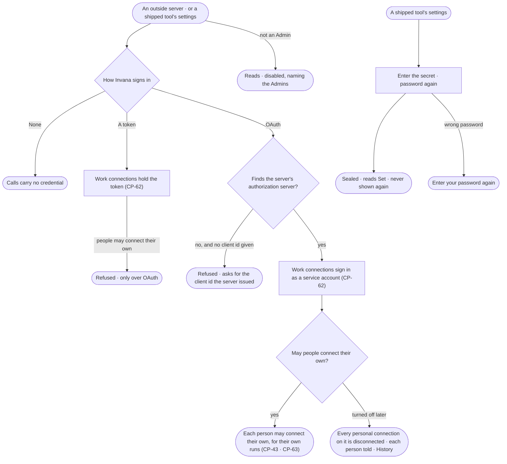

# CP-42 · Choose how Invana signs in to an outside server

**As** an Admin **I want** to choose, for each outside server, whether agents call it with no credential, with a token
or over OAuth — and whether people may connect their own accounts to it — and to set the secrets the tools Invana
ships need **so that** no credential sits in an environment variable, shared work always has a service identity, and
an agent reaches someone's own account only in that person's runs.

Tasks: [task.md](task.md) · Feature: [CP-F02](../../feature.md)

## Who can

Roles are [the role table](../../../../../access/features/AC-F02-access-policies/feature.md#the-role-table).

| Lens | Can | Otherwise sees |
|---|---|---|
| Admin | Choose how Invana signs in to each outside server and whether people may connect their own; set or clear a shipped tool's secrets — each with the password again | — |
| Operator | Read how each server signs in, whether people may connect their own, and whether each secret is set; a Modeller reads the same | Every credential act is disabled, naming the Admins. A secret's value is never shown to anyone |

## Flow

## Acceptance criteria

| # | Given | When | Then |
|---|---|---|---|
| CP-42.1 | An outside server | an Admin opens how it signs in | it offers *None*, *A token* and *OAuth*, and with OAuth *People may connect their own*, with the current choice and who set it |
| CP-42.2 | An Admin choosing *A token* or *OAuth* | it is saved with their password | calls carry the credential of the work connection attached to the agent (CP-62); History records who chose it |
| CP-42.3 | *A token* chosen while adding a server with no token for its first work connection | it is saved | it is refused, asking for the token |
| CP-42.4 | *OAuth* on a server whose authorization server cannot be found from its metadata, and no client id given | it is saved | it is refused, asking for the client id the server issued |
| CP-42.5 | A server whose *People may connect their own* is turned off | it is saved | every personal connection on it is disconnected, each person told in the Inbox; History records it |
| CP-42.6 | A shipped tool — `web` or `mail` — whose secret is not set | a step calls one of its functions | the step is refused, naming the setting an Admin sets |
| CP-42.7 | Any credential change | it is made without the password, with a wrong one, or with a key | it is refused — *Enter your password again to do this* |
| CP-42.8 | An Operator or a Modeller | they open a server's sign-in or a tool's settings | the choice and whether each secret is set read; every act is disabled, naming the Admins; through the API it is refused |
| CP-42.9 | Any secret or token | any route, History row, log line or *What left the platform* is read | the value is never in it |
| CP-42.10 | *People may connect their own* on a server that signs in with a token or none | it is saved | it is refused — *People connect their own only over OAuth* |

## Screens

| Surface | Lens | First use | Empty after a filter | Loading | Has data | Failed | Agent working or proposing | No access |
|---|---|---|---|---|---|---|---|---|
| How a server signs in | Admin | settings.plugins.server · Sign-in not set | — | settings.plugins.server · Loading | settings.plugins.server · Sign-in | settings.plugins.server · Sign-in refused | — | — |
| How a server signs in | Operator | settings.plugins.server · Sign-in · Read only | — | settings.plugins.server · Loading | settings.plugins.server · Sign-in · Read only | settings.plugins.server · Could not load | — | settings.plugins.server · Sign-in · Read only |
| A shipped tool's settings | Admin | settings.plugins · Secret not set | — | settings.plugins · Loading | settings.plugins · Secret set | settings.plugins · Could not load | — | — |
| A shipped tool's settings | Operator | settings.plugins · Secret not set · Read only | — | settings.plugins · Loading | settings.plugins · Secret set · Read only | settings.plugins · Could not load | — | settings.plugins · Secret set · Read only |
| Password again | Admin | — | — | access.sign_in_again · Checking | access.sign_in_again | access.sign_in_again · Wrong password | — | — |
| Password again | Operator | — | — | — | — | — | — | — |
