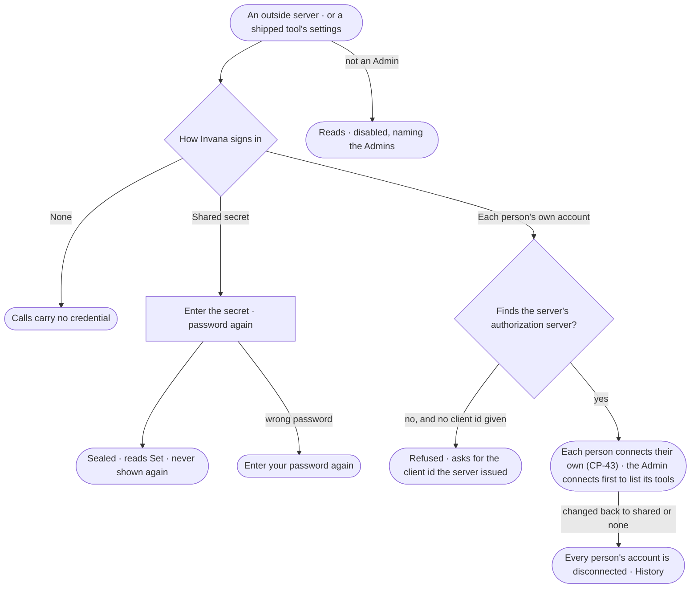

# CP-42 · Choose how Invana signs in to an outside server

**As** an Admin **I want** to choose, for each outside server, whether agents call it with no credential, with one
shared secret, or as each person with their own account — and to set the secrets the tools Invana ships need
**so that** no credential sits in an environment variable, and an agent reaches someone's outside account only as them.

Tasks: [task.md](task.md) · Feature: [CP-F02](../../feature.md)

## Who can

| Lens | Can | Otherwise sees |
|---|---|---|
| Admin | Choose how Invana signs in to each outside server; set, replace or clear a shared secret; set a shipped tool's secrets — each with the password again | — |
| Operator | Read how each server signs in and whether each secret is set | Every credential act is disabled, naming the Admins. A secret's value is never shown to anyone |

## Flow

## Acceptance criteria

| # | Given | When | Then |
|---|---|---|---|
| CP-42.1 | An outside server | an Admin opens how it signs in | it offers *None*, *Shared secret* and *Each person's own account*, with the current choice and who set it |
| CP-42.2 | An Admin choosing *Shared secret* | they enter the secret with their password | it is sealed and reads *Set*, never its value; every call sends it; History records who set it, never the value |
| CP-42.3 | *Shared secret* chosen with no secret | it is saved | it is refused, asking for the secret |
| CP-42.4 | *Each person's own account* on a server whose authorization server cannot be found from its metadata, and no client id given | it is saved | it is refused, asking for the client id the server issued |
| CP-42.5 | A server moved off *Each person's own account* | it is saved | every person's connected account on it is disconnected, each told in the Inbox; History records it |
| CP-42.6 | A shipped tool — `web` or `mail` — whose secret is not set | a step calls one of its functions | the step is refused, naming the setting an Admin sets |
| CP-42.7 | Any credential change | it is made without the password, with a wrong one, or with a key | it is refused — *Enter your password again to do this* |
| CP-42.8 | An Operator | they open a server's sign-in or a tool's settings | the choice and whether each secret is set read; every act is disabled, naming the Admins; through the API it is refused |
| CP-42.9 | Any secret | any route, History row, log line or *What left the platform* is read | the value is never in it |

## Screens

| Surface | Lens | First use | Empty after a filter | Loading | Has data | Failed | Agent working or proposing | No access |
|---|---|---|---|---|---|---|---|---|
| How a server signs in | Admin | settings.plugins.server · Sign-in not set | — | settings.plugins.server · Loading | settings.plugins.server · Sign-in | settings.plugins.server · Sign-in refused | — | — |
| How a server signs in | Operator | settings.plugins.server · Sign-in · Read only | — | settings.plugins.server · Loading | settings.plugins.server · Sign-in · Read only | settings.plugins.server · Could not load | — | settings.plugins.server · Sign-in · Read only |
| A shipped tool's settings | Admin | settings.plugins · Secret not set | — | settings.plugins · Loading | settings.plugins · Secret set | settings.plugins · Could not load | — | — |
| A shipped tool's settings | Operator | settings.plugins · Secret not set · Read only | — | settings.plugins · Loading | settings.plugins · Secret set · Read only | settings.plugins · Could not load | — | settings.plugins · Secret set · Read only |
| Password again | Admin | — | — | access.sign_in_again · Checking | access.sign_in_again | access.sign_in_again · Wrong password | — | — |
| Password again | Operator | — | — | — | — | — | — | — |
