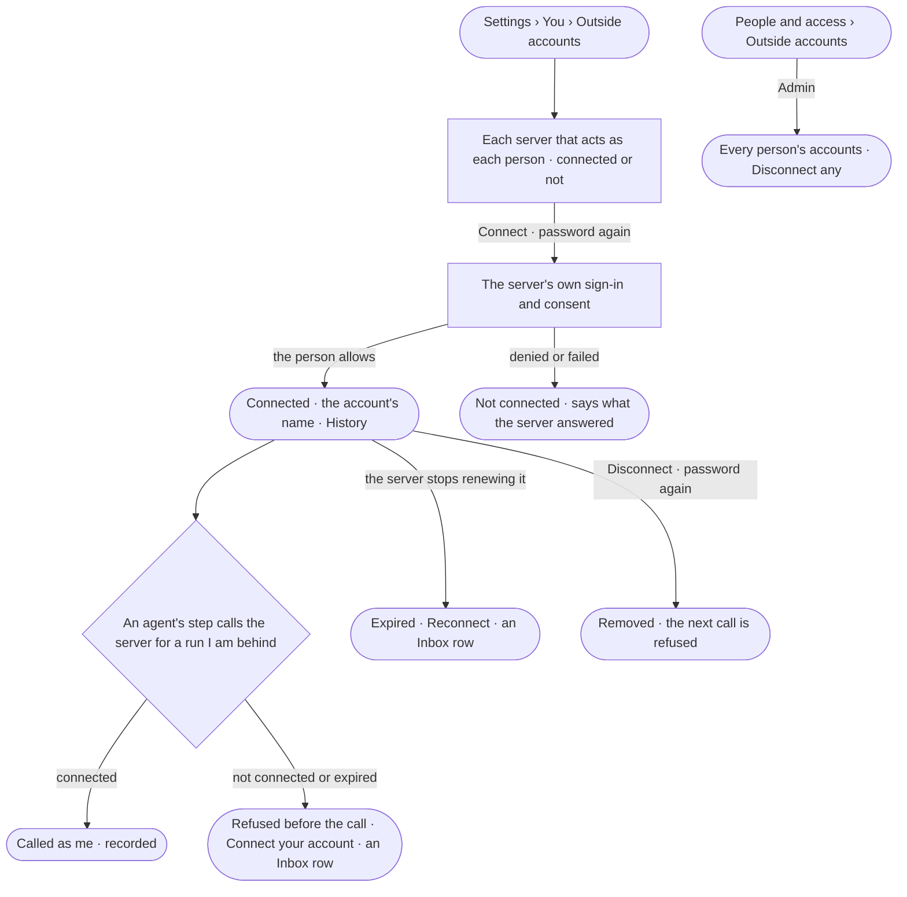

# CP-43 · Connect my own account to an outside server

**As** an analyst or agent builder **I want** to connect my own account on an outside server that acts as each person
— and disconnect it whenever I choose **so that** agents I use reach that service as me and see only what I may see
there, and nobody's agent reaches it as me without my say.

Tasks: [task.md](task.md) · Feature: [CP-F02](../../feature.md)

## Who can

| Lens | Can | Otherwise sees |
|---|---|---|
| Admin | Connect and disconnect their own accounts; read every person's connected accounts and disconnect any — each with the password again | — |
| Operator | Connect and disconnect their own accounts, with the password again | Another person's accounts are absent. A service user has no account to connect |

## Flow

## Acceptance criteria

| # | Given | When | Then |
|---|---|---|---|
| CP-43.1 | A person and servers that act as each person | they open *Outside accounts* | each such server reads, connected — with the account's name, when and last used — or not, with *Connect*; *No accounts connected* when none is |
| CP-43.2 | A person | they press *Connect* and give their password | their browser goes to the server's own sign-in with PKCE, naming the server as the resource |
| CP-43.3 | The person allows on the server | the server sends them back | the account is connected, its tokens sealed; History records who connected which server, never a token |
| CP-43.4 | The person denies, or the server answers with an error | they come back | nothing is connected, and the page says what the server answered |
| CP-43.5 | A run whose person has not connected an account on that server | a step calls one of its tools | the step is refused before the call, telling the person to connect their account, and they get an Inbox row with *Connect* |
| CP-43.6 | A connected account | a step calls the server for a run the person is behind — or a schedule they created | the call is made as that account, renewed first when its access token has run out, and *What left the platform* names the person |
| CP-43.7 | An account the server stops renewing | a renewal is refused | it reads *Expired* with *Reconnect*; the person gets an Inbox row; their calls are refused until they reconnect |
| CP-43.8 | A run behind a service user | a step calls a server that acts as each person | it is refused, saying a service user has no account there |
| CP-43.9 | Connecting or disconnecting | it is done without the password, with a wrong one, or with a key | it is refused — *Enter your password again to do this* |
| CP-43.10 | A person | they disconnect their account | it is removed at once; the next call for their runs is refused as in CP-43.5; History records it |
| CP-43.11 | An Admin | they open *People and access › Outside accounts* and disconnect a person's account with their password | it is removed; the person is told in the Inbox; History names the Admin |
| CP-43.12 | An Operator | they read another person's account by any path | it is absent (`404`) |
| CP-43.13 | A person deactivated (AC-23) | it is done | every outside account of theirs is disconnected |

## Screens

| Surface | Lens | First use | Empty after a filter | Loading | Has data | Failed | Agent working or proposing | No access |
|---|---|---|---|---|---|---|---|---|
| Your outside accounts | Admin | settings.me · No accounts connected | — | settings.me · Loading | settings.me · Outside accounts | settings.me · Account expired | — | — |
| Your outside accounts | Operator | settings.me · No accounts connected | — | settings.me · Loading | settings.me · Outside accounts | settings.me · Account expired | — | — |
| Connect | Admin | — | — | settings.me · Connecting | settings.me · Account connected | settings.me · Not connected | — | — |
| Connect | Operator | — | — | settings.me · Connecting | settings.me · Account connected | settings.me · Not connected | — | — |
| Every person's accounts | Admin | settings.people · No accounts connected | settings.people · Nothing matches | settings.people · Loading | settings.people · Outside accounts | settings.people · Could not load | — | — |
| Every person's accounts | Operator | — | — | — | — | — | — | access.locked |
| Password again | Admin | — | — | access.sign_in_again · Checking | access.sign_in_again | access.sign_in_again · Wrong password | — | — |
| Password again | Operator | — | — | access.sign_in_again · Checking | access.sign_in_again | access.sign_in_again · Wrong password | — | — |
