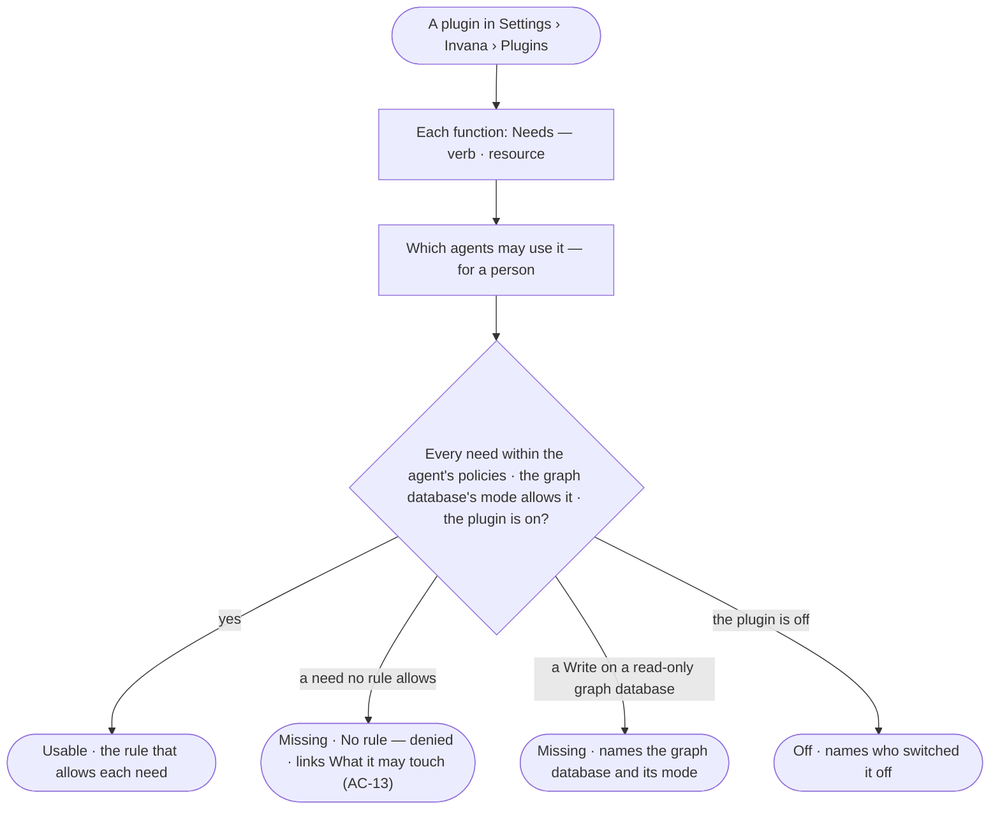

# CP-44 · See what a plugin needs and which agents may use it

**As** an agent builder or an Admin **I want** every function of a plugin to say what it needs — which data it reads
or writes, which outside tool it calls — and which agents may use it for a given person **so that** I know before a
run why an agent cannot use it, and turning a plugin on never grants more than the agents' policies already allow.

Tasks: [task.md](task.md) · Feature: [CP-F02](../../feature.md)

## Who can

| Lens | Can | Otherwise sees |
|---|---|---|
| Admin | Read every function's needs and, for any person, which agents may use it and what is missing | — |
| Operator | The same reads, for themselves and any person — everyone reads access ([AC-F02](../../../../../access/features/AC-F02-access-policies/feature.md#decisions)) | — |

## Flow

## Acceptance criteria

| # | Given | When | Then |
|---|---|---|---|
| CP-44.1 | A plugin | one of its functions is opened | its needs read as sentences — *Reads Customer in any graph database* · *Calls design_lookup on the design server* — with the exact `verb resource` one click deeper |
| CP-44.2 | A plugin and a person chosen | *Which agents may use it* opens | each agent the person may use reads usable or not, function by function, each need met or missing |
| CP-44.3 | A need no rule on the agent's policies allows, for that person | it is read | it reads *Missing — no rule allows it*, linking to what the agent may touch (AC-13) |
| CP-44.4 | A need to write on a graph database that is read-only | it is read | it reads *Missing — {database} is read-only* |
| CP-44.5 | A plugin whose manifest leaves a function's needs undeclared — an empty list declares it needs nothing — or names a need outside the resource grammar | the engine starts | it does not start, naming the plugin and the function |
| CP-44.6 | An outside server's tool | it is frozen | it needs Run on its own `tool/<server>/<tool>` and nothing else is assumed |
| CP-44.7 | A plugin turned on | nothing else changes | no agent gains anything: each need is still decided by the agent's policies for the person behind the run (AC-F04) |
| CP-44.8 | A step whose function has a need that is missing | it would run | it is refused before it runs, naming the need and the agent (AC-13.7) |

## Screens

| Surface | Lens | First use | Empty after a filter | Loading | Has data | Failed | Agent working or proposing | No access |
|---|---|---|---|---|---|---|---|---|
| A function's needs | Admin | — | — | settings.plugins · Loading | settings.plugins · Needs | settings.plugins · Could not load | — | — |
| A function's needs | Operator | — | — | settings.plugins · Loading | settings.plugins · Needs | settings.plugins · Could not load | — | — |
| Which agents may use it | Admin | settings.plugins · No agent may use it | settings.plugins · Nothing matches | settings.plugins · Loading | settings.plugins · Agents and needs | settings.plugins · Need missing | — | — |
| Which agents may use it | Operator | settings.plugins · No agent may use it | settings.plugins · Nothing matches | settings.plugins · Loading | settings.plugins · Agents and needs | settings.plugins · Need missing | — | — |
