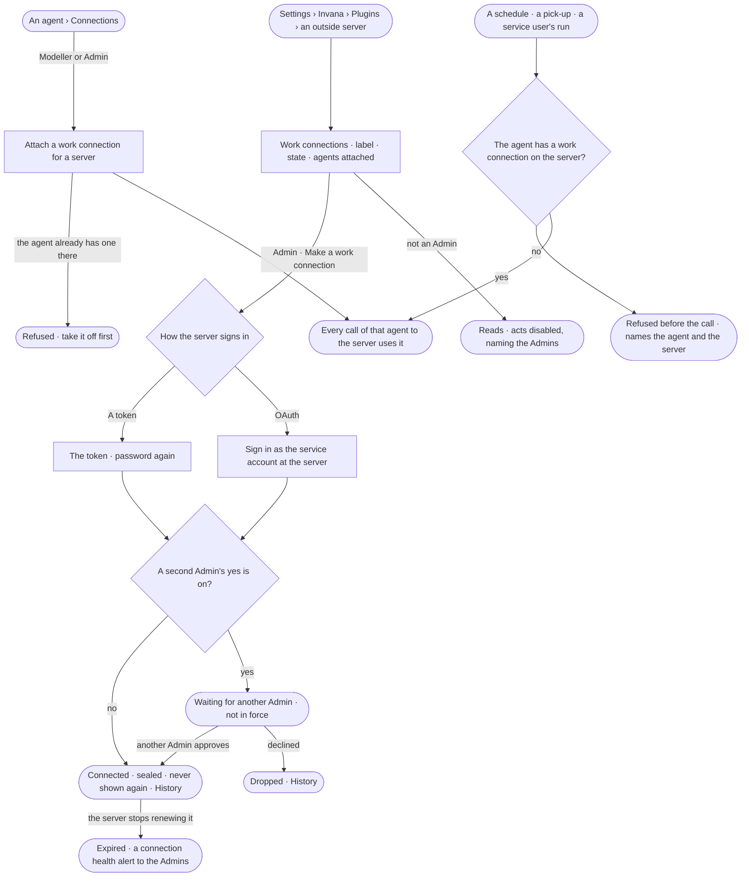

# CP-62 · Make a work connection and attach it to agents

**As** an Admin **I want** to make a service identity on an outside server once, and an agent builder to attach it to
the agents that need it **so that** shared work — schedules, picked-up tasks, service users — reaches the server as
the organisation, the same for everyone who uses the agent, and keeps working when a person leaves.

Tasks: [task.md](task.md) · Feature: [CP-F02](../../feature.md)

## Who can

Roles are [the role table](../../../../../access/features/AC-F02-access-policies/feature.md#the-role-table).

| Lens | Can | Otherwise sees |
|---|---|---|
| Admin | Make, renew and remove a work connection, with the password again; approve another Admin's change when a second Admin's yes is on; attach and take off a work connection on any agent | The Admin who made a change cannot approve it |
| Operator | Read every work connection — its server, label, state, who made it and the agents it is attached to — on the server and on each agent. A Modeller also attaches and takes off a work connection on an agent | *Make a work connection*, *Renew* and *Remove* are disabled, naming the Admins; *Attach* is disabled for an Operator, naming the Modeller role |

## Flow

## Acceptance criteria

| # | Given | When | Then |
|---|---|---|---|
| CP-62.1 | An outside server that signs in with a token | an Admin makes a work connection with a name, a label and the token, giving their password | it is sealed and reads *Connected*, never its value; History records who made it, never the token |
| CP-62.2 | An outside server that signs in with OAuth | an Admin makes a work connection | they sign in at the server as the service account; the tokens are sealed and the connection reads *Connected* with the account's name |
| CP-62.3 | A second Admin's yes is on for the deployment | an Admin makes, renews or removes a work connection | it reads *Waiting for another Admin*, every other Admin gets it in the Inbox, and the previous state stays in force until one approves |
| CP-62.4 | A change waiting for a second Admin | the Admin who made it approves it | it is refused — *Another Admin approves this change* |
| CP-62.5 | A Modeller or an Admin on an agent | they attach a work connection | from the agent's next call, every call to that server uses it — in a person's own run too — and the agent's page lists it |
| CP-62.6 | An agent that already has a work connection on a server | a second one on that server is attached | it is refused, naming the one it has |
| CP-62.7 | A schedule, a picked-up task or a service user's run whose agent has no work connection on a server | a step calls the server | it is refused before the call, naming the agent and the server and saying a Modeller or an Admin attaches one |
| CP-62.8 | A work connection the server stops renewing | a renewal is refused | it reads *Expired*; the Admins get a connection health alert; calls that need it are refused until an Admin renews it |
| CP-62.9 | An Operator or a Modeller | they make, renew or remove a work connection by any path | it is refused — *This needs an Admin* — and the acts read disabled, naming the Admins |
| CP-62.10 | An Operator | they attach or take off a work connection | it is refused — *This needs the Modeller role* |
| CP-62.11 | Making, renewing, removing or approving a work connection | it is done without the password, with a wrong one, or with a key | it is refused — *Enter your password again to do this* |
| CP-62.12 | An Admin removing a work connection | they confirm | the agents it is attached to are listed first; it is taken off each and removed; History records it |
| CP-62.13 | A call made with a work connection | it is recorded | *What left the platform* names the work connection, never its credential (AC-F09) |

## Screens

| Surface | Lens | First use | Empty after a filter | Loading | Has data | Failed | Agent working or proposing | No access |
|---|---|---|---|---|---|---|---|---|
| A server's work connections | Admin | settings.plugins.server · No work connections | — | settings.plugins.server · Loading | settings.plugins.server · Work connections | settings.plugins.server · Connection expired | — | — |
| A server's work connections | Operator | settings.plugins.server · No work connections · Read only | — | settings.plugins.server · Loading | settings.plugins.server · Work connections · Read only | settings.plugins.server · Connection expired | — | settings.plugins.server · Work connections · Read only |
| Make a work connection | Admin | settings.plugins.server · Make a work connection | — | settings.plugins.server · Connecting | settings.plugins.server · Waiting for another Admin | settings.plugins.server · Sign-in refused | — | — |
| Make a work connection | Operator | — | — | — | — | — | — | access.locked |
| An agent's connections | Admin | agents.agent · No connections | — | agents.agent · Loading | agents.agent · Connections | agents.agent · Already attached | — | — |
| An agent's connections | Operator | agents.agent · No connections · Read only | — | agents.agent · Loading | agents.agent · Connections · Read only | agents.agent · Could not load | — | agents.agent · Connections · Read only |
| Password again | Admin | — | — | access.sign_in_again · Checking | access.sign_in_again | access.sign_in_again · Wrong password | — | — |
| Password again | Operator | — | — | — | — | — | — | — |
