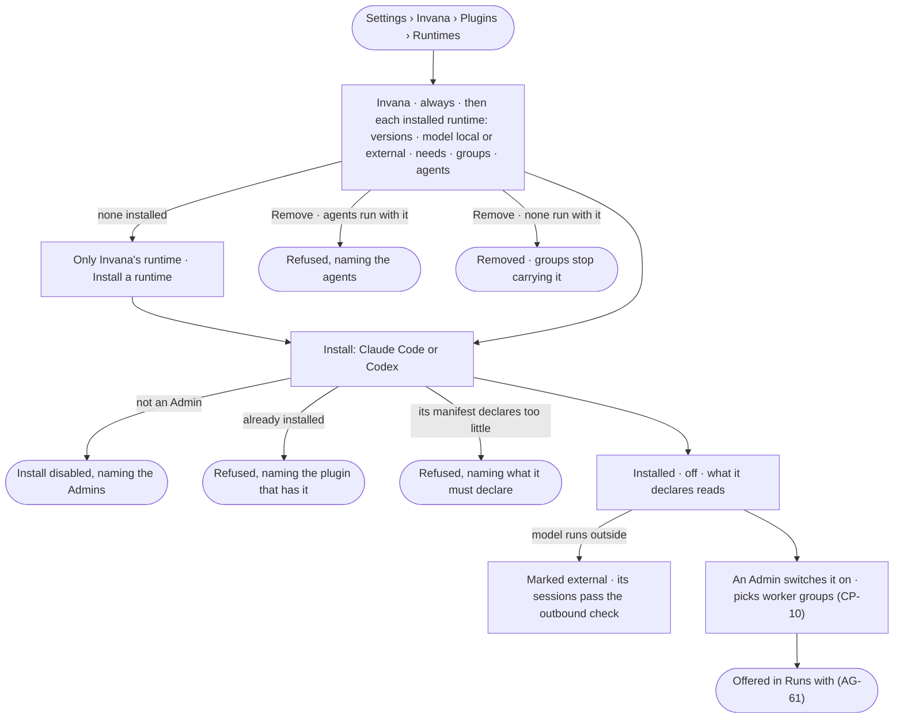

# CP-64 · Install an agent runtime

**As** an Admin **I want** to install Claude Code or Codex as a runtime plugin and see what each declares — its
versions, where its model runs, the files, programs and hosts it needs — **so that** I decide which outside runtimes
agents may run with on our workers, and know when an agent's work leaves the deployment.

Tasks: [task.md](task.md) · Feature: [CP-F02](../../feature.md)

## Who can

The role × feature table is [AC-F02 › The role table](../../../../../access/features/AC-F02-access-policies/feature.md#the-role-table).

| Lens | Can | Otherwise sees |
|---|---|---|
| Admin | Install and remove a runtime plugin; switch it on or off; pick the worker groups that carry it (CP-10) | — |
| Operator | Read every runtime, what it declares, the groups that carry it and how many agents run with it; a Modeller reads the same | *Install* and *Remove* disabled — *This needs an Admin — ask {admins}* |

## Flow

## Acceptance criteria

| # | Given | When | Then |
|---|---|---|---|
| CP-64.1 | Anyone signed in | they open *Runtimes* | Invana's runtime reads first, always installed and on; then each installed runtime with its versions, where its model runs — *local* or *external* — what it needs in files, programs and hosts, its switch, the worker groups that carry it and how many agents run with it |
| CP-64.2 | No runtime plugin installed | *Runtimes* opens | only Invana's runtime reads, with *Install a runtime* for an Admin |
| CP-64.3 | An Admin | they install the Claude Code or the Codex runtime plugin | it is installed off; what it declares reads; History records who and when |
| CP-64.4 | A runtime whose model runs outside the deployment | it reads | it is marked *external*, naming that every session's prompt passes the outbound check ([AC-F09](../../../../../access/features/AC-F09-what-left-the-platform/feature.md)) |
| CP-64.5 | What a runtime declares it needs | it reads | the declaration grants nothing: each need reads beside whether the agents that run with it are allowed it by their Access Policies ([AC-37](../../../../../access/features/AC-F02-access-policies/stories/AC-37-say-what-an-agent-may-touch-on-a-worker/story.md)) |
| CP-64.6 | A runtime an active or paused agent runs with | an Admin presses *Remove* | it is refused — *{n} agents run with {runtime} — change what they run with first.* — naming the agents |
| CP-64.7 | A runtime already installed | an Admin installs another plugin for it | it is refused — *{runtime} is already installed by {plugin}.* |
| CP-64.8 | A runtime plugin whose manifest does not declare its versions, where its model runs or its needs | the engine starts | it does not load, naming the plugin and what it must declare |
| CP-64.9 | An Operator | they look for *Install* or *Remove* | each is disabled — *This needs an Admin — ask {admins}* |
| CP-64.10 | A runtime switched off | an agent that runs with it is started | the run is refused before it starts, naming who switched it off |
| CP-64.11 | An installed, switched-on runtime no worker group carries | it reads | it says no group carries it and links *Workers* to add it to a group |

## Screens

| Surface | Lens | First use | Empty after a filter | Loading | Has data | Failed | Agent working or proposing | No access |
|---|---|---|---|---|---|---|---|---|
| Runtimes | Admin | settings.plugins · Only Invana's runtime | — | settings.plugins · Loading | settings.plugins · Runtimes | settings.plugins · Install refused | — | — |
| Runtimes | Operator | settings.plugins · Only Invana's runtime | — | settings.plugins · Loading | settings.plugins · Runtimes · Read only | settings.plugins · Could not load | — | settings.plugins · Runtimes · Read only |
| A worker group's runtimes | Admin | — | — | settings.workers · Loading | settings.workers · Group | settings.workers · No worker carries the runtime | — | — |
| A worker group's runtimes | Operator | — | — | settings.workers · Loading | settings.workers · Group · Read only | settings.workers · No worker carries the runtime | — | settings.workers · Read only |
</content>
</invoke>
<invoke name="TaskUpdate">
<parameter name="taskId">3</parameter>
<parameter name="activeForm">CP-F04 session budget</parameter>
</invoke>
