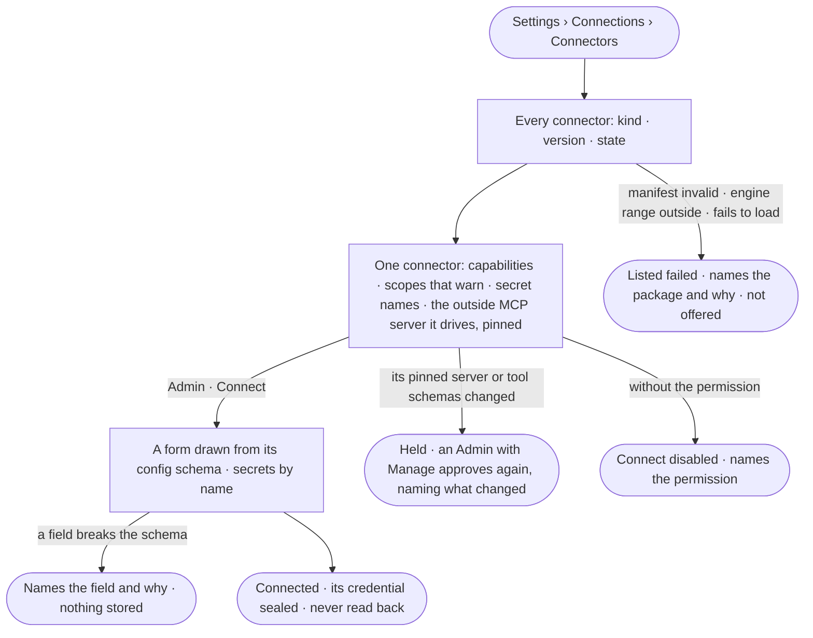

# CP-77 · See the connectors installed and connect one from its manifest

**As** an Admin **I want** to see every connector installed — graph, code host and source — with what it declares, and connect one through a form its own manifest draws **so that** I know what code reaches outside before I connect it, which secrets it needs and which scopes are risky, and a new connector needs no change to Invana.

Tasks: [task.md](task.md) · Feature: [CP-F02](../../feature.md)

## Who can

A connector is installed on the engine's machine ([CP-17](../../../CP-F05-graph-databases/stories/CP-17-install-a-graph-connector-and-see-it-offered/story.md)); connecting one is the permission its kind already needs ([CP-25](../../../CP-F05-graph-databases/feature.md) for a graph database, [CP-73](../../../CP-F12-issue-trackers/stories/CP-73-connect-an-issue-tracker-and-link-a-project/story.md) for a tracker or a source).

| Access | Can | Otherwise sees |
|---|---|---|
| Admin | Read every connector and its manifest; connect one with the permission its kind needs, the form drawn from its `config` and its secrets set by name | — |
| Operator | Read every connector, its kind, version, capabilities and scopes; never a secret | *Connect* is disabled — *Needs Manage on the {name} plugin — ask {who can grant}* |

## Flow

## Acceptance criteria

| # | Given | When | Then |
|---|---|---|---|
| CP-77.1 | Connectors installed beside the engine | Settings › Connections › Connectors opens | every connector lists with its kind (graph · code host · source), version, state and the engine range it needs; a person reads it without any act of their own |
| CP-77.2 | A connector | its page opens | it shows its capabilities — a code host's never include `delete` or `merge`, and its `force_push_branch` is marked guarded — only after a person approves — its scopes with the ones that warn named, the names of its secrets (never a value) and the outside MCP server it drives, with its pinned version |
| CP-77.3 | An Admin with the permission its kind needs | they connect a connector | the form is drawn from the connector's `config` schema, a secret is set by name and sealed, and a field that breaks the schema is refused naming the field and why |
| CP-77.4 | A connector whose pinned MCP server version or tool schemas changed | it is next read | it is held until an Admin with Manage approves it again, naming what changed (CP-73.15) |
| CP-77.5 | A connector whose `connector.yaml` is missing or invalid, whose engine range excludes this engine, or that fails to load | the engine starts | the engine starts; the connector is listed failed, naming the package and why, and is not offered |
| CP-77.6 | Two packages that claim one connector id | the engine starts | neither is offered; both packages are named |
| CP-77.7 | An Operator | they open a connector | everything reads; *Connect* is disabled, naming the permission, and the engine refuses it the same |
| CP-77.8 | The core installed alone | Connectors opens | only `invana-files` is listed, bundled; GitHub, Gitea and every graph database connector appear once installed |

## Screens

| Surface | Access | First use | Empty after a filter | Loading | Has data | Failed | Agent working or proposing | No access |
|---|---|---|---|---|---|---|---|---|
| The connectors | Admin | settings.connectors · None installed | settings.connectors · Nothing matches | settings.connectors · Loading | settings.connectors | settings.connectors · Could not load | — | — |
| The connectors | Operator | settings.connectors · None installed | settings.connectors · Nothing matches | settings.connectors · Loading | settings.connectors · Read only | settings.connectors · Could not load | — | settings.connectors · Read only |
| One connector | Admin | — | — | settings.connectors · Detail · Loading | settings.connectors · Detail | settings.connectors · Detail · Failed | — | — |
| One connector | Operator | — | — | settings.connectors · Detail · Loading | settings.connectors · Detail · Read only | settings.connectors · Detail · Failed | — | settings.connectors · Detail · Read only |
| Connect it | Admin | — | — | settings.connectors · Connect · Testing | settings.connectors · Connect | settings.connectors · Connect · Refused | — | — |
| Connect it | Operator | — | — | — | — | — | — | settings.connectors · Detail · Read only |
| A held connector | Admin | — | — | — | settings.connectors · Detail · Held | — | — | — |
| A held connector | Operator | — | — | — | — | — | — | settings.connectors · Detail · Held · Read only |
