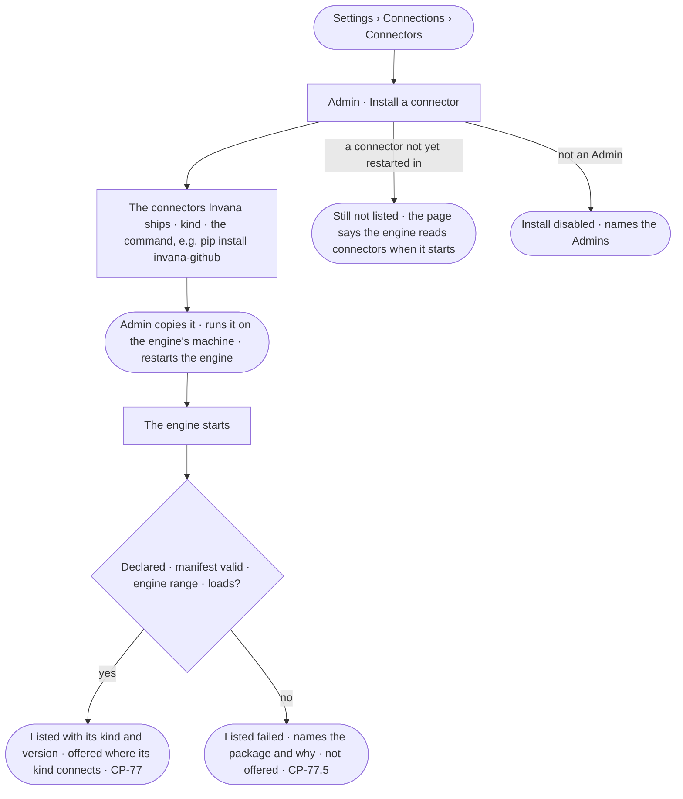

# CP-79 · Install a connector

**As** an Admin **I want** to be shown exactly what to run to install a connector, and to see it offered once it is installed **so that** the deployment reaches only the code I chose to install — a package change on the engine's machine, never a click that runs code from a web page.

Tasks: [task.md](task.md) · Feature: [CP-F02](../../feature.md)

## Who can

A connector is code ([CP-F02 › Rules](../../feature.md#rules)): installing one changes the deployment's software, so it is done on the engine's machine by whoever runs the deployment, never from Invana's pages. Studio shows the command and the result.

| Access | Can | Otherwise sees |
|---|---|---|
| Admin | Read *Install a connector* — the connectors Invana ships, each with its kind and its command — and copy a command; read which connectors are installed, failed or not yet offered | — |
| Operator | Read every connector, as [CP-77](../CP-77-see-the-connectors-installed-and-connect-one-from-its-manifest/story.md) shows | *Install a connector* is disabled — *This needs an Admin — ask {admins}* |

## Flow

## Acceptance criteria

| # | Given | When | Then |
|---|---|---|---|
| CP-79.1 | An Admin | they open *Install a connector* | every connector Invana ships reads — graph database, code host, source and runtime — each with its kind, its pip name, whether it is installed, and the command that installs it |
| CP-79.2 | A connector not installed | an Admin reads its row | the command reads as one line to copy, with *Run it on the engine's machine, then restart the engine*; Invana runs nothing |
| CP-79.3 | A connector installed and the engine restarted | Connectors opens | it lists with its kind, version and state, and is offered where its kind connects — a graph database in [CP-25](../../../CP-F05-graph-databases/feature.md), a tracker in [CP-73](../../../CP-F12-issue-trackers/stories/CP-73-connect-an-issue-tracker-and-link-a-project/story.md) |
| CP-79.4 | A connector installed and the engine not restarted | Connectors opens | it is not listed; *Install a connector* says connectors are read when the engine starts |
| CP-79.5 | A connector installed whose manifest is invalid, whose engine range excludes this engine or that fails to load | the engine starts | it lists failed, naming the package and why, and is not offered ([CP-77.5](../CP-77-see-the-connectors-installed-and-connect-one-from-its-manifest/story.md)) |
| CP-79.6 | A deployment with only the bundled `invana-files` | Connectors opens | *None installed* reads for every kind but that one, with *Install a connector* leading |
| CP-79.7 | An Operator | they open *Install a connector* | it reads disabled — *This needs an Admin — ask {admins}* — and no act of Invana installs a connector for anyone |
| CP-79.8 | A person | they look for a way to install a connector by Studio or by the API | none exists; the only install is the package command on the engine's machine |

## Screens

| Surface | Access | First use | Empty after a filter | Loading | Has data | Failed | Agent working or proposing | No access |
|---|---|---|---|---|---|---|---|---|
| The connectors | Admin | settings.connectors · None installed | settings.connectors · Nothing matches | settings.connectors · Loading | settings.connectors | settings.connectors · Could not load | — | — |
| The connectors | Operator | settings.connectors · None installed | settings.connectors · Nothing matches | settings.connectors · Loading | settings.connectors · Read only | settings.connectors · Could not load | — | settings.connectors · Read only |
| Install a connector | Admin | settings.connectors · Install | — | settings.connectors · Install · Loading | settings.connectors · Install · Command | settings.connectors · Install · Not offered yet | — | — |
| Install a connector | Operator | — | — | — | — | — | — | settings.connectors · Install · Read only |
