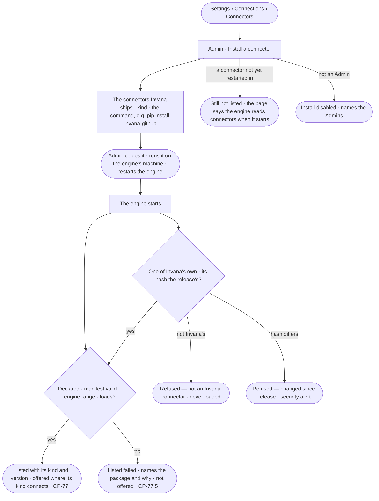

# CP-79 · Install a connector

**As** an Admin **I want** to be shown exactly what to run to install a connector, and to see it offered once it is installed **so that** the deployment reaches only the code I chose to install — a package change on the engine's machine, never a click that runs code from a web page.

Tasks: [task.md](task.md) · Feature: [CP-F02](../../feature.md)

## Who can

A connector is code ([CP-F02 › Rules](../../feature.md#rules)): installing one changes the deployment's software, so it is done on the engine's machine by whoever runs the deployment, never from Invana's pages. Studio shows the command and the result.

| Access | Can | Otherwise sees |
|---|---|---|
| Admin | Read *Install a connector* — the connectors Invana ships, each with its kind and its command — and copy a command; read which connectors are installed, failed or not yet offered | — |
| Operator | Read every connector, as [CP-77](../CP-77-see-the-connectors-installed-and-connect-one-from-its-manifest/story.md) shows | *Install a connector* is disabled — *This needs an Admin — ask {admins}* |

## Flow

## Acceptance criteria

| # | Given | When | Then |
|---|---|---|---|
| CP-79.1 | An Admin | they open *Install a connector* | every connector Invana ships reads — graph database, code host, source and runtime — each with its kind, its pip name, whether it is installed, and the command that installs it |
| CP-79.2 | A connector not installed | an Admin reads its row | the command reads as one line to copy, with *Run it on the engine's machine, then restart the engine*; Invana runs nothing |
| CP-79.3 | A connector installed and the engine restarted | Connectors opens | it lists with its kind, version and state, and is offered where its kind connects — a graph database in [CP-25](../../../CP-F05-graph-databases/feature.md), a tracker in [CP-73](../../../CP-F12-issue-trackers/stories/CP-73-connect-an-issue-tracker-and-link-a-project/story.md) |
| CP-79.4 | A connector installed and the engine not restarted | Connectors opens | it is not listed; *Install a connector* says connectors are read when the engine starts |
| CP-79.5 | A connector installed whose manifest is invalid, whose engine range excludes this engine or that fails to load | the engine starts | it lists failed, naming the package and why, and is not offered ([CP-77.5](../CP-77-see-the-connectors-installed-and-connect-one-from-its-manifest/story.md)) |
| CP-79.6 | A deployment with only the bundled `invana-files` | Connectors opens | *None installed* reads for every kind but that one, with *Install a connector* leading |
| CP-79.7 | An Operator | they open *Install a connector* | it reads disabled — *This needs an Admin — ask {admins}* — and no act of Invana installs a connector for anyone |
| CP-79.8 | A person | they look for a way to install a connector by Studio or by the API | none exists; the only install is the package command on the engine's machine |
| CP-79.9 | A connector package installed beside the engine that declares a connector under the entry-point group `invana.connectors` | the engine starts | the connector is found by its registered name; no list in the engine names it |
| CP-79.10 | Installed connectors | someone runs `invana version` | it lists the engine version and every installed connector — its name, language and package version |
| CP-79.11 | Connecting a graph database (CP-25) | the connector choice draws | it offers every installed connector by name with its language — Neo4j, Memgraph and ArcadeDB in openCypher; JanusGraph, Amazon Neptune, TinkerGraph and ArcadeDB in Gremlin — and only those installed |
| CP-79.12 | A database whose package is not installed | an Admin looks for it while connecting | it is not offered; the step names the package that would add it |
| CP-79.13 | A package whose connector fails to load | the engine starts | the engine starts; `invana version` lists that connector as failed, naming the package and the error, and it is not offered |
| CP-79.14 | A saved graph database | it is stored | it names its connector by the registered name, never by a code path |
| CP-79.15 | A graph database whose connector's package was removed | it is read or a run reaches it | it says the connector is not installed, naming the package; nothing runs against it |
| CP-79.16 | Two packages that register the same name | the engine starts | neither is offered under that name; `invana version` names both packages |
| CP-79.17 | An Operator | they open a graph database's details | they read its connector and language; installing one is not an act of Invana — this story shows an Admin the command to run on the engine's machine |
| CP-79.18 | Connectors in Settings › Connections | the list is read | each installed connector reads its graph databases and *Used by n agents*, as the engine counts them |
| CP-79.19 | Installed graph connectors | a person opens Settings › Connections › Connectors | each lists with the graph database it connects, its version and *Used by n graph databases*; an Operator reads the same list, which has no acts of its own |
| CP-79.20 | A connector's command is shown | the Admin ran it and restarted the engine and presses *I ran it — check again* | *Checking* reads, then the connector lists with its kind and version, or *Not found yet* names what was not found, with *Check again* and *Close*; *Copy* and *Close* stay on the command |
| CP-79.21 | A connector the engine does not offer yet | its details open | *Not offered* names why and *Install a connector* leads to that connector's *Not installed* command |
| CP-79.22 | A package beside the engine that registers a connector but is not one of Invana's own | the engine starts | it is not loaded — no code of it runs in the engine; Connectors and `invana version` list it *Refused — not an Invana connector*, naming the package; it is not offered |
| CP-79.23 | One of Invana's own connectors whose installed files hash differently from the ones that engine release names | the engine starts | it is not loaded; it lists *Refused — changed since release*, naming the package and both hashes; a security alert reaches the Admins ([CP-F11](../../../CP-F11-ops-alerting/feature.md)) |

## Screens

| Surface | Access | First use | Empty after a filter | Loading | Has data | Failed | Agent working or proposing | No access |
|---|---|---|---|---|---|---|---|---|
| The connectors | Admin | settings.connectors · None installed | settings.connectors · Nothing matches | settings.connectors · Loading | settings.connectors | settings.connectors · Could not load | — | — |
| The connectors | Operator | settings.connectors · None installed | settings.connectors · Nothing matches | settings.connectors · Loading | settings.connectors · Read only | settings.connectors · Could not load | — | settings.connectors · Read only |
| Install a connector | Admin | settings.connectors · Install · Not installed | — | settings.connectors · Install · Loading | settings.connectors · Install · Command | settings.connectors · Install · Not offered yet | — | — |
| Install a connector | Operator | — | — | — | — | — | — | settings.connectors · Install · Read only |
| Install a connector · Check again | Admin | — | — | settings.connectors · Install · Checking | settings.connectors | settings.connectors · Install · Not found yet | — | — |
| Install a connector · Check again | Operator | — | — | — | — | — | — | settings.connectors · Install · Read only |
| A connector not offered | Admin | — | — | — | settings.connectors · Install · Not installed | settings.connectors · Detail · Not offered | — | — |
| A connector not offered | Operator | — | — | — | — | — | — | settings.connectors · Detail · Read only |
| A connector refused at start | Admin | — | — | — | — | settings.connectors · Detail · Refused · Not an Invana connector · Changed since release | — | — |
| A connector refused at start | Operator | — | — | — | — | settings.connectors · Detail · Refused · Read only | — | settings.connectors · Detail · Read only |
| The connector choice | Admin | settings.databases · Connect · No connector installed | — | — | settings.databases · Connect | settings.databases · Connect · Connector failed | — | — |
| The connector choice | Operator | — | — | — | — | — | — | settings.databases · Read only |
