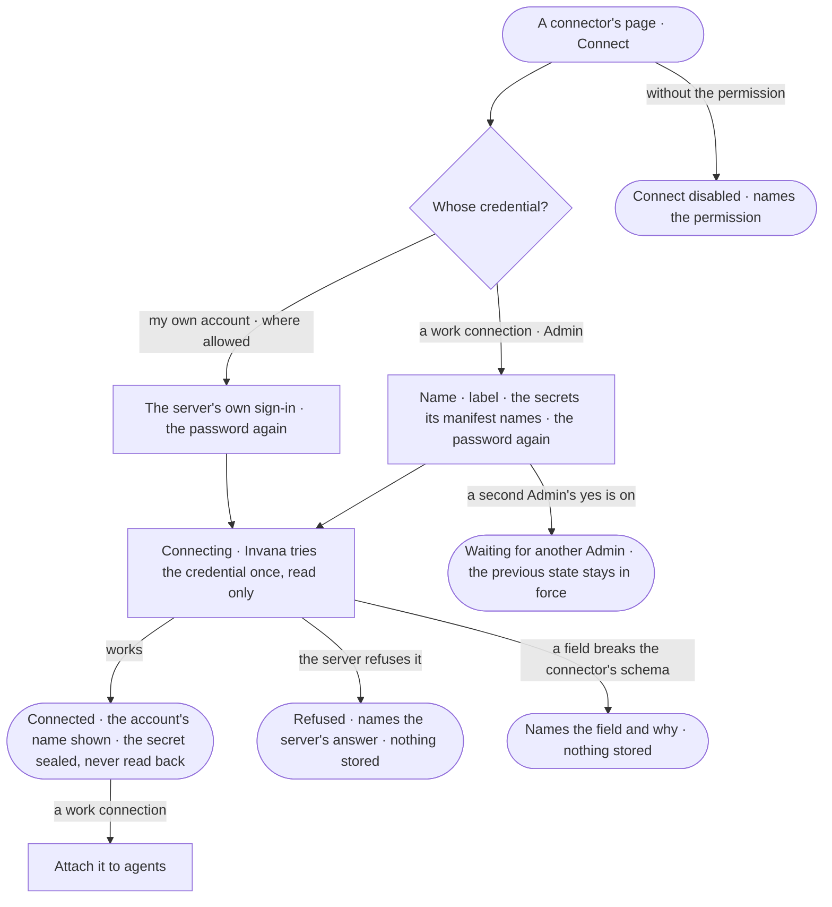

# CP-80 · Add a credential to a connector and connect it

**As** an Admin — or a person with my own account — **I want** to give a connector a credential and connect it, as a work connection the agents share or as my own personal connection **so that** an agent reaches the outside as the identity I meant, and a credential is proven to work the moment it is added.

Tasks: [task.md](task.md) · Feature: [CP-F02](../../feature.md)

## Who can

A connector's credential is a connection on the outside server it drives: a **work connection** — a service identity, made by an Admin and attached to agents ([CP-80](../CP-80-add-a-credential-to-a-connector-and-connect-it/story.md)) — or a **personal connection** — a person's own account, used only in the runs they start ([CP-43](../CP-43-connect-my-own-account-to-an-outside-server/story.md)). A graph database's own login is part of connecting it ([CP-25](../../../CP-F05-graph-databases/feature.md)), not a connection here. The permission each act needs is in [the permission catalogue](../../../../../access/features/AC-F02-access-policies/feature.md#the-permission-catalogue).

| Access | Can | Otherwise sees |
|---|---|---|
| Admin | With Manage on `plugin/<id>` and the password again, make a work connection for a connector, naming it and its secrets; connect their own account where the connector allows | — |
| Operator | Connect their own account to a connector that allows personal connections, with the password again | *Make a work connection* is disabled — *Needs Manage on the {name} plugin — ask {who can grant}*. A connector that allows no personal connection shows no *My own account* |

## Flow

## Acceptance criteria

| # | Given | When | Then |
|---|---|---|---|
| CP-80.1 | A connector whose manifest names secrets | an Admin with Manage on `plugin/<id>` makes a work connection, giving the password again | a form drawn from its `config` and `secrets` asks for a name, a label and each secret by name; nothing is stored until the credential has been tried |
| CP-80.2 | A credential being added | Invana tries it | it makes one read-only call to the server the connector drives, shown as *Connecting*; the call is ledgered ([AC-F06](../../../../../access/features/AC-F06-history/feature.md)) and carries no record of the Graph |
| CP-80.3 | A credential the server accepts | the try ends | the connection reads *Connected* with the account's name, its secret sealed and never read back; History records who made it, never the secret |
| CP-80.4 | A credential the server refuses, or a server that does not answer | the try ends | it is refused, naming the server's answer; nothing is stored, and the form keeps what was typed except the secret |
| CP-80.5 | A field that breaks the connector's `config` schema | it is submitted | it is refused, naming the field and why; nothing is tried |
| CP-80.6 | A connector | an Admin connects it | the credential is a work connection: it is attached to agents and every call through them uses it; a person's own account is not connected here |
| CP-80.7 | A person | they look for *My own account* | it is not offered; a connection is a work connection, and the engine refuses a personal one |
| CP-80.8 | The second Admin's yes is on for the deployment | an Admin makes a work connection | it reads *Waiting for another Admin*, as CP-80.14 says |
| CP-80.9 | A work connection just made | it reads *Connected* | *Attach to agents* leads, and until it is attached to an agent no agent uses it |
| CP-80.10 | Adding a credential | it is done without the password, with a wrong one, or with a key | it is refused — *Enter your password again to do this* |
| CP-80.11 | An Operator without Manage on the plugin | they make a work connection by any path | it is refused — *Needs Manage on the {name} plugin — ask {who can grant}* — and the act reads disabled, naming the permission |
| CP-80.12 | A connector failed, held or not installed | someone opens *Connect* | it is not offered, naming why ([CP-77](../CP-77-see-the-connectors-installed-and-connect-one-from-its-manifest/story.md)) |
| CP-80.13 | An outside server that signs in with OAuth | an Admin makes a work connection | they sign in at the server as the service account; the tokens are sealed and the connection reads *Connected* with the account's name |
| CP-80.14 | A second Admin's yes is on for the deployment | an Admin makes, renews or removes a work connection | it reads *Waiting for another Admin*, every other Admin gets it in the Inbox, and the previous state stays in force until one approves |
| CP-80.15 | A change waiting for a second Admin | the Admin who made it approves it | it is refused — *Another Admin approves this change* |
| CP-80.16 | A person with Edit on the agent | they attach a work connection | from the agent's next call, every call to that server uses it — in a person's own run too — and the agent's page lists it |
| CP-80.17 | An agent that already has a work connection on a server | a second one on that server is attached | it is refused, naming the one it has |
| CP-80.18 | A schedule, a picked-up task or a project key's run whose agent has no work connection on a server | a step calls the server | it is refused before the call, naming the agent and the server and saying someone with Edit on the agent attaches one |
| CP-80.19 | A work connection the server stops renewing | a renewal is refused | it reads *Expired*; the Admins get a connection health alert; calls that need it are refused until an Admin renews it |
| CP-80.20 | An Operator without Edit on the agent | they attach or take off a work connection | it is refused — *Needs Edit on the {name} agent — ask {who can grant}* |
| CP-80.21 | A call made with a work connection | it is recorded | History names the work connection, never its credential (AC-F06) |
| CP-80.22 | A work connection that is connected | the Admin presses *Attach to agents* | the agents with a work connection on that server are named, one is picked and attached; the agent's page lists it; a second one on the same server reads *Already attached* |

## Screens

| Surface | Access | First use | Empty after a filter | Loading | Has data | Failed | Agent working or proposing | No access |
|---|---|---|---|---|---|---|---|---|
| A connector's credentials | Admin | settings.connectors · Detail · Credentials · None yet | — | settings.connectors · Detail · Credentials · Loading | settings.connectors · Detail · Credentials | settings.connectors · Detail · Credentials · Could not load | — | — |
| A connector's credentials | Operator | settings.connectors · Detail · Credentials · None yet · Read only | — | settings.connectors · Detail · Credentials · Loading | settings.connectors · Detail · Credentials · Read only | settings.connectors · Detail · Credentials · Could not load | — | settings.connectors · Detail · Credentials · Read only |
| Add a credential | Admin | settings.connectors · Connect | — | settings.connectors · Connect · Testing · Connecting | settings.connectors · Connect · Connected | settings.connectors · Connect · Refused · Name taken | — | — |
| Add a credential | Operator | — | — | — | — | — | — | settings.connectors · Detail · Read only |
| Add a credential · Not allowed | Admin | — | — | — | — | — | — | — |
| Add a credential · Not allowed | Operator | — | — | — | — | — | — | settings.connectors · Connect · Needs Manage on the plugin |
| Add a credential · Password again | Admin | — | — | — | access.signin · Sign in again · Add a credential | access.signin · Sign in again · Add a credential · Wrong password | — | — |
| Add a credential · Password again | Operator | — | — | — | — | — | — | settings.connectors · Detail · Read only |
| A second Admin's yes | Admin | — | — | — | settings.connectors · Detail · Credentials · Waiting for another Admin | — | — | — |
| A second Admin's yes | Operator | — | — | — | — | — | — | settings.connectors · Detail · Credentials · Read only |
| Connected · Attach to agents | Admin | — | — | — | settings.connectors · Detail · Credentials · Attach to agents | agents.agents · Detail · Already attached | — | — |
| Connected · Attach to agents | Operator | — | — | — | — | — | — | settings.connectors · Detail · Credentials · Read only |
| An agent's connections | Admin | agents.agents · Detail · No connections | — | agents.agents · Detail · Loading | agents.agents · Detail · Connections | agents.agents · Detail · Already attached | — | — |
| An agent's connections | Operator | agents.agents · Detail · No connections · Read only | — | agents.agents · Detail · Loading | agents.agents · Detail · Connections · Read only | agents.agents · Detail · Could not load | — | agents.agents · Detail · Connections · Read only |
| Outside server's own sign-in | Admin | settings.plugins · Servers · Connect | — | settings.plugins · Servers · Connect · Connecting | settings.plugins · Servers · Connect · Waiting for another Admin | settings.plugins · Servers · Connect · Sign-in refused | — | — |
| Outside server's own sign-in | Operator | — | — | — | — | — | — | settings.plugins · Servers · Connect · Locked |
