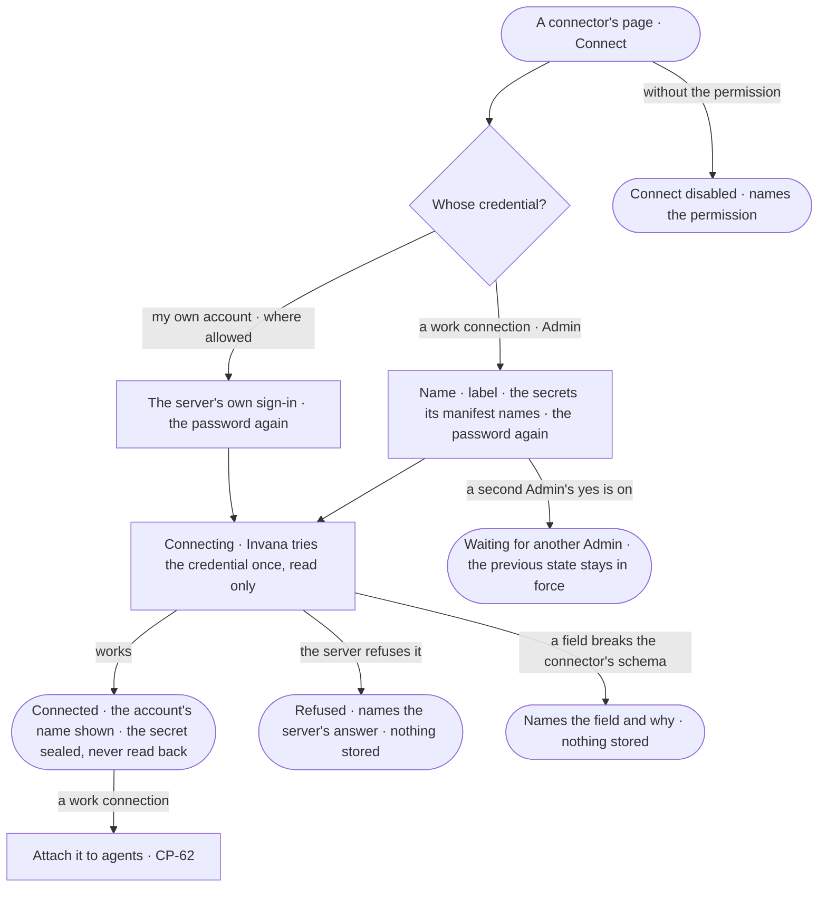

# CP-80 · Add a credential to a connector and connect it

**As** an Admin — or a person with my own account — **I want** to give a connector a credential and connect it, as a work connection the agents share or as my own personal connection **so that** an agent reaches the outside as the identity I meant, and a credential is proven to work the moment it is added.

Tasks: [task.md](task.md) · Feature: [CP-F02](../../feature.md)

## Who can

A connector's credential is a connection on the outside server it drives: a **work connection** — a service identity, made by an Admin and attached to agents ([CP-62](../CP-62-make-a-work-connection-and-attach-it-to-agents/story.md)) — or a **personal connection** — a person's own account, used only in the runs they start ([CP-43](../CP-43-connect-my-own-account-to-an-outside-server/story.md)). A graph database's own login is part of connecting it ([CP-25](../../../CP-F05-graph-databases/feature.md)), not a connection here. The permission each act needs is in [the permission catalogue](../../../../../access/features/AC-F02-access-policies/feature.md#the-permission-catalogue).

| Access | Can | Otherwise sees |
|---|---|---|
| Admin | With Manage on `plugin/<id>` and the password again, make a work connection for a connector, naming it and its secrets; connect their own account where the connector allows | — |
| Operator | Connect their own account to a connector that allows personal connections, with the password again | *Make a work connection* is disabled — *Needs Manage on the {name} plugin — ask {who can grant}*. A connector that allows no personal connection shows no *My own account* |

## Flow

## Acceptance criteria

| # | Given | When | Then |
|---|---|---|---|
| CP-80.1 | A connector whose manifest names secrets | an Admin with Manage on `plugin/<id>` makes a work connection, giving the password again | a form drawn from its `config` and `secrets` asks for a name, a label and each secret by name; nothing is stored until the credential has been tried |
| CP-80.2 | A credential being added | Invana tries it | it makes one read-only call to the server the connector drives, shown as *Connecting*; the call is ledgered ([AC-F09](../../../../../access/features/AC-F09-what-left-the-platform/feature.md)) and carries no record of the Graph |
| CP-80.3 | A credential the server accepts | the try ends | the connection reads *Connected* with the account's name, its secret sealed and never read back; History records who made it, never the secret |
| CP-80.4 | A credential the server refuses, or a server that does not answer | the try ends | it is refused, naming the server's answer; nothing is stored, and the form keeps what was typed except the secret |
| CP-80.5 | A field that breaks the connector's `config` schema | it is submitted | it is refused, naming the field and why; nothing is tried |
| CP-80.6 | A connector whose server a person may connect their own account to | a person connects their own | their browser goes to the server's own sign-in as [CP-43.2](../CP-43-connect-my-own-account-to-an-outside-server/story.md) says; the account is theirs alone, used only in runs they start |
| CP-80.7 | A connector that allows no personal connection — every source Invana ships, `web` and `mail` among them | a person looks for *My own account* | it is not offered, and the engine refuses it the same |
| CP-80.8 | The second Admin's yes is on for the deployment | an Admin makes a work connection | it reads *Waiting for another Admin*, as [CP-62.3](../CP-62-make-a-work-connection-and-attach-it-to-agents/story.md) says |
| CP-80.9 | A work connection just made | it reads *Connected* | *Attach to agents* leads, and until it is attached to an agent no agent uses it |
| CP-80.10 | Adding a credential | it is done without the password, with a wrong one, or with a key | it is refused — *Enter your password again to do this* |
| CP-80.11 | An Operator without Manage on the plugin | they make a work connection by any path | it is refused — *Needs Manage on the {name} plugin — ask {who can grant}* — and the act reads disabled, naming the permission |
| CP-80.12 | A connector failed, held or not installed | someone opens *Connect* | it is not offered, naming why ([CP-77](../CP-77-see-the-connectors-installed-and-connect-one-from-its-manifest/story.md)) |

## Screens

| Surface | Access | First use | Empty after a filter | Loading | Has data | Failed | Agent working or proposing | No access |
|---|---|---|---|---|---|---|---|---|
| A connector's connections | Admin | settings.plugins · Servers · Work connections · None yet | — | settings.plugins · Servers · Work connections · Loading | settings.plugins · Servers · Work connections | settings.plugins · Servers · Work connections · Could not load | — | — |
| A connector's connections | Operator | settings.plugins · Servers · Work connections · None yet · Read only | — | settings.plugins · Servers · Work connections · Loading | settings.plugins · Servers · Work connections · Read only | settings.plugins · Servers · Work connections · Could not load | — | settings.plugins · Servers · Work connections · Read only |
| Make a work connection | Admin | settings.connectors · Connect | — | settings.connectors · Connect · Testing | settings.connectors · Connect · Connected | settings.connectors · Connect · Refused | — | — |
| Make a work connection | Operator | — | — | — | — | — | — | settings.connectors · Detail · Read only |
| A second Admin's yes | Admin | — | — | — | settings.plugins · Servers · Work connections · Waiting for another Admin | — | — | — |
| A second Admin's yes | Operator | — | — | — | — | — | — | settings.plugins · Servers · Work connections · Read only |
| My own account | Admin | settings.me · Connections · Personal connections | — | settings.me · Connections · Connect · Connecting | settings.me · Connections · Connect · Account connected | settings.me · Connections · Connect · Refused | — | — |
| My own account | Operator | settings.me · Connections · Personal connections | — | settings.me · Connections · Connect · Connecting | settings.me · Connections · Connect · Account connected | settings.me · Connections · Connect · Refused | — | — |
