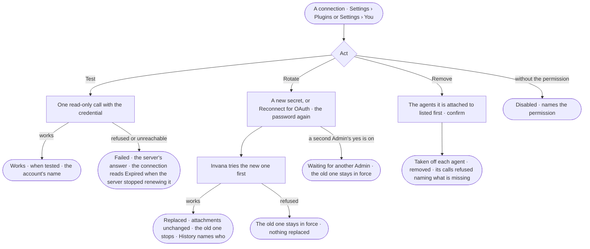

# CP-81 · Test, rotate and remove a credential

**As** an Admin — or a person with my own account — **I want** to test a credential whenever I doubt it, replace it before it lapses, and remove it when it should end **so that** an agent never stops on a credential nobody knew had failed, and a credential that should end really ends.

Tasks: [task.md](task.md) · Feature: [CP-F02](../../feature.md)

## Who can

The credential is a work or a personal connection ([CP-80](../CP-80-add-a-credential-to-a-connector-and-connect-it/story.md)). The permission each act needs is in [the permission catalogue](../../../../../access/features/AC-F02-access-policies/feature.md#the-permission-catalogue).

| Access | Can | Otherwise sees |
|---|---|---|
| Admin | With Manage on `plugin/<id>` and the password again: test, rotate or remove any work connection and read or disconnect any person's personal connection; test, rotate or remove their own | — |
| Operator | Test, rotate (*Reconnect*) or disconnect their own personal connection, with the password again | Every work connection reads — its server, label, state and the agents it is attached to; *Test*, *Rotate* and *Remove* are disabled — *Needs Manage on the {name} plugin — ask {who can grant}*. Another person's connection is absent |

## Flow

## Acceptance criteria

| # | Given | When | Then |
|---|---|---|---|
| CP-81.1 | A connection of one's own, or a work connection with Manage on its plugin | *Test* is pressed | Invana makes one read-only call to the server with the credential and shows *Works* with the account's name and the time, or *Failed* with the server's answer; no record of the Graph is carried |
| CP-81.2 | A test | it is made | the call is ledgered naming the connection, never its credential ([AC-F09](../../../../../access/features/AC-F09-what-left-the-platform/feature.md)), and History records who tested which connection |
| CP-81.3 | A connection the server stopped renewing | it is read or tested | it reads *Expired* with *Reconnect* for a person's own and *Renew* for a work connection; calls that need it are refused until it is replaced |
| CP-81.4 | A work connection or a personal connection | its person or an Admin with Manage on the plugin presses *Rotate* and gives the password again | a token connection asks for the new token, an OAuth one sends the browser to the server's sign-in; the new credential is tried before anything is replaced |
| CP-81.5 | A rotation whose new credential works | the try ends | it replaces the old one at once; every attachment to an agent stays; the old credential stops working in Invana; History records who and when, never either secret |
| CP-81.6 | A rotation whose new credential the server refuses | the try ends | nothing is replaced — the old credential stays in force — and the answer is named |
| CP-81.7 | The second Admin's yes is on for the deployment | an Admin rotates a work connection | it reads *Waiting for another Admin*; the old credential stays in force until another Admin approves ([CP-62.3](../CP-62-make-a-work-connection-and-attach-it-to-agents/story.md)) |
| CP-81.8 | A work connection attached to agents | an Admin presses *Remove* | the agents it is attached to are listed first; on confirm it is taken off each and removed; History records it |
| CP-81.9 | A personal connection | its person presses *Disconnect* | it is removed at once and the next call for their runs is refused as [CP-43.5](../CP-43-connect-my-own-account-to-an-outside-server/story.md) says |
| CP-81.10 | A removed credential | an agent's step needs it | the step is refused before the call, naming the agent and the server, as [CP-62.7](../CP-62-make-a-work-connection-and-attach-it-to-agents/story.md) says |
| CP-81.11 | Rotating or removing | it is done without the password, with a wrong one, or with a key | it is refused — *Enter your password again to do this*; a test changes nothing, so it asks no password |
| CP-81.12 | An Operator without Manage on the plugin | they test, rotate or remove a work connection by any path | it is refused — *Needs Manage on the {name} plugin — ask {who can grant}* — and the acts read disabled, naming the permission |
| CP-81.13 | An Operator | they read another person's connection by any path | it is absent (`404`) |

## Screens

| Surface | Access | First use | Empty after a filter | Loading | Has data | Failed | Agent working or proposing | No access |
|---|---|---|---|---|---|---|---|---|
| A work connection | Admin | — | — | settings.plugins · Servers · Work connections · Testing | settings.plugins · Servers · Work connections · Works | settings.plugins · Servers · Work connections · Failed | — | — |
| A work connection | Operator | — | — | — | settings.plugins · Servers · Work connections · Read only | — | — | settings.plugins · Servers · Work connections · Read only |
| Rotate a credential | Admin | — | — | settings.plugins · Servers · Work connections · Rotating | settings.plugins · Servers · Work connections · Rotate | settings.plugins · Servers · Work connections · Rotate · Refused | — | — |
| Rotate a credential | Operator | — | — | — | — | — | — | settings.plugins · Servers · Work connections · Read only |
| Remove a credential | Admin | — | — | — | settings.plugins · Servers · Work connections · Remove | settings.plugins · Servers · Work connections · Remove · Refused | — | — |
| Remove a credential | Operator | — | — | — | — | — | — | settings.plugins · Servers · Work connections · Read only |
| My own account | Admin | settings.me · Connections · Personal connections | — | settings.me · Connections · Testing | settings.me · Connections · Works | settings.me · Connections · Expired | — | — |
| My own account | Operator | settings.me · Connections · Personal connections | — | settings.me · Connections · Testing | settings.me · Connections · Works | settings.me · Connections · Expired | — | — |
