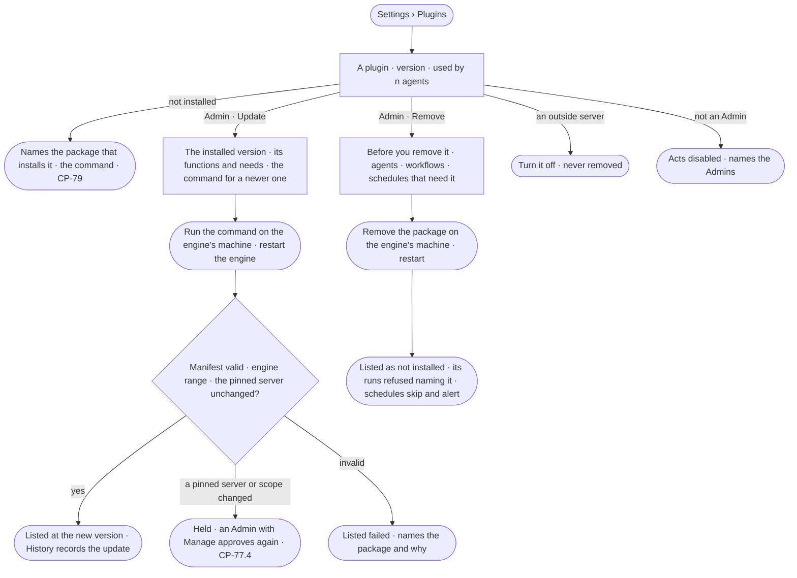

# CP-82 · Install, update and remove a plugin

**As** an Admin **I want** to install a plugin, update it and remove it, and to see what depends on it before I do **so that** an update or a removal never leaves an agent, a workflow or a schedule failing without warning.

Tasks: [task.md](task.md) · Feature: [CP-F02](../../feature.md)

## Who can

How a plugin is installed depends on its kind ([CP-F02 › Rules](../../feature.md#rules)). A Team pack is [CP-83](../CP-83-install-update-and-remove-a-team-pack/story.md).

| Kind | Install | Update | Remove |
|---|---|---|---|
| Tool plugin — a connector of kind `source`: `web` · `mail` · `science` | On the engine's machine, as [CP-79](../CP-79-install-a-connector/story.md) shows | The same command with a newer version, then a restart | On the engine's machine |
| Runtime — Claude Code · Codex | In Studio, [CP-64](../CP-64-install-an-agent-runtime/story.md) | The same command as a tool plugin | In Studio, [CP-64.6](../CP-64-install-an-agent-runtime/story.md) refuses it while agents run with it |
| Outside server | In Studio, [CP-02](../CP-02-add-an-outside-mcp-server-and-let-agents-call-its-tools/story.md) | *Read its tools again*, CP-02.6 | Not offered: turn it off |

| Access | Can | Otherwise sees |
|---|---|---|
| Admin | Read what depends on any plugin and the command that updates it; do the act the table gives for its kind, with the permission it needs | — |
| Operator | Read the same | Every act disabled — *This needs an Admin — ask {admins}* |

## Flow

## Acceptance criteria

| # | Given | When | Then |
|---|---|---|---|
| CP-82.1 | A plugin not installed | it is read | it names the package or extra that installs it and its command, and cannot be turned on ([CP-04.5](../CP-04-see-every-plugin-and-switch-it-on-or-off/story.md)) |
| CP-82.2 | An installed tool plugin or runtime | its package is installed at a newer version and the engine restarts | it lists at the new version; History records who installed it before and the version from and to; a run still pins the version it ran |
| CP-82.3 | An installed plugin | an Admin opens *Update* | the installed version, its functions with their needs, and the command that installs a newer version read; Invana does not look for newer versions and installs nothing from Studio |
| CP-82.4 | An updated plugin whose pinned outside server, tool schemas or scopes changed | the engine starts | it is held until an Admin with Manage on the plugin approves it again, naming what changed ([CP-77.4](../CP-77-see-the-connectors-installed-and-connect-one-from-its-manifest/story.md)) |
| CP-82.5 | An installed plugin | an Admin opens *Remove* | it lists first every agent that may use its functions, every workflow that needs it and every schedule that runs it, and says removing is done on the engine's machine |
| CP-82.6 | A plugin whose package was removed | a run's plan needs it | the run is refused before it starts, naming the plugin as not installed ([CP-04.6](../CP-04-see-every-plugin-and-switch-it-on-or-off/story.md)); a schedule skips its firing and raises an ops alert; a workflow is flagged |
| CP-82.7 | A runtime an active or paused agent runs with | an Admin removes it | it is refused, naming the agents ([CP-64.6](../CP-64-install-an-agent-runtime/story.md)) |
| CP-82.8 | An outside server | an Admin looks for *Remove* | it is not offered; *Turn it off* is, and its tools stay readable for the runs that used them |
| CP-82.9 | An Operator | they open *Update* or *Remove* | what depends on the plugin reads; the acts are disabled — *This needs an Admin — ask {admins}* |
| CP-82.10 | Anyone | they run `invana plugins list` after an update or a removal | it shows the version or the not-installed state Studio shows |
| CP-82.11 | An Admin | they open *Install* for a plugin | the command to run on the engine's machine reads with *Copy*; *I ran it — check again* makes the engine look: *Checking*, then the plugin lists, or *Not found yet* names what was not found, with *Check again* and *Close* |
| CP-82.12 | An Admin | they ran the update command and press *I ran it — check again* | *Checking*, then *Updated* to the version now installed, or *Still old version* naming the version found; *Copy command* and *Close* stay |
| CP-82.13 | An Admin | they ran the remove command and press *I ran it — check again* | *Checking*, then *Removed* and the plugin leaves the list; a plugin still found reads *Refused*, naming why |

## Screens

| Surface | Access | First use | Empty after a filter | Loading | Has data | Failed | Agent working or proposing | No access |
|---|---|---|---|---|---|---|---|---|
| A plugin | Admin | settings.plugins · Plugin off | — | settings.plugins · Loading | settings.plugins · Plugin | settings.plugins · Not installed | — | — |
| A plugin | Operator | settings.plugins · Plugin off · Read only | — | settings.plugins · Loading | settings.plugins · Plugin · My switch | settings.plugins · Not installed | — | settings.plugins · Read only |
| Install a plugin · Command | Admin | settings.plugins · Install · Command | — | — | — | — | — | — |
| Install a plugin · Command | Operator | — | — | — | — | — | — | settings.plugins · Read only |
| Install a plugin · Checking | Admin | — | — | settings.plugins · Install · Checking | settings.plugins · Plugin | settings.plugins · Install · Not found yet | — | — |
| Install a plugin · Checking | Operator | — | — | — | — | — | — | settings.plugins · Read only |
| Update a plugin · Command | Admin | — | — | settings.plugins · Update · Loading | settings.plugins · Update · Command | settings.plugins · Update · Held | — | — |
| Update a plugin · Command | Operator | — | — | — | settings.plugins · Update · Read only | — | — | settings.plugins · Read only |
| Update a plugin · Checking | Admin | — | — | settings.plugins · Update · Checking | settings.plugins · Update · Updated | settings.plugins · Update · Still old version | — | — |
| Update a plugin · Checking | Operator | — | — | — | — | — | — | settings.plugins · Read only |
| Remove a plugin · Command | Admin | — | — | settings.plugins · Remove · Loading | settings.plugins · Remove · Command | settings.plugins · Remove · Refused | — | — |
| Remove a plugin · Command | Operator | — | — | — | settings.plugins · Remove · Read only | — | — | settings.plugins · Read only |
| Remove a plugin · Checking | Admin | — | — | settings.plugins · Remove · Checking | settings.plugins · Remove · Removed | — | — | — |
| Remove a plugin · Checking | Operator | — | — | — | — | — | — | settings.plugins · Read only |
