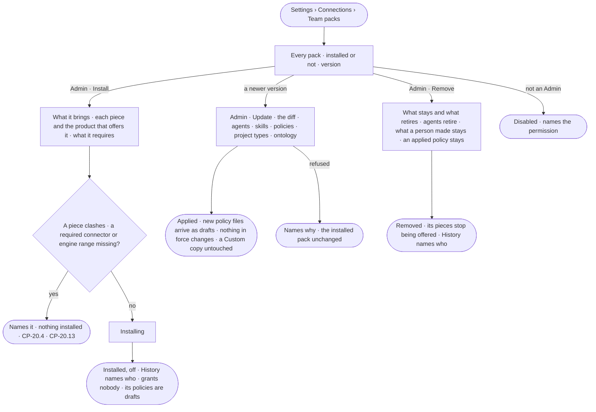

# CP-83 · Install, update and remove a Team pack

**As** an Admin **I want** to install a Team pack, update it when a newer version arrives and remove it when a team is done with it, seeing each time what it changes **so that** a team's work arrives and leaves whole, and nothing in force widens or vanishes without my yes.

Tasks: [task.md](task.md) · Feature: [CP-F02](../../feature.md)

## Who can

A pack is content, not code ([CP-F02 › Rules](../../feature.md#rules)), so — unlike a connector — Studio installs it. What a pack is, what it brings and its policies are [CP-20](../CP-20-install-a-team-pack/story.md). The permission each act needs is in [the permission catalogue](../../../../../access/features/AC-F02-access-policies/feature.md#the-permission-catalogue).

| Access | Can | Otherwise sees |
|---|---|---|
| Admin | Read every pack; install one (Create on `setting/team-packs`); update or remove one (Edit on `setting/team-packs`) | — |
| Operator | Read every pack, what an install, an update or a removal would change, and its state | *Install*, *Update* and *Remove* are disabled — *Needs Create on Settings — ask {who can grant}* (*Update* and *Remove*: Edit) |

## Flow

## Acceptance criteria

| # | Given | When | Then |
|---|---|---|---|
| CP-83.1 | A pack not installed | an Admin opens *Install* | what it brings reads before anything is done — each piece with the product that will offer it, the connectors and engine range it requires, and that installing grants nobody anything |
| CP-83.2 | A pack with no clashing piece, every required connector installed and its engine range met | an Admin confirms *Install* | it reads *Installing*, then installed and off, as [CP-20.3](../CP-20-install-a-team-pack/story.md) says; History records its name, version, content hash and who installed it |
| CP-83.3 | A pack with a clashing piece, a missing connector or an engine range this engine is outside | an Admin confirms *Install* | it is refused as [CP-20.4 · CP-20.13](../CP-20-install-a-team-pack/story.md) say, naming the piece, the connector or the range; nothing is installed |
| CP-83.4 | An installed pack and a newer version | an Admin opens *Update* | the diff reads — agents, skills, policies, project types and ontology added, changed or removed — and what stays as it is: policies in force, Custom copies, what people made |
| CP-83.5 | A diff | an Admin applies it | the pack moves to the new version; new policy files arrive as new drafts and nothing in force changes; History records who and the diff's counts; runs that already ran pin the old version ([CP-20.16](../CP-20-install-a-team-pack/story.md)) |
| CP-83.6 | A pack whose newer version needs a connector not installed or an engine range this engine is outside | an Admin applies it | it is refused, naming why; the installed pack is unchanged |
| CP-83.7 | An installed pack | an Admin opens *Remove* | it reads first what retires — its agents, by name — and what stays — models, projects and agents people made from it, and policies an Admin applied — and the confirmation names the pack |
| CP-83.8 | An Admin who confirms *Remove* | it completes | its pieces stop being offered, its agents retire keeping their names, and History records who and when ([CP-20.5](../CP-20-install-a-team-pack/story.md)) |
| CP-83.9 | A removed pack | it is read | it lists as not installed, with *Install* again; installing it again starts it off |
| CP-83.10 | An Operator | they open *Install*, *Update* or *Remove* | everything reads, each act is disabled, naming the permission, and the engine refuses it the same ([CP-20.6](../CP-20-install-a-team-pack/story.md)) |
| CP-83.11 | Any act on a pack | it is done | History records it with the pack's name and version, and the act is never an environment change or a restart |

## Screens

| Surface | Access | First use | Empty after a filter | Loading | Has data | Failed | Agent working or proposing | No access |
|---|---|---|---|---|---|---|---|---|
| Install a pack | Admin | settings.packs · Install | — | settings.packs · Install · Installing | settings.packs · Install · What it brings | settings.packs · Install · Pack clashes | — | — |
| Install a pack | Operator | — | — | — | settings.packs · Install · What it brings · Read only | — | — | settings.packs · Packs · Read only |
| Update a pack | Admin | — | — | settings.packs · Upgrade · Loading | settings.packs · Upgrade · Diff | settings.packs · Upgrade · Refused | — | — |
| Update a pack | Operator | — | — | — | settings.packs · Upgrade · Diff · Read only | — | — | settings.packs · Packs · Read only |
| Remove a pack | Admin | — | — | settings.packs · Remove · Removing | settings.packs · Remove | settings.packs · Remove · Refused | — | — |
| Remove a pack | Operator | — | — | — | settings.packs · Remove · Read only | — | — | settings.packs · Packs · Read only |
| Team packs | Admin | settings.packs · No pack installed | settings.packs · Nothing matches | settings.packs · Loading | settings.packs · Packs | settings.packs · Pack clashes | — | — |
| Team packs | Operator | settings.packs · No pack installed | settings.packs · Nothing matches | settings.packs · Loading | settings.packs · Packs · Read only | settings.packs · Could not load | — | settings.packs · Packs · Read only |
