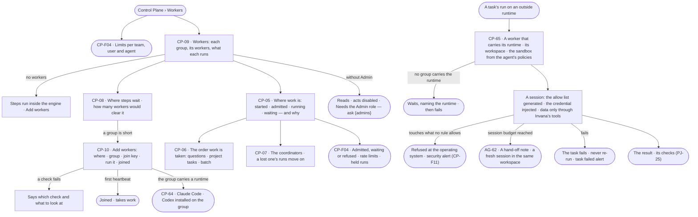
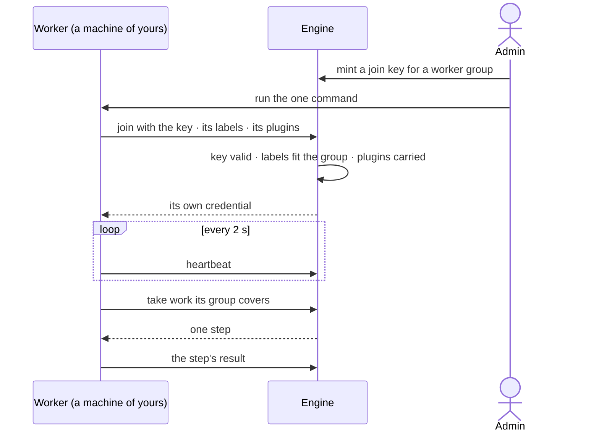
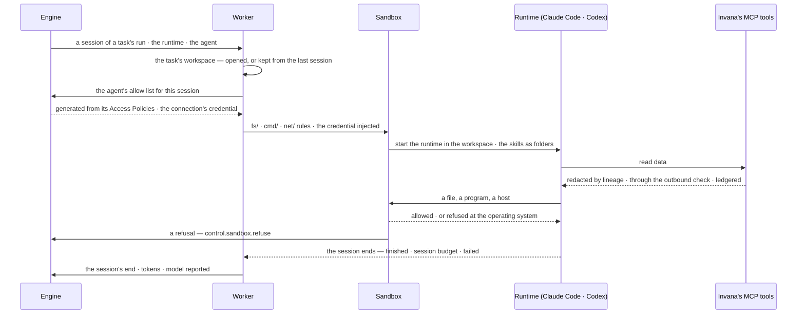

# Workers and the queue

> The machines that run agents' work and the order work is taken in — added and scaled by an Admin, read
> everywhere. A worker carries the runtimes an agent runs with, a sandbox that enforces what the agent may touch there,
> and a workspace per task. The decision it helps make: *where is work waiting, and do we add workers or let it
> queue?*

## User journey

Journeys this feature is a step of: [J07 · Ready a deployment](../../../../journeys/J07-ready-a-deployment.md) ·
[J10 · Fix a reported bug with an agent](../../../../journeys/J10-fix-a-reported-bug-with-an-agent.md)

## Stories

| ID | Story | Status |
|---|---|---|
| CP-05 | [See where work is and why it waits](stories/CP-05-see-where-work-is-and-why-it-waits/story.md) | idea |
| CP-06 | [Questions go before batch work](stories/CP-06-questions-go-before-batch-work/story.md) | idea |
| CP-07 | [A lost coordinator costs seconds, not runs](stories/CP-07-a-lost-coordinator-costs-seconds-not-runs/story.md) | idea |
| CP-08 | [See how many workers each group needs](stories/CP-08-see-how-many-workers-each-group-needs/story.md) | idea |
| CP-09 | [See every worker and what it is running](stories/CP-09-see-every-worker-and-what-it-is-running/story.md) | idea |
| CP-10 | [Add workers on my own machines with one command](stories/CP-10-add-workers-on-my-own-machines-with-one-command/story.md) | idea |
| CP-65 | [Run an outside runtime safely on a worker](stories/CP-65-run-an-outside-runtime-safely-on-a-worker/story.md) | idea |

## Access

The role × feature table is [AC-F02 › The role table](../../../access/features/AC-F02-access-policies/feature.md#the-role-table);
this is what it means here.

| Act | Role | Everyone else sees |
|---|---|---|
| Read Workers — groups, workers, the runtimes each carries, where work waits, coordinators, rate limits | Operator · Modeller · Admin | — |
| Add workers · make or change a worker group, its runtimes among them · mint and revoke join keys · drain a worker or a group | Admin | Each act disabled — *Needs the Admin role — ask {admins}* |
| Read a run's sessions on a worker — its workspace, the sandbox's refusals | The person behind the run · Admin; content as [AC-31](../../../access/features/AC-F09-what-left-the-platform/stories/AC-31-keep-a-runs-content-to-those-who-may-read-it/story.md) | That a session ran and was refused; what it touched *withheld*, naming who may read it |
| Say what an agent may touch on a worker | The agent's Access Policies alone ([AC-37](../../../access/features/AC-F02-access-policies/stories/AC-37-say-what-an-agent-may-touch-on-a-worker/story.md)); nothing on a worker grants | — |

## States

| State | What the person sees |
|---|---|
| First use | No workers: *Steps run inside the engine. Add workers to run tool steps on other machines.* and *Add workers* |
| Empty after a filter | Workers filtered to a state none has: *No worker matches* |
| Loading | The section opens at once; rows fill in place |
| Has data | Each worker group with its workers, what each runs, where steps wait and how many workers would clear it |
| Failed | A join that failed, naming the check; a lost worker, with how many steps were handed on; a step no group covers, naming the missing label; a session no group carries the runtime for, naming the runtime; a sandbox refusal, naming the file, program or host and the rule |
| Agent working or proposing | A run waiting names its position and what it waits behind; a session in a workspace names its runtime and its worker |
| No access | Everything reads; every act is disabled — *Needs the Admin role — ask {admins}* |

## Rules

| Rule | Detail |
|---|---|
| A run waiting is not a run running | It holds no slot, uses no worker and costs nothing |
| Questions go first | Work is taken in this order: a question someone waits on · a project task picked up · batch (schedules, sweeps, runs past twenty agents). People whose work waits share the workers equally, by the person behind each run; an idle person's share is lent |
| Waiting always says why | A waiting run names its position and what it waits behind — *a person is waiting* · *helper — counts as a run* · *schedule* — or the limit, the AI model's rate limit or the worker group |
| Agents never start machines | Workers are added and scaled by a person; Invana says where steps wait and how many workers would clear them |
| Work goes by labels | A step goes to a worker group whose labels cover what its function needs; a step no live group covers waits, naming the missing label, then fails |
| A worker dials out | Over HTTPS with its own credential; no inbound port, no database credential; it runs steps under the agent's access, never its own |
| A worker carries runtimes | A worker group carries the runtimes an Admin installed on it — Invana's always, Claude Code and Codex when their runtime plugins are installed ([CP-64](../CP-F02-plugins-and-outside-tools/stories/CP-64-install-an-agent-runtime/story.md)). A session goes to a group that carries its agent's runtime and the `code` label; with none, it waits, naming the runtime, then fails |
| A workspace per task | A task's run works in its own workspace on the worker; the workspace is kept across the run's sessions and removed when the task closes. A session that continues goes to the worker holding the workspace; if that worker is lost, a fresh workspace starts from the task's inputs and the hand-off note ([AG-F05](../../../../capabilities/agents/features/AG-F05-delegation-and-outside-agents/feature.md)) |
| The sandbox enforces the agent's policies | Every session on a worker runs inside a sandbox that enforces the agent's `fs/` · `cmd/` · `net/` rules at the operating system, whatever the runtime asks for ([AC-37](../../../access/features/AC-F02-access-policies/stories/AC-37-say-what-an-agent-may-touch-on-a-worker/story.md)); a refusal is recorded on the run and raises a security alert ([CP-F11](../CP-F11-ops-alerting/feature.md)). The sandbox only narrows: nothing on a worker grants |
| Derived, never hand-kept | An outside runtime's own allow list is generated from the agent's Access Policies at the start of every session; a policy change reaches the next session |
| Data only through Invana's tools | An outside runtime reaches data only through Invana's MCP tools — redacted by lineage, through the outbound check and ledgered at the tool ([AC-F09](../../../access/features/AC-F09-what-left-the-platform/feature.md)); the sandbox limits its network to the agent's `net/` rules and the engine |
| The credential is injected | The connection a session uses — a work connection, or the personal connection of the person who started the run ([CP-F02](../CP-F02-plugins-and-outside-tools/feature.md)) — is injected into the sandbox on the worker for that session only and never written to the workspace |
| A failed task is never re-run | A task whose run fails closes *Failed*, raises a task failed alert and waits on a fix task; nothing re-runs it. A plan step's bounded `repeat` stays a step's signal inside a run and never re-runs a failed task |
| A lost worker loses no work | No heartbeat for 30 s is lost; its steps go to another worker and run once |
| Join keys are shown once | Scoped to one worker group, with an expiry and a cap on how many may join; revoking stops new joins; draining stops a worker after what it holds |
| A library runs where it is installed | A library added in Agents (AG-F08) must be installed on the workers of the groups that run its functions; Workers shows which groups carry it |
| The engine counts | Every number on Workers and Usage — busy, waiting, oldest, suggested — is stored by the engine; Studio only shows it |
| Leans on | Limits and the session budget (CP-F04) · runs and their sessions (CP-F10) · plugins, runtime plugins and connections (CP-F02) · Access Policies and worker rules (AC-F02) · continuation (AG-F05) · alerts (CP-F11) |

## Data touched

| Record | Read or write |
|---|---|
| Worker groups — name, runs on, labels, slots a worker, plugins, runtimes, secret names, outbound domains | Read · write |
| Workers — state, what each runs, the runtimes it carries, heartbeat | Read · write (drain) |
| Workspaces — a task's folder on a worker, kept across its sessions | Write · read |
| Sandbox refusals — the session, the file, program or host, the rule | Write |
| Join keys | Write · read |
| Stored counts every 30 s — workers, busy, waiting, oldest, suggested | Read |
| Waiting and refused runs with their reasons (CP-F10) | Read |
| History rows of every limit, join, drain and revoke (AC-F06) | Write |

## Engine

The low-level design: what this feature stores, serves and refuses — the runtime that walks every run's plan and the
workers that run its steps. Conventions — naming, errors, lists, events — are
[system-design.md](../../../../system-design.md) §§ 6–8; this section only fills them in.

### Records

| Table | Columns | Notes |
|---|---|---|
| `control_worker_pools` | `name` · `runs_on` (`docker` · `python` · `kubernetes`) · `labels` (`cpu` · `llm` · `egress` · `gpu` · `code`) · `slots_per_worker` (4) · `plugins` · `runtimes[]` (`claude_code` · `codex` — runtime plugins it carries; Invana's is always carried) · `secrets` (names only) · `egress` (outbound domains) · `min_workers` · `max_workers` · `set_by` (`hand` · `replicas`) · `replicas?` | A worker group; `name` unique for the deployment. `replicas` is what a person declared for a Kubernetes group — Invana never starts them |
| `control_workers` | `pool_id` · `name` · `node` · `version` · `labels` · `plugins` · `runtimes[]` (each `name@version` it loaded) · `slots` · `slots_busy` · `cpu?` · `state` (`starting` · `busy` · `idle` · `draining` · `lost` · `stopped`) · `credential_hash` · `previous_credential_hash` · `credential_rotated_at` · `queue_worker_id` · `joined_via` · `joined_at` · `last_heartbeat_at` · `from_ip` · `redelivered` | One joined worker; `queue_worker_id` is the queue's own id for it |
| `control_worker_events` | `pool_id` · `worker_id?` · `change` (`joined` · `lost` · `drained` · `stopped` · `replicas` · `changed` · `revoked`) · `detail` · `why` · `actor_id?` · `at` | A group's changes, newest first; append-only |
| `control_worker_stats` | `pool_id` · `at` · `workers` · `starting` · `lost` · `slots` · `slots_busy` · `ready` · `oldest_s` · `envelopes` · `suggested` | Written every 30 s per group; every number Workers shows |
| `control_worker_logs` | `worker_id` · `at` · `level` · `line` | A worker's recent log, kept beyond its process; trimmed to the newest 1,000 lines a worker |
| `control_envelope_outcomes` | `idempotency_key` (`run_id:node_id:attempt`, the key) · `run_id` · `outcome` (`out` · `failure` · `needs_input` · `cannot_answer` · `converse`, with `_worker` — id · group · duration — and `_artifacts`) · `created_at` | A step's outcome as a worker posted it; the first one stands |
| `control_coordinators` | `id` · `host` · `pid` · `started_at` · `renewed_at` · `state` (`holding` · `standby` · `lost`) · `runs_held` | One row per engine process; the one `holding` hands out steps |
| `control_workspaces` | `task_id?` · `run_id` · `worker_id` · `pool_id` · `state` (`open` · `kept` · `removed`) · `created_at` · `removed_at?` | A task's folder on a worker, `kept` between sessions, `removed` when the task closes or its worker is lost; the folder's files stay on the worker, never in the engine |
| `control_sandbox_refusals` | `run_id` · `session_seq` · `worker_id` · `act` (`fs` · `cmd` · `net`) · `target` (the path, program or host) · `verb` · `rule_id?` · `policy_id?` · `at` | One row per act the sandbox refused; append-only. `rule_id` is the Deny that matched, or null when no rule allowed it |

### Reads

| Record | Owner |
|---|---|
| Runs and their step rows — `cursor`, `lane` · `iteration` · `attempt`, `triggered_by`, `idem_key`, the stream a run writes | [CP-F10](../CP-F10-runs-and-how-the-agents-are-doing/feature.md#engine) |
| The plan and its grammar, the check, the catalogue and a function's `resources` · `timeout_s` | [AG-F06](../../../../capabilities/agents/features/AG-F06-plans-and-workflows/feature.md#engine) |
| What an agent may do — the envelope, its bounds and `requires_approval` | [AG-F01](../../../../capabilities/agents/features/AG-F01-build-an-agent/feature.md#engine) |
| Helper depth and chain depth | [AG-F05](../../../../capabilities/agents/features/AG-F05-delegation-and-outside-agents/feature.md#engine) |
| Admission, runs at once, capacity pools, rate-limit waits | [CP-F04](../CP-F04-limits/feature.md#engine) |
| Plugins a worker carries, their secrets; runtime plugins, what each declares and where its model runs; work and personal connections | [CP-F02](../CP-F02-plugins-and-outside-tools/feature.md#engine) |
| A run's sessions — `control_run_sessions` | [CP-F10](../CP-F10-runs-and-how-the-agents-are-doing/feature.md#engine) |
| The agent's runtime and model set | [AG-F01](../../../../capabilities/agents/features/AG-F01-build-an-agent/feature.md#engine) |
| Hand-off notes and continuation | [AG-F05](../../../../capabilities/agents/features/AG-F05-delegation-and-outside-agents/feature.md#engine) |
| The session budget | [CP-F04](../CP-F04-limits/feature.md#engine) |
| `fs/` · `cmd/` · `net/` rules and `decide()` | [AC-F02](../../../access/features/AC-F02-access-policies/feature.md#engine) |
| The tasks a workspace belongs to, and their state | [PJ-F01](../../../../capabilities/projects/features/PJ-F01-projects-and-tasks/feature.md#engine) |
| Join keys — a service account's keys scoped to one group | [AC-F03](../../../access/features/AC-F03-directory/feature.md#engine) |
| Libraries a group must carry | [AG-F08](../../../../capabilities/agents/features/AG-F08-portable-agents-and-skills/feature.md#engine) |
| Pauses — approvals, clarifications, verdicts — and who answers | [AC-F05](../../../access/features/AC-F05-asks-and-approvals/feature.md#engine) |
| History rows of every join, mint, drain, revoke and group change | [AC-F06](../../../access/features/AC-F06-history/feature.md#engine) |

### Routes

| Route, after `/api/v1/control/workers` | Does | Story |
|---|---|---|
| `GET /` | Each group: runs on, labels, workers, busy and total, steps waiting, the oldest and its state — keeping up · short · no workers | CP-09 |
| `POST /pools` · `PATCH /pools/{name}` | Make or change a worker group | CP-10 |
| `GET /pools/{name}/workers` | Its workers, filter `state` | CP-09 |
| `GET /pools/{name}/events` | Its changes, newest first | CP-09 |
| `POST /pools/{name}/drain` · `POST /{id}/drain` | Drain a group · a worker | CP-09 |
| `GET /{id}` | One worker — what it runs now, steps this hour, failures, recent log | CP-09 |
| `GET /capacity` | Per group: steps waiting, the oldest, workers, suggested, as last stored | CP-08 |
| `GET /work` | Runs by stage — started · admitted · running · waiting — each count as stored, each waiting run with its reason and how long; the order work is taken in and each person's share | CP-05 · CP-06 |
| `GET /coordinators` | Each coordinator, its state, the runs it holds, when it last renewed | CP-07 |
| `GET /join-keys` · `POST /pools/{name}/join-keys` · `POST /join-keys/{id}/revoke` | List keys (prefix, expiry, joined of cap, revoked) · mint one `{expires_at, cap}` → its secret once and the commands · revoke | CP-10 |
| `POST /join` · `POST /heartbeat` · `POST /lease` · `POST /outcome` | The worker's own: join with a key, labels, plugins and runtimes → its credential · heartbeat · long-poll for one step (20 s) · post a step's outcome | CP-10 |
| `POST /sessions/start` | The worker's own: `{run_id, seq}` → the session's allow list generated from the agent's Access Policies, the connection's credential for this session, the skills to copy in as folders, the MCP endpoint and a session token for Invana's tools | CP-65 |
| `POST /sessions/refusal` · `POST /sessions/end` | The worker's own: a sandbox refusal `{run_id, seq, act, target, verb}` · a session's end `{run_id, seq, ended_because, tokens_in, tokens_out, model_reported, runtime_version}` | CP-65 |
| `GET /runs/{run_id}/refusals` | A run's sandbox refusals — the session, the act, the target, the rule and policy; content-gated as the run is | CP-65 |

### Events

| Event | When |
|---|---|
| `control.worker_pools.create` · `.update` · `.drain` | A group is made, changed or drained |
| `control.workers.join` · `.lost` · `.drain` · `.stop` | A worker joins, goes silent, is drained, stops |
| `control.join_keys.mint` · `.revoke` | A join key is minted or revoked |
| `control.coordinators.takeover` | A coordinator's lease lapses and another takes its runs |
| `control.workspaces.open` · `.remove` | A task's workspace is made on a worker · removed |
| `control.sandbox.refuse` | The sandbox refused an act — `run_id` · `session_seq` · `act` · `target` · `rule?` · `policy?`; CP-F11 raises a security alert from it |

### Refusals

| Status | When | Sentence | Criterion |
|---|---|---|---|
| 403 | A group change, mint, revoke or drain by anyone but an Admin | *Needs the Admin role — ask {admins}.* | CP-08.7 · CP-09.10 · CP-10.10 |
| 409 | A group name already taken | *{name} is taken.* | CP-10.3 |
| 422 | Labels outside `cpu` · `llm` · `egress` · `gpu` · `code` | *{label} is not a worker label.* | CP-10.3 |
| 401 | A join with an expired, revoked or used-up key | *This join key {why}.* | CP-10.8 |
| 422 | A join whose labels the group does not allow, or missing the group's plugins or runtimes | *{labels, plugins or runtimes} do not fit {group}.* | CP-10.8 · CP-10.15 |
| 422 | A group given a runtime that is not installed, or an outside runtime without the `code` label | *{runtime} is not installed.* · *A group that carries {runtime} needs the code label.* | CP-10.14 |
| 401 | A drained or stopped worker's credential | *This worker has stopped — join again.* | API only — the worker process reads it and exits |
| step failed | No live group carries a step's labels past its allowance — `transient · worker_unavailable` | *No worker took this — no group carries {label}. Add workers: {command}.* | CP-04.16 · CP-08.5 · CP-16.8 |
| step failed | A function `key@version` the process has not loaded — `defect · unknown_task_type` | *{key@version} is not loaded on {worker} — restart the workers with the engine.* | API only — an install fault named on the step |
| step failed | No live group carries the session's runtime past the queue-wait allowance — `transient · runtime_unavailable` | *No worker carries {runtime} — install it on a worker group.* | CP-65.3 |
| refused in the sandbox | A file, program or host no `fs/` · `cmd/` · `net/` rule of the agent allows, or one a rule denies | *The sandbox refused {act} {target} — {rule or *no rule allows it*}.* | CP-65.6 · AC-37.5 |
| step failed | The session's connection cannot sign in | *{connection} cannot sign in — {why}.* | CP-65.9 |

### CLI

| Command | Does |
|---|---|
| `invana worker --engine --token --pool [--labels] [--slots] [--name]` | Join and run steps from the group's queues; env `INVANA_ENGINE_URL` · `INVANA_JOIN_TOKEN` · `INVANA_POOL` · `INVANA_LABELS` · `INVANA_SLOTS`; the image `invana/worker:<engine version>` runs the same |
| `invana worker install-service` | Prints a systemd or launchd unit for the same command |

### Mechanisms

| Mechanism | How |
|---|---|
| The runtime is a plan interpreter | It walks a checked plan, holds a frontier and honours the signals steps return; every kind of run — ask, import, bulk, stitch, model, canvas, data edit, enrich — runs here, and nothing downstream branches on kind. Nothing executes outside it |
| The frontier | A run's `cursor` — `done` · `running` · `settled` (step → outcome) · `lanes` (step → done · failed · total). A step is ready when every reachable predecessor has settled, at least one edge is satisfied (`success` · `failure` · `any_outcome`) and its `when` holds; every ready step dispatches, up to the lowest ceiling (CP-F04). The run ends when nothing is ready or running — a required step failed is `failed`, else `answered` or `cannot_answer` |
| Skip | A false `when` settles the step `skipped`, recording the predicate; downstream `success` edges are unsatisfied, `any_outcome` edges satisfied |
| Fan-out | One lane, one row; lanes retry independently. The step settles when every lane has: `fail` — any lane failing fails it · `fail_fast` — the first failure cancels the rest · `continue` — it succeeds and the failures are reported by lane, grouped by reason. Emissions merge in lane order. A declared `int` or `float` output sums over succeeded lanes, a `list` concatenates; `.lanes` · `.succeeded` · `.failed` · `.failed_lanes` bind on every fanned-out step |
| Loops | A `loop` node stays `running` while it iterates; each pass is an `iteration` row; `${self.previous}` · `${self.feedback}` · `${self.verdict}` bind inside it; downstream reads the last pass, or every pass under `accumulate`. A verdict loop pauses after each pass, once whatever its lanes |
| Signals | A step returns one of `next` · `repeat` (bounded by `retry.max_attempts`; a step's own retry inside its run — it never re-runs a failed task, and a task's run that fails is never opened again) · `back(id)` (the repair budget) · `replan` (the run's replan count) · `ask` · `approve` (before dispatch) · `judge` (after the pass) · `skip` · `stop(outcome)`. A signal past its bound becomes `stop(failed)`, naming the bound; exceptions are for faults |
| Pauses hold nothing | A run waiting on an answer, an approval or a verdict releases its slot and holds no worker; the deadline that ends a pause is `stop(failed)`, naming who was asked — never an auto-approval. A pause is a `control_run_prompts` row (CP-F10) |
| Streamed signals | Each signal writes a frame — `step.retrying` · `step.skipped` · `plan.revised` · `run.awaiting_input` · `run.awaiting_approval` · `run.awaiting_verdict` — to the run's stream (CP-F10) |
| Cancellation | Cooperative: every step gets a cancel token and honours it at its await points; one that ignores it is cancelled at its `timeout_s`. Nothing new dispatches once a run is cancelling; cancelling cancels every descendant, each recorded; a cancelled child settles `cancelled` and its parent applies its edge rule |
| Resume | On restart or a coordinator takeover, a `running` step closes `interrupted` and re-dispatches as a new attempt if its retry allows, else fails the run with a diagnosis; the frontier resumes from the database |
| Opening a run | `triggered_by` `user` · `task` · `schedule` · `automation` (the automation and its event recorded) · `delegation` · `canvas` · `mcp` · `system`. The same call for every opener; the same `idem_key` twice returns the existing run |
| Interactive runs | `run_inline` runs a committed run inside the caller's request — same plan, view, stream and trace, admission still applied; under contention a `canvas` run waits with a `user` run's precedence and a `system` run with a schedule's. Their cost is measured — runs a minute a person, rows and bytes a run, latency added, the window anyone reads — and turned down in order: coarser steps · shorter retention · prune steps and stream, keep the row · reference the plan and view, not copy them |
| A step travels as an envelope | `TaskEnvelope` — `run_id` · `node_id` · `attempt` · `plugin` (`name@version`) · `task` (`key@version`) · `args` (resolved, JSON only) · `actor_id?` · `behind_user_id`. No session, connection or secret rides it; the worker rebuilds the step's context from ids with the same `run_vars` the interpreter uses |
| `run_envelope()` is the one call | In-process and on every worker; it applies `timeout_s` (`transient · task_timeout`); a `key@version` not loaded is `defect · unknown_task_type` before any context opens |
| Idempotency | The key is `run_id:node_id:attempt`; redelivery keeps it, a retry the coordinator decides changes it; a key already in `control_envelope_outcomes` returns that outcome and runs nothing |
| Wire forms | A worker's outcome crosses as tagged JSON: `out` (every output field) · `failure` (`cls` · `cause` · `message` · `short` · `evidence` · `raw`) · `needs_input` (`question` · `options` · `descriptions`) · `cannot_answer` (`reason` · `exchange`) · `converse` (`reply` · `options` · `exchange`). Anything else, or an exception the worker cannot name, is `defect · worker_error` |
| Outcomes come back through a row | The queue keeps no result: the engine writes what a worker posts; the waiting process polls it (250 ms, backing off to 1 s) and raises the failure or signal as in-process |
| The worker owns its transaction | It commits when the function returns, rolls back when it raises; it settles the step's row through the engine |
| In-process by default | `INVANA_EXECUTOR` — `procrastinate` (default with PostgreSQL) sends steps to the queue · `inline` calls `run_envelope` in the API process. procrastinate is the `workers` extra, on the app's PostgreSQL, its tables applied by `invana migrate`; with any other database the engine refuses to start, naming `INVANA_EXECUTOR=inline` |
| What stays in-process | A step that hands over through run vars rather than declared outputs — the import stages, the question-answering chain — runs in the engine until that state is an output |
| Join | Checked in order — key, group, labels, plugins — and refused, making no worker, with the reason. A joined worker gets `invana_wkr_…`, stored as sha256, rotated hourly; the previous one stays valid until the next heartbeat |
| Heartbeat and loss | Every 2 s. A sweep every 5 s marks a worker silent 30 s `lost` and requeues its steps under the same idempotency key; a lost worker that heartbeats again is revived under a new `queue_worker_id` and runs none of them |
| Drain | A draining worker takes no new step; when it reports no busy slot it is `stopped` and its credential refused |
| Queues | A step's queue is `tools.<labels>` — its function's `resources`, sorted and joined by `+` (`tools.cpu`, `tools.cpu+gpu`) — one per label set and step class; a worker leases from every queue its labels cover. The step's frames land in the run's stream by run id |
| The order work is taken | A question someone waits on · a project task picked up · batch (schedules, sweeps, runs past twenty agents); within a class first in, first served; a delegated child takes its parent's class. People whose work waits share the workers equally, by the person behind each run; an idle person's share is lent. Position is stored and readable |
| Suggested | Steps ready ÷ steps a worker took over the last ten minutes, written to `control_worker_stats` every 30 s; clamped to the group's `min_workers` · `max_workers` and to the worker time an hour of each binding limit ([CP-F04](../CP-F04-limits/feature.md)). A step waiting on an AI model's rate limit is not counted |
| Idle drain | A worker idle 5 minutes in a group above its `min_workers` is drained, then stopped; a person starts every machine |
| No group carries the label | Past the step's limit plus the queue-wait allowance, the step fails `transient · worker_unavailable`, naming the label and the command that adds a worker; the envelope stays queued |
| A worker dials out | It long-polls `POST /lease` over HTTPS with its own credential: no inbound port, no database credential. It resolves only the secrets its step's function declares |
| One coordinator | The engine process whose `control_coordinators` row is `holding` hands out steps, renewing every 5 s; a lease unrenewed for 15 s lapses, another process takes it, woken by `LISTEN/NOTIFY`, and the lost one's runs resume from their last settled step |
| Artifacts stay at home | A remote worker keeps artifacts in its own network; the engine holds each one's digest (CP-F10) |
| A session on an outside runtime | A step whose agent runs with `claude_code` or `codex` ([AG-F01](../../../../capabilities/agents/features/AG-F01-build-an-agent/feature.md#engine)) goes to the queue `runtime.<name>`; a worker leases from it only when its group carries that runtime and the `code` label. Each lease is one session — a `control_run_sessions` row (CP-F10) |
| The workspace | The first session of a task's run opens a `control_workspaces` row and a folder on the worker; a continuing session is leased first by the worker that holds the run's `kept` workspace, for the queue-wait allowance, then by any worker, which opens a fresh workspace and starts from the task's inputs and the hand-off note. The task closing removes it |
| Starting a session | `POST /sessions/start` runs `decide()` for the agent over its `fs/` · `cmd/` · `net/` rules ([AC-F02](../../../access/features/AC-F02-access-policies/feature.md#engine)) and returns the allow list, generated for this session only; the connection's secret is unsealed for this session and injected into the sandbox's environment, never written to the workspace or the log. The runtime gets the agent's skills as folders ([AG-F04](../../../../capabilities/agents/features/AG-F04-skills/feature.md)) and Invana's MCP endpoint with a token scoped to this run, which every tool call carries |
| The sandbox | The worker starts the runtime in an operating-system sandbox: the filesystem is the workspace, with `fs/` rules mapped to read or write paths inside it; a program runs only when a `cmd/` rule allows it; the network reaches only the hosts `net/` rules allow and the engine. An Ask rule pauses the session on an ask ([AC-F05](../../../access/features/AC-F05-asks-and-approvals/feature.md)); a refusal is posted to `POST /sessions/refusal`, written to `control_sandbox_refusals`, recorded on the run's trace and emitted as `control.sandbox.refuse` |
| Data through Invana's tools | The runtime holds no graph database credential and no route to one; it reads data only through Invana's MCP tools, each call checked, redacted by lineage, through the outbound check and ledgered at the tool ([AC-F09](../../../access/features/AC-F09-what-left-the-platform/feature.md#engine)) |
| A runtime's model | Where a runtime's model runs is its plugin's declaration (`model_runs` — [CP-F02](../CP-F02-plugins-and-outside-tools/feature.md#engine)); an `external` one makes every session's prompt an outbound exit through the outbound check. The session posts the model the runtime reports it ran on; the model set is the agent's pin |
| A session ends | `POST /sessions/end` closes the `control_run_sessions` row with why — `finished` · `session_budget` · `stopped` · `failed` · `refused`. `session_budget` hands the run to continuation ([AG-F05](../../../../capabilities/agents/features/AG-F05-delegation-and-outside-agents/feature.md#engine)); `failed` fails the run, and a task's run that fails closes its task *Failed* ([PJ-F01](../../../../capabilities/projects/features/PJ-F01-projects-and-tasks/feature.md#engine)) |

## System impact

| HLD section | Change | NFRs |
|---|---|---|
| § 6 Data and storage | Nine runtime tables — workspaces and sandbox refusals among them; procrastinate's queue tables on the app's PostgreSQL | — |
| § 7 Architecture and components | The runtime (planner, interpreter, executor) in the engine; workers as optional processes that dial out, carrying runtimes, a sandbox and a workspace per task | — |
| § 8 APIs and events | `/api/v1/control/workers` routes, the worker's own seven, `control.workers.*`, `control.workspaces.*` and `control.sandbox.refuse` events | — |
| § 9 Distributed execution | Steps as envelopes over a procrastinate queue; one coordinator by lease; outcomes through a row; redelivery under one idempotency key; workers by label and by runtime; a session per lease | — |
| § 10 AI and agents | Outside runtimes — Claude Code, Codex — run an agent's sessions on workers | — |
| § 11 Failure modes and the outside boundary | A lost worker requeues its steps; a lost coordinator's runs move on; no worker for a label or a runtime fails, never hangs; a failed task is never re-run | — |
| § 12 Qualities | Security: workers hold no database credential and no inbound port; secrets never ride an envelope; the sandbox enforces `fs/` · `cmd/` · `net/` at the operating system; a credential is injected per session | NFR-SEC-14 |

## Decisions

| Decision | Detail |
|---|---|
| Workers is the Control Plane's | One section with Workers · Where work waits · Join keys; a worker group or a worker opens in place, with a breadcrumb; Add workers is a modal |
| Worker groups are the deployment's | An Admin names the groups a team, user or agent may use in its limits ([CP-F04](../CP-F04-limits/feature.md)); a heavy agent gets its own, others share |
| Suggested is the engine's | Steps ready ÷ steps a worker took over the last ten minutes, every 30 s |
| Every group is scaled by hand | Docker, Python or Kubernetes; Invana never starts a machine and holds no cloud keys |
| Outside runtimes run on workers | Claude Code and Codex run an agent's sessions on a worker group that carries their runtime plugin, inside the sandbox, in the task's workspace — never in the engine serving Studio |
| The sandbox is the last word on a worker | Whatever a runtime's own settings allow, the sandbox enforces the agent's `fs/` · `cmd/` · `net/` rules at the operating system; its allow list is generated each session, never kept by hand |
| No retry for a task | A failed task alerts and waits on a fix task; re-running blind repeats what failed. A step's bounded `repeat` inside a run stays |
| Scale-out keeps its pools, not an autoscaler | Pools carry the labels `cpu` · `llm` · `egress` · `gpu` · `code`, with one queue per label and step class (a question · a project task · batch). The engine's desired-workers figure — steps ready ÷ steps a worker runs at once — is clamped to the pool's min and max and to the worker time an hour of each binding limit; a worker idle 5 minutes is drained, then stopped. A person adds every machine; the engine shape is [Engine](#engine) |

## Open questions

| Question | Who answers |
|---|---|
| CP-05 · CP-06 · CP-07 · CP-12 · CP-13 come from a scale-out proposal still under review (durable runs, coordinators, admission, the AI-model rate limiter). Recommend: keep them at `idea` until Ravi accepts the proposal; the rest of the feature stands without them | Ravi |
| Where does *Where work is* (CP-05) draw — a tab of Workers, or each run in Inbox › Running? Recommend: a tab of Workers for the deployment; a run's own wait on its run | Ravi |

## Not building

| Item | Why not |
|---|---|
| Autoscaling, cloud APIs, a Helm chart | A person adds workers; Invana says how many |
| KEDA or EC2 Auto Scaling applying the desired-workers figure | Every group is scaled by hand; Invana holds no cloud credentials |
| Coordinator replicas — `invana start --role orchestrator` | One coordinator holds the lease (CP-07); a second role is a second thing to run and watch |
| A deployment shape per mode — laptop, compose, Kubernetes with Jobs | One image and one command run every shape; workers are added the same way everywhere (CP-10) |
| Agents asking for workers or starting machines | A person adds and scales workers |
| Pinning an agent or a run to a worker | Work goes per step, by labels |
| Priority weights per agent · stopping a running run to make room | A weight nobody can explain makes an order nobody can predict; a half-run agent leaves work nobody can account for |
| One-shot containers per step | A worker carries its runtimes and a workspace per task; a container per step loses the workspace between sessions |
| Rules held by a worker or a worker group | Workers run any agent's steps; access belongs to the agent's Access Policies, which the sandbox enforces |
| Retrying a failed task | A failure alerts and waits on a fix task |
| Keeping workers near a cache | An optimisation for later |
