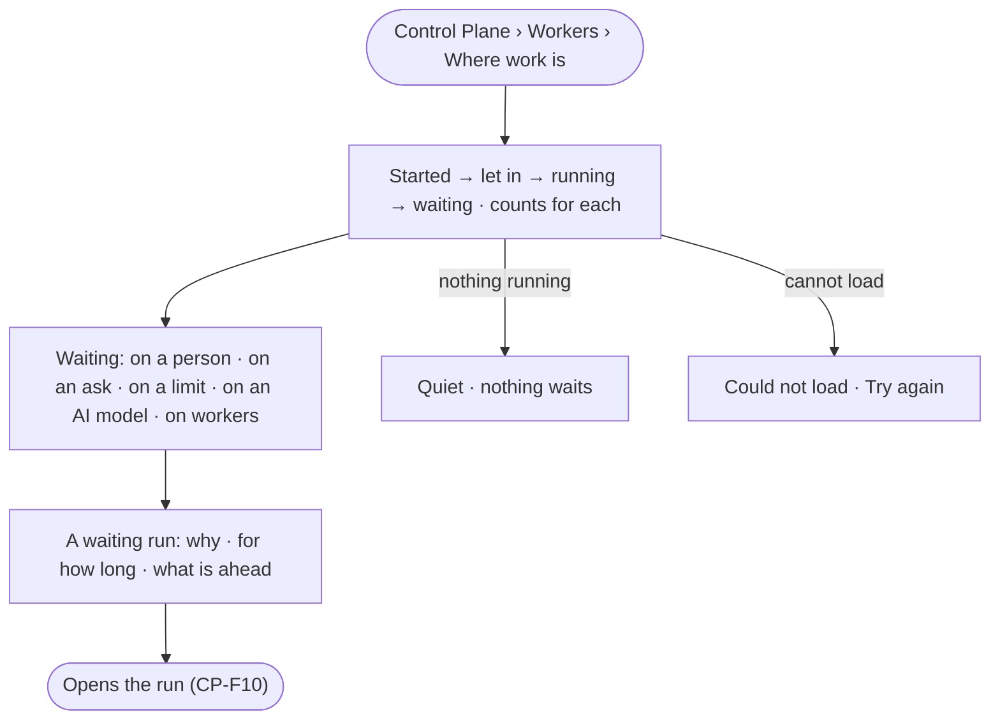

# CP-05 · See where work is and why it waits

**As** an Admin **I want** one view from what started a run to whether it was let in, what is running, and what
waits and why **so that** I see where work is and why it waits, instead of guessing from a slow answer.

Tasks: [task.md](task.md) · Feature: [CP-F03](../../feature.md)

## Who can

| Lens | Can | Otherwise sees |
|---|---|---|
| Admin | Read where work is across the deployment | — |
| Operator | Read where work is across the deployment | — |

## Flow

## Acceptance criteria

| # | Given | When | Then |
|---|---|---|---|
| CP-05.1 | An Operator | they open *Where work is* | runs read by stage — started, let in, running, waiting — with a count each, as the engine stored them |
| CP-05.2 | Waiting runs | they are read | each says what it waits on — a person, an ask, a limit — naming whose — an AI model's rate limit, or workers — and for how long |
| CP-05.3 | A run waiting on a person or an ask | it is read | it uses no worker and holds no slot |
| CP-05.4 | A waiting run | it is opened | its run opens, showing the same reason (CP-F10) |
| CP-05.5 | Nothing running | the view opens | it says nothing is running or waiting |
| CP-05.6 | The view cannot load | it opens | it says so and offers to try again |

## Screens

| Surface | Lens | First use | Empty after a filter | Loading | Has data | Failed | Agent working or proposing | No access |
|---|---|---|---|---|---|---|---|---|
| Where work is | Admin | settings.workers · Nothing running | — | settings.workers · Loading | settings.workers · Where work is | settings.workers · Could not load | — | — |
| Where work is | Operator | settings.workers · Nothing running | — | settings.workers · Loading | settings.workers · Where work is | settings.workers · Could not load | — | — |
