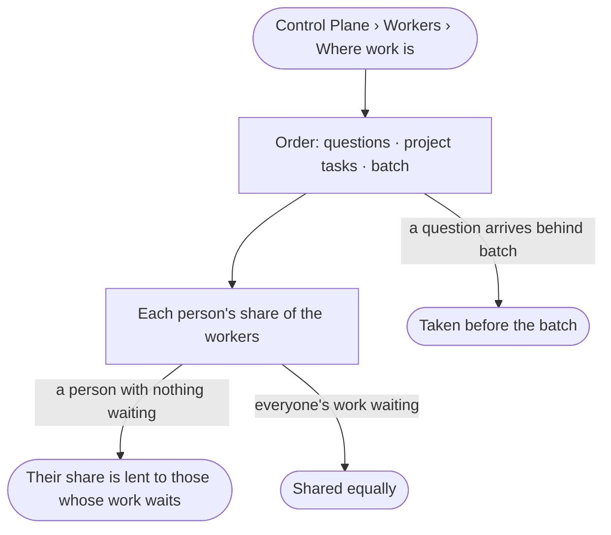

# CP-06 · Questions go before batch work

**As** an Admin **I want** to see the order workers take work in — a question someone waits on, then project
tasks, then batch — and each person's share **so that** a batch of agents never delays a question.

Tasks: [task.md](task.md) · Feature: [CP-F03](../../feature.md)

## Who can

| Lens | Can | Otherwise sees |
|---|---|---|
| Admin | Read the order work is taken in and each person's share | — |
| Operator | Read the order work is taken in and each person's share | — |

## Flow

## Acceptance criteria

| # | Given | When | Then |
|---|---|---|---|
| CP-06.1 | Work waiting of several kinds | the order is read | a question someone waits on reads first, then project tasks picked up, then batch — schedules, sweeps and runs past twenty agents |
| CP-06.2 | Batch waiting | a person asks a question | the question is taken before the batch |
| CP-06.3 | Several people's work waiting | their shares are read | each has an equal share of the workers |
| CP-06.4 | A person with no work waiting | the shares are read | their share is lent to people whose work waits, and says so |
| CP-06.5 | A person's work waiting | their row is read | how many wait, of which kind, and the oldest |

## Screens

| Surface | Lens | First use | Empty after a filter | Loading | Has data | Failed | Agent working or proposing | No access |
|---|---|---|---|---|---|---|---|---|
| The order and each person's share | Admin | settings.workers · Nothing running | — | settings.workers · Loading | settings.workers · Order | settings.workers · Could not load | — | — |
| The order and each person's share | Operator | settings.workers · Nothing running | — | settings.workers · Loading | settings.workers · Order | settings.workers · Could not load | — | — |
