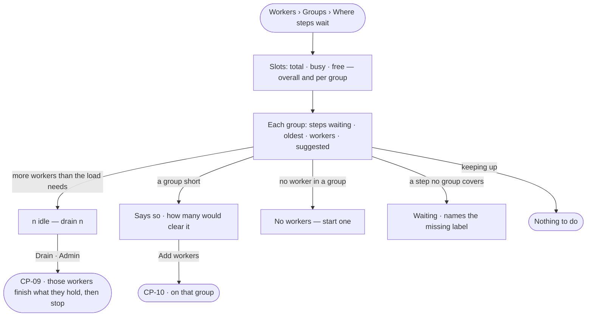

# CP-08 · See how many workers each group needs

**As** an Admin **I want** the slots every worker together has now — total, busy and free, overall and per group —
each group's steps waiting, the oldest, and advice to add workers or drain idle ones **so that** I size the workers to
the load, without Invana holding cloud keys or scaling anything itself.

Tasks: [task.md](task.md) · Feature: [CP-F03](../../feature.md)

## Who can

| Lens | Can | Otherwise sees |
|---|---|---|
| Admin | Read the slots and where steps wait; *Add workers* on a short group; *Drain* idle workers the advice names | — |
| Operator | Read the slots, where steps wait and the advice | *Add workers* and *Drain* disabled — *Needs the Admin role — ask {admins}* |

## Flow

## Acceptance criteria

| # | Given | When | Then |
|---|---|---|---|
| CP-08.1 | An Operator | they open *Where steps wait* | each worker group reads steps waiting, the oldest, its workers and how many are suggested, as the engine stored them every 30 s |
| CP-08.2 | A group with more steps waiting than its workers take | it is read | it says it is short and how many workers would clear it — steps waiting ÷ steps a worker took over the last ten minutes |
| CP-08.3 | A short group | the Admin presses *Add workers* | Add workers opens on that group (CP-10) |
| CP-08.4 | A group with no worker | it is read | it says *no workers — start one*, and a run waiting on it names the group |
| CP-08.5 | A step whose labels no live group covers | it waits | it is named, with the missing label, and fails when its wait runs out |
| CP-08.6 | Any group | Invana suggests workers | nothing starts a machine; a person adds them |
| CP-08.7 | An Operator | they open Where steps wait | everything reads; *Add workers* and *Drain* are disabled — *Needs the Admin role — ask {admins}* |
| CP-08.8 | Workers in any group | Workers › Groups opens | its head reads the slots every worker together has now — *48 slots · 31 busy · 17 free* — and each group reads its own; a slot is one agent step a worker can take at once, and every number is the engine's, stored every 30 s |
| CP-08.9 | A group whose suggested count is above its workers | it is read | its advice reads *Add {n} workers*, the number the engine suggested |
| CP-08.10 | A group with workers idle over the last ten minutes and a suggested count below its workers, above its minimum | it is read | its advice reads *{n} idle — drain {n}*, never below the group's minimum; an Admin's *Drain* drains that many idle workers (CP-09) |
| CP-08.11 | A group whose workers match the load | it is read | its advice reads *Keeping up*; no act is offered |

## Screens

| Surface | Lens | First use | Empty after a filter | Loading | Has data | Failed | Agent working or proposing | No access |
|---|---|---|---|---|---|---|---|---|
| Where steps wait | Admin | settings.workers · No workers | — | settings.workers · Loading | settings.workers · Where steps wait | settings.workers · Short of workers | — | — |
| Where steps wait | Operator | settings.workers · No workers | — | settings.workers · Loading | settings.workers · Where steps wait | settings.workers · Short of workers | — | settings.workers · Read only |
| Slots and advice | Admin | settings.workers · No workers | — | settings.workers · Loading | settings.workers · Slots and advice | settings.workers · Short of workers | — | — |
| Slots and advice | Operator | settings.workers · No workers | — | settings.workers · Loading | settings.workers · Slots and advice | settings.workers · Short of workers | — | settings.workers · Read only |
