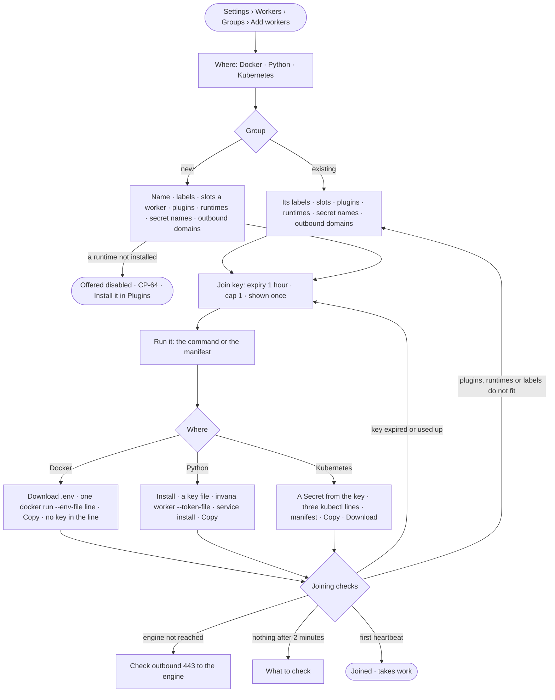

# CP-10 · Add workers on my own machines with one command

**As** an Admin **I want** to add workers on my own machines with one command, and watch them join **so that**
capacity is a command away, not a code change.

Tasks: [task.md](task.md) · Feature: [CP-F03](../../feature.md)

## Who can

| Access | Can | Otherwise sees |
|---|---|---|
| Admin | With Create on `worker/<group>`: add workers: pick where, a group (or make one), mint a join key, run the command, watch it join | — |
| Operator | — | *Add workers* disabled — *Needs Create on Workers — ask {who can grant}* |

## Flow

## Acceptance criteria

| # | Given | When | Then |
|---|---|---|---|
| CP-10.1 | An Admin | they press *Add workers* | a 720 px modal opens with a step strip — *Where*, Docker first, then *Group*, *Join key*, *Run it*, *Joined* — on *Where* |
| CP-10.2 | *Add workers* from a short group | it opens | that group is chosen |
| CP-10.3 | A new group | it is made | it has a name unique for the deployment, labels from `cpu · llm · egress · gpu · code`, slots a worker, plugins, the runtimes it carries, secret names and outbound domains |
| CP-10.4 | A join key | it is minted | it is scoped to the group, with an expiry — *1 hour* unless the Admin picks another — and a cap — *1 worker* unless the Admin picks another; its secret shows once, on *Run it*; afterwards only its prefix reads |
| CP-10.5 | *Run it* | it is read | Docker reads one `docker run` line; Python an install and one command, and a service install; Kubernetes three lines and a manifest to download — each carrying the group, labels and slots |
| CP-10.6 | A worker joining | each check passes or fails | key used · engine reached · plugins loaded · labels fit · first heartbeat show as they happen, each failure with what to check |
| CP-10.7 | Nothing after two minutes | *Joined* waits | a checklist of what to check reads |
| CP-10.8 | A refused join — expired or used-up key, labels outside the group, plugins missing | the worker tries | no worker is made, and the worker is told the reason |
| CP-10.9 | A joined worker | it heartbeats | it takes work its group covers, holding no database credential and no inbound port |
| CP-10.10 | An Operator | they look for *Add workers* | it is disabled — *Needs Create on Workers — ask {who can grant}* |
| CP-10.11 | A key minted or a worker joined | it is done | History records who and when (AC-F06) |
| CP-10.12 | An Admin | they change a worker group — its labels, slots a worker, plugins, secret names or outbound domains | the change is stored and History records who and when (AC-F06); workers that join afterwards take it |
| CP-10.13 | An Operator | they open *Join keys* | every key reads its group, prefix, expiry, how many joined of its cap, and whether it is revoked — never its secret |
| CP-10.14 | A group's runtimes | an Admin picks them | only runtimes installed as runtime plugins are offered; one not installed reads disabled, naming *Install it in Plugins* (CP-64); a group that carries an outside runtime needs the `code` label, or the change is refused, naming it |
| CP-10.15 | A worker joining a group that carries a runtime | the joining checks run | *runtimes loaded* passes only when the worker loaded each runtime the group carries, at a version its plugin allows; else the join is refused, naming the runtime |
| CP-10.16 | *Run it* on Docker | it is read | *Download .env* holds the engine address, the join key, the group, labels and slots as `INVANA_ENGINE_URL` · `INVANA_JOIN_TOKEN` · `INVANA_POOL` · `INVANA_LABELS` · `INVANA_SLOTS`, and one `docker run --env-file` line reads it, with *Copy*; the key's secret shows once, on this step, and never in the line |
| CP-10.17 | *Run it* on Python | it is read | it reads the install, a key file to save, the one `invana worker --token-file` command with the other values and, below it, `invana worker install-service` for a service on the machine, each with *Copy*; the key never sits in the command |
| CP-10.18 | *Run it* on Kubernetes | it is read | three `kubectl` lines — the first makes a Secret from the key — and a manifest that reads the key from that Secret, with *Copy* and *Download*; Invana starts nothing — the replicas are declared by the Admin (CP-08.6) |
| CP-10.26 | Any *Run it* | it is read or copied | no command line carries the join key as an argument, so neither a process list nor a shell history keeps it; the key travels in an environment file, a key file or a Secret |
| CP-10.19 | A worker group whose machine sits in a region | *Join key* is filled and *Run it* is read | an optional *Region* field on *Join key*, a short tag from the data stores' regions ([CP-F13](../../../CP-F13-data-stores/feature.md#rules)), is part of the *Run it* command as `INVANA_REGION`; untagged reads *anywhere*; the worker carries the tag it joined with, and *Joined* reads it |
| CP-10.20 | *Group* | it opens | it offers *Existing group* — the groups with their labels, slots, plugins, runtimes and secret names — or *New group*; choosing one shows what the worker will be held to |
| CP-10.21 | The *Join keys* list | it is read | each key reads its group, who minted it and when, its prefix, expiry, how many joined of its cap and whether it is revoked — never its secret; an Admin's *Revoke* ends it for new workers (CP-09.8), and an Operator reads the list with *Revoke* disabled — *Needs Manage on the {group} worker group — ask {who can grant}* |
| CP-10.22 | A join key that expired or reached its cap | a worker tries to join with it | *Join key* reads *Expired* or *Used up*; *Back* returns to *Join key* to mint another |
| CP-10.23 | An Admin | they press *Revoke* on a key | a confirm names the key, its group and how many workers it already joined; confirming marks the row *Revoked* and removes *Revoke*; History records who and when (AC-F06) |
| CP-10.24 | A new group names a runtime that is not installed | the Admin presses *Install it in Plugins* | the install opens and, once done, returns to the same *Group* step |
| CP-10.25 | *Joined* | it shows | it reads the worker and its region; *Done* closes to *All workers* with the new worker, *Add more* returns to *Where*; a failed join reads its cause and keeps *Cancel* and *Back* |

## Screens

| Surface | Access | First use | Empty after a filter | Loading | Has data | Failed | Agent working or proposing | No access |
|---|---|---|---|---|---|---|---|---|
| Add workers · 1 Where | Admin | settings.workers · Add workers | — | — | settings.workers · Add workers · Where picked · Docker · Python · Kubernetes | — | — | — |
| Add workers · 1 Where | Operator | — | — | — | — | — | — | settings.workers · Read only |
| Add workers · 2 Group | Admin | settings.workers · Add workers · New group | — | — | settings.workers · Add workers · Existing group | settings.workers · Add workers · Runtime not installed | — | — |
| Add workers · 2 Group | Operator | — | — | — | — | — | — | settings.workers · Read only |
| Add workers · 2 Group · New group filled | Admin | — | — | — | settings.workers · Add workers · New group · Filled | — | — | — |
| Add workers · 2 Group · New group filled | Operator | — | — | — | — | — | — | settings.workers · Read only |
| Add workers · 3 Join key | Admin | settings.workers · Add workers · Join key | — | — | settings.workers · Add workers · Join key · Set | settings.workers · Add workers · Join key · Expired · Used up | — | — |
| Add workers · 3 Join key | Operator | — | — | — | — | — | — | settings.workers · Read only |
| Add workers · 4 Run it · Docker | Admin | — | — | — | settings.workers · Add workers · Run it · Docker | — | — | — |
| Add workers · 4 Run it · Docker | Operator | — | — | — | — | — | — | settings.workers · Read only |
| Add workers · 4 Run it · Python | Admin | — | — | — | settings.workers · Add workers · Run it · Python | — | — | — |
| Add workers · 4 Run it · Python | Operator | — | — | — | — | — | — | settings.workers · Read only |
| Add workers · 4 Run it · Kubernetes | Admin | — | — | — | settings.workers · Add workers · Run it · Kubernetes | — | — | — |
| Add workers · 4 Run it · Kubernetes | Operator | — | — | — | — | — | — | settings.workers · Read only |
| Add workers · 5 Joined | Admin | — | — | settings.workers · Add workers · Waiting to join | settings.workers · Add workers · Joined · Done · Add more | settings.workers · Add workers · Join failed · Engine not reached · Plugins not loaded · Runtimes not loaded · Labels outside the group · Nothing after 2 minutes | — | — |
| Add workers · 5 Joined | Operator | — | — | — | — | — | — | settings.workers · Read only |
| Where it lands · All workers | Admin | — | — | — | settings.workers · All workers | — | — | — |
| Where it lands · All workers | Operator | — | — | — | — | — | — | settings.workers · Read only |
| Join keys | Admin | settings.workers · No join keys | — | settings.workers · Loading | settings.workers · Join keys | settings.workers · Could not load | — | — |
| Join keys | Operator | settings.workers · No join keys | — | settings.workers · Loading | settings.workers · Join keys | settings.workers · Could not load | — | settings.workers · Read only |
| Join keys · Revoke | Admin | — | — | — | settings.workers · Join keys · Revoke | — | — | — |
| Join keys · Revoke | Operator | — | — | — | — | — | — | settings.workers · Read only |
| Join keys · Revoked | Admin | — | — | — | settings.workers · Join keys · Revoked | — | — | — |
| Join keys · Revoked | Operator | — | — | — | — | — | — | settings.workers · Read only |
