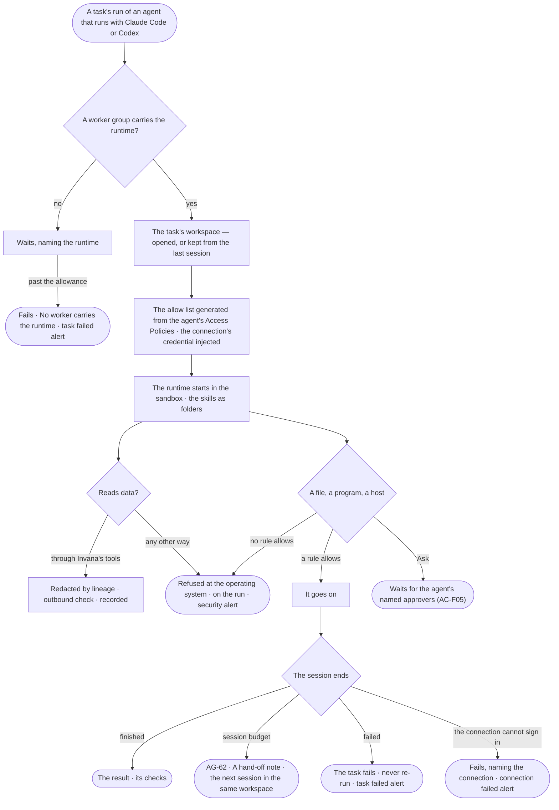

# CP-65 · Run an outside runtime safely on a worker

**As** an Admin **I want** an agent that runs with Claude Code or Codex to work on a worker inside a sandbox that
enforces the agent's Access Policies, in a workspace of its task, reaching data only through Invana's tools
**so that** an outside runtime does the same thing for everyone who uses the agent, and touches only what its job needs —
whatever the runtime itself would allow.

Tasks: [task.md](task.md) · Feature: [CP-F03](../../feature.md)

## Who can

The role × feature table is [AC-F02 › The role table](../../../../../access/features/AC-F02-access-policies/feature.md#the-role-table).

| Lens | Can | Otherwise sees |
|---|---|---|
| Admin | Read every session on every worker, its workspace and every sandbox refusal; change the agent's worker rules ([AC-37](../../../../../access/features/AC-F02-access-policies/stories/AC-37-say-what-an-agent-may-touch-on-a-worker/story.md)) | — |
| Operator | Start a run of an agent they are granted; read their own runs' sessions and refusals; a Modeller reads the same | Another person's run: its sessions' heads, content *withheld*, naming who may read it ([AC-31](../../../../../access/features/AC-F09-what-left-the-platform/stories/AC-31-keep-a-runs-content-to-those-who-may-read-it/story.md)) |

## Flow

## Acceptance criteria

| # | Given | When | Then |
|---|---|---|---|
| CP-65.1 | A task given to an agent that runs with Claude Code | its run starts | a session is leased by a worker whose group carries Claude Code and the `code` label; the run reads *Session 1 · Claude Code* with the worker |
| CP-65.2 | A session | it starts | the runtime works in the task's workspace on that worker; the agent's skills are in it as folders; nothing outside the workspace is readable |
| CP-65.3 | No worker group carries the agent's runtime | a session waits past the queue-wait allowance | the run fails — *No worker carries {runtime} — install it on a worker group.* — and a task failed alert is raised |
| CP-65.4 | A session | it starts | the runtime's own allow list is generated from the agent's Access Policies for this session; nobody edits it, and a policy change reaches the next session |
| CP-65.5 | A file, a program or a host a rule allows | the runtime reaches it | it goes on |
| CP-65.6 | A file, a program or a host no rule allows, or one a rule denies | the runtime reaches it — even when its own settings allow it | the sandbox refuses it at the operating system; the run's *How it got here* names the session, the act, the target and the rule — or *no rule allows it* — and a security alert is raised ([CP-F11](../../../CP-F11-ops-alerting/feature.md)) |
| CP-65.7 | A rule that says Ask on a worker resource | the runtime reaches it | the session waits on the agent's named approvers; a yes covers this step of this run; a no refuses it as CP-65.6 |
| CP-65.8 | The runtime | it reads data | it reads only through Invana's MCP tools: each call is checked against the agent's Access Policies, redacted by lineage, passed through the outbound check and recorded in *What left the platform*; a graph database is never reachable from the sandbox |
| CP-65.9 | The connection the session uses | it cannot sign in | the session fails, naming the connection and why; a connection failed alert is raised; the secret never reads anywhere |
| CP-65.10 | A session | it ends | the run records why — finished · session budget · stopped · failed · refused — its tokens, the runtime's version and the model it reported running on |
| CP-65.11 | A session that reaches its session budget | it ends | the next session continues the same run in the same workspace from the hand-off note ([AG-62](../../../../../../capabilities/agents/features/AG-F05-delegation-and-outside-agents/stories/AG-62-continue-in-a-fresh-session-from-a-hand-off-note/story.md)); when the worker holding it is lost, a fresh workspace starts from the task's inputs and the note |
| CP-65.12 | A task's run that fails | it ends | the task closes *Failed*; nothing re-runs it; a task failed alert reaches the task's assignee and the project's reviewers, and the fix is a new task |
| CP-65.13 | A task | it closes | its workspace is removed from the worker |
| CP-65.14 | An Operator | they open another person's run on an outside runtime | the sessions' heads and that a refusal happened read; what was touched is *withheld*, naming who may read it |
| CP-65.15 | A runtime whose model runs outside the deployment | a session sends its prompt | it passes the outbound check as an external exit ([AC-F09](../../../../../access/features/AC-F09-what-left-the-platform/feature.md)) |

## Screens

| Surface | Lens | First use | Empty after a filter | Loading | Has data | Failed | Agent working or proposing | No access |
|---|---|---|---|---|---|---|---|---|
| A run's sessions and sandbox refusals | Admin | — | — | agents.run · Loading | agents.run · Sessions | agents.run · Sandbox refused | agents.run · Session running | — |
| A run's sessions and sandbox refusals | Operator | — | — | agents.run · Loading | agents.run · Sessions | agents.run · Sandbox refused | agents.run · Session running | agents.run · Withheld |
| A worker running a session | Admin | — | — | settings.workers · Loading | settings.workers · Worker | settings.workers · No worker carries the runtime | settings.workers · Worker | — |
| A worker running a session | Operator | — | — | settings.workers · Loading | settings.workers · Worker · Read only | settings.workers · No worker carries the runtime | settings.workers · Worker · Read only | settings.workers · Read only |
</content>
</invoke>
<invoke name="Bash">
<parameter name="command">cat /Users/ravi.merugu/Projects/invana/invana/specs/os/control/features/CP-F03-workers-and-the-queue/stories/CP-65-run-an-outside-runtime-safely-on-a-worker/task.md | head -3; ls /Users/ravi.merugu/Projects/invana/invana/specs/capabilities/agents/features/AG-F05-delegation-and-outside-agents/stories