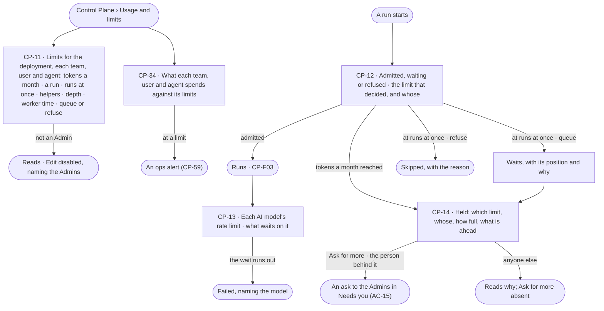

# Limits

> What the deployment, each team, each user and each agent may spend and have running at once — set in one place by
> an Admin, read by everyone — what each spends against them, and why a run started, waits or was refused. The
> decision it helps make: *do we raise this team's, user's or agent's limit, or let the work queue?*

## User journey

Journeys this feature is a step of: [J07 · Ready a deployment](../../../../journeys/J07-ready-a-deployment.md) ·
[J08 · Watch agent workloads and act on an alert](../../../../journeys/J08-watch-agent-workloads-and-act-on-an-alert.md)

## Stories

| ID | Story | Status |
|---|---|---|
| CP-11 | [Set limits for the deployment, a team, a user or an agent](stories/CP-11-set-limits-for-the-deployment-a-team-a-user-or-an-agent/story.md) | idea |
| CP-34 | [Read what each team, user and agent spends against its limits](stories/CP-34-read-what-each-team-user-and-agent-spends-against-its-limits/story.md) | idea |
| CP-12 | [See why a run started, waits or was refused](stories/CP-12-see-why-a-run-started-waits-or-was-refused/story.md) | idea |
| CP-13 | [See each AI model's rate limit and what waits on it](stories/CP-13-see-each-ai-models-rate-limit-and-what-waits-on-it/story.md) | idea |
| CP-14 | [Know why my run is held and ask for more](stories/CP-14-know-why-my-run-is-held-and-ask-for-more/story.md) | idea |

## Access

The role × feature table is [AC-F02 › The role table](../../../access/features/AC-F02-access-policies/feature.md#the-role-table)
(*Workers and the queue · limits · AI models · skill scripts*: Operator Reads · Modeller Reads · Admin Acts); this is
what it means here.

| Act | Role | Everyone else sees |
|---|---|---|
| Read every limit and what each team, user and agent spends against it | Operator · Modeller · Admin | — |
| Set, change or clear a limit — the deployment's, a team's, a user's or an agent's; a model's rate limit | Admin | *Edit* disabled — *Needs the Admin role — ask {admins}* |
| Ask for a higher limit from a held run | The person behind the run | *Ask for more* absent; why it is held reads |
| Allow that ask | Admin, in Needs you (AC-15) | As AC-F05 |

## States

| State | What the person sees |
|---|---|
| First use | The deployment on its defaults — four runs at once, queue, no monthly token limit — and *No team, user or agent has its own limits* |
| Empty after a filter | *No {team · user · agent} has its own limits* · *Clear* |
| Loading | The section opens at once; rows fill in place |
| Has data | Each limit row: who it bounds, each limit with its ceiling, used now and a meter; each start admitted, waiting or refused with the limit that decided; each AI model's rate limit and what waits on it |
| Failed | A limit refused names the field and its range; a run refused at a limit names the limit and whose; a rate-limit wait that ran out names the model |
| Agent working or proposing | A run held by a limit says which, whose, how full and what is ahead, with *Ask for more* for the person behind it |
| No access | Everything reads; *Edit* is disabled for everyone but an Admin, naming the Admins |

## Rules

| Rule | Detail |
|---|---|
| One place for limits | The deployment's, each team's, each user's and each agent's limits are set here and nowhere else; an agent's page reads its limits from here |
| What a limit holds | *Tokens* a month · *Tokens* a run · *Runs at once* · *Helpers* a run · *Helper depth* · *Worker time* an hour · *Worker groups* it may use · *At the limit* — queue or refuse · *May ask for more* |
| No row, no limit | A team, user or agent with no limit row adds none; the deployment's always applies. A limit with no ceiling reads *No limit* |
| What binds a run | The agent's limits · the limits of the person behind it · the limits of each team that person was on when the run opened · the deployment's. The tightest binds, and a run held or refused names which limit and whose |
| Used now is the engine's | Tokens this month; a run's tokens as the 95th percentile over 30 days of finished runs; runs at once; helpers as the largest live tree, naming its run; Studio derives none |
| At runs at once, the limit decides | *Queue* — the run waits, with its position and why; *refuse* — the firing is recorded as skipped, with the reason. The deployment's default is four at once, queue |
| An agent at its own runs at once is refused, not queued | And told about its own limit before any other |
| At tokens a month | An agent's run is held, naming the limit and whose; a question a person asks the Assistant still answers within its tokens a run |
| Tokens are held before a call | The engine sets aside a call's most tokens before it runs and returns what it did not spend, so calls at once never pass a limit; Allow never passes one ([Control Plane › Decisions](../../product.md#decisions)) |
| Helpers never make room | A helper draws on its parent's runs at once, tokens a run, helpers and depth |
| A run's sub-tasks are bounded by its agent | An agent's sub-tasks stop at its helper depth (2 by default), helpers (12 in all) and tokens a run; people's sub-tasks have no limit |
| A rate limit is a wait, not a failure | Backed off and shown as waiting; a failure only when the wait runs out, naming the model |
| Ask for more | The person behind a held run asks the Admins for more of the limit that holds it — for this run, for some days, or always — when that limit *May ask for more* |
| Over a limit alerts | A team, user or agent reaching its monthly tokens raises an ops alert ([CP-F11](../CP-F11-ops-alerting/feature.md)) |
| Tokens, never currency | Every limit, meter and figure counts tokens ([glossary › Token budget](../../../../glossary.md#what-may-happen)) |
| Leans on | Workers and the queue (CP-F03) · runs (CP-F10) · ops alerts (CP-F11) · teams and users (AC-F03) · asks (AC-F05) |

## Data touched

| Record | Read or write |
|---|---|
| Limits — the deployment's, each team's, user's and agent's | Read · write |
| Spend this month and runs at once for each | Write (at each settle) · read |
| Grants from *Ask for more* | Write · read |
| Waiting and refused runs with their reasons (CP-F10) | Read |

## Engine

The low-level design: what this feature stores, serves and refuses. Conventions — naming, errors, lists, events — are
[system-design.md](../../../../system-design.md) §§ 6–8; this section only fills them in.

### Records

| Table | Columns | Notes |
|---|---|---|
| `control_limits` | `scope` (`deployment` · `team` · `user` · `agent`) · `subject_id?` · `monthly_tokens?` · `tokens_per_run?` · `max_concurrent_runs?` · `max_helpers?` · `max_depth?` · `worker_seconds_hour?` · `pools[]?` · `at_limit` (`queue` · `refuse`) · `may_ask_for_more` · `updated_by_id` · `updated_at` | Unique (`scope`, `subject_id`); the `deployment` row always exists, seeded with four runs at once and `queue`. A null column is *No limit* |
| `control_spend` | `scope` · `subject_id?` · `month` · `tokens` · `held_tokens` · `runs_at_once` · `updated_at` | Written when a call settles or a run is admitted or ends, never computed on read; unique (`scope`, `subject_id`, `month`) |
| `control_capacity_pools` | `name` (unique) · `slots` | Named capacity for the deployment; `llm` (20) · `graphdb` (50) · `heavy` (4) ship. Who waits on which, with position, is read — never stored twice |
| `control_llm_rate_limits` | `llm_id` · `requests_per_minute` · `tokens_per_minute` | One row per offered model version that has a limit |
| `control_limit_grants` | `scope` · `subject_id?` · `limit` (`monthly_tokens` · `tokens_per_run` · `max_concurrent_runs` · `worker_seconds_hour`) · `value` · `run_id?` · `until?` · `ask_id` · `granted_by_id` · `granted_at` | A raise an Admin allowed from *Ask for more*: for one run, until a date, or — *always* — written to `control_limits` instead |

### Reads

| Record | Owner |
|---|---|
| Runs — `status`, `queued_at`, `triggered_by`, the person behind it, `team_ids[]`, tokens, the reason a run waits | [CP-F10](../CP-F10-runs-and-how-the-agents-are-doing/feature.md#engine) |
| Teams and users, and who is on which team | [AC-F03](../../../access/features/AC-F03-directory/feature.md#engine) |
| Agents a limit names | [AG-F01](../../../../capabilities/agents/features/AG-F01-build-an-agent/feature.md#engine) |
| The ask *Ask for more* raises and its answer | [AC-F05](../../../access/features/AC-F05-asks-and-approvals/feature.md#engine) |
| Worker groups, the queue order and suggested workers | [CP-F03](../CP-F03-workers-and-the-queue/feature.md#engine) |
| Model versions a rate limit sits on | [CP-F01](../CP-F01-ai-models/feature.md#engine) |
| An agent's sub-tasks and their refusal | [PJ-F01](../../../../capabilities/projects/features/PJ-F01-projects-and-tasks/feature.md#engine) |
| History rows of every limit change and grant | [AC-F06](../../../access/features/AC-F06-history/feature.md#engine) |

### Routes

| Route, after `/api/v1/control` | Does | Story |
|---|---|---|
| `GET /limits` | Every limit row with its spend and used now — `?scope=` · `?subject_id=`; each row: `scope` · `subject_id` · `name` · each limit's `ceiling` (null — no limit) · `used` · `used_line` · `at_limit` · `may_ask_for_more` · grants in force | CP-11 · CP-34 |
| `PUT /limits/{scope}/{subject_id}` · `PUT /limits/deployment` · `DELETE /limits/{scope}/{subject_id}` | Set a team's, user's or agent's limits · the deployment's · clear one, back to *No limit* | CP-11 |
| `GET /limits/binding?run_id=` · `GET /limits/binding?user_id=&agent_id=` | Which limits bind a run, or would bind a person running an agent, the tightest first | CP-12 · CP-14 |
| `GET /contention` | `running` (run ids) · `queued` (`run_id` · `position` · `triggered_by` · `queued_at` · `reason` · `binding` {scope, subject, limit}) · `running_count` · `queued_count` · `pools` — every capacity pool with `size` and `in_use`, idle ones included | CP-12 · CP-14 |
| `GET /starts` | Each start — admitted, waiting or refused — with the limit and whose that decided it, newest first | CP-12 |
| `POST /limits/asks` | *Ask for more* from a held run `{run_id, limit, span (run · days · always), days?}` → an ask in the Admins' Needs you | CP-14 |
| `GET /llm-limits` · `PUT /llm-limits/{llm_id}` | Each offered model version's rate limit, how much is used and the steps waiting on it · set one | CP-13 |

### Events

| Event | When |
|---|---|
| `control.limits.update` · `control.limits.clear` | An Admin sets or clears a limit row — scope, subject, old and new |
| `control.limits.grant` | An ask for more is allowed, with its span |
| `control.runs.queue` · `control.runs.admit` · `control.runs.refuse` | A start waits, is admitted, or is refused — naming the limit and its scope (`deployment` · `team` · `user` · `agent` · `pool`) |
| `control.limits.reached` | A team, user or agent reaches its monthly tokens — read by ops alerting |
| `control.pools.saturated` | A capacity pool has had no free slot for a stated interval |
| `control.llms.wait` | A step waits on a model version's rate limit, naming it |

### Refusals

| Status | When | Sentence | Criterion |
|---|---|---|---|
| 403 | Setting or clearing a limit, or a model's rate limit, by anyone but an Admin | *Needs the Admin role — ask {admins}.* | CP-11.10 · CP-13.6 |
| 422 | A limit outside its range, or naming a team, user or agent that does not exist | *{field}: {why}.* | CP-11.11 |
| run skipped | A start at a runs-at-once limit set to `refuse` | *Skipped — {subject} is at {n} runs at once.* | CP-11.5 |
| run held | A team, user, agent or the deployment at its tokens a month — an agent's run | *{subject} has used its {n} tokens this month.* | CP-11.9 |
| run refused | An agent at its own runs at once | *{agent} is at its {n} runs at once.* | CP-12.4 |
| step failed | A rate-limit wait that runs out | *{model} stayed at its rate limit past {wait}.* | CP-13.3 |
| step refused | A step needing more slots than its pool has | *{step} needs {n} slots — {pool} has {size}.* | API only — a plan is checked before it runs, and the refusal reads on the run's Plan step (AG-18.17) |
| 403 | *Ask for more* by anyone but the person behind the run, or on a limit that may not ask for more | *Only {person} can ask for more for this run.* · *{limit} does not take asks — ask {admins}.* | CP-14.6 |

### CLI

| Command | Does |
|---|---|
| — | No command of its own; limits are set in Usage and limits or through the routes |

### Mechanisms

| Mechanism | How |
|---|---|
| Admission | At a run's start, in order: the access check ([AC-F04](../../../access/features/AC-F04-what-an-agent-may-touch/feature.md)) · every switch the work needs ([CP-F02](../CP-F02-plugins-and-outside-tools/feature.md) · [CP-F05](../CP-F05-graph-databases/feature.md)) · the agent's `max_concurrent_runs` — refused, never queued · the person behind it, each of their teams and the deployment, each `max_concurrent_runs` by its `at_limit` · every `monthly_tokens`. Each outcome is a `control.runs.*` event and a row of `GET /starts`, naming the binding limit; waiting is never a refusal |
| The tightest binds | For each limit, the smallest ceiling among the agent's, the person's, each of their teams' at open and the deployment's, plus any grant in force for that subject; ties name the narrowest scope — agent, then user, then team, then deployment |
| A slot | Counted at admission for the agent, the person, each team, the deployment and each capacity pool; a waiting or paused run holds none. Lowering a limit below what runs stops new starts until the count is under it |
| A helper's slot | Counted against its parent's agent, person, teams and the deployment like any run; its wait or refusal carries `parent_run_id` |
| A run's sub-tasks | Checked when a run writes a sub-task: levels below the run's task against `max_depth`, the run's sub-tasks in all against `max_helpers`, tokens against `tokens_per_run`; one past any is PJ-F01's 422, and the run carries on |
| Capacity pools | A step declares its pool and `pool_slots` (default 1; the function gives the default pool). A slot is taken after the access check and released when the call ends; any left are swept when the run settles. Slots go round-robin across runs, then by the order work is taken (CP-F03); the lowest of pool · step `max_parallel` · every binding runs at once wins |
| Holding tokens | A call's `max_tokens` is held against the run and every binding month — agent, person, each team, deployment — in `control_spend.held_tokens` before it is sent, and the unspent part returned when it settles |
| Rate limits are backpressure | Per model version, requests and tokens a minute: a step that would pass the bucket waits before dispatch, `queued`, holding no slot and no worker, and is not counted in suggested workers; past its wait it fails naming the model |
| A month | `monthly_tokens` counts from 00:00 UTC on the first of the month; at it, an agent's run waits *held* and `control.limits.reached` is written once for that subject and month |
| Used now | `control_spend` for tokens this month and runs at once; a run's tokens as the p95 over 30 days of finished runs and the largest live helper tree are computed in the engine from stored per-run numbers |
| Ask for more | Raises an AC-F05 ask to every Admin naming the run, the limit, whose, how full it is and the span; allowed, it writes a grant (or the limit for *always*) and the held run is admitted; declined, the run keeps waiting and says so |
| Admission survives a restart | Queued runs and their positions are rows; the coordinator that takes over (CP-F03) re-admits them in order |

## System impact

| HLD section | Change | NFRs |
|---|---|---|
| § 6 Data and storage | Five tables: limits by scope, spend by scope and month, capacity pools, model rate limits, grants | — |
| § 8 APIs and events | `/api/v1/control/limits`, `/contention`, `/starts`, `/llm-limits`; `control.limits.*` · `control.runs.queue/admit/refuse` · `control.pools.saturated` · `control.llms.wait` events | — |
| § 9 Distributed execution | Admission and slots at the coordinator across agent, person, teams and the deployment; a waiting run holds nothing; rate limits wait before dispatch | NFR-REL-2 |
| § 10 AI and agents | Tokens are held before each call against every binding month; a run's sub-tasks are bounded by its agent's depth, helpers and tokens | — |
| § 12 Qualities | Cost: every limit in tokens; Allow never passes a limit | NFR-COST-1 · NFR-COST-2 |

## Decisions

| Decision | Detail |
|---|---|
| Limits sit with Usage | *Usage and limits* is one page: each limit beside what is spent against it |
| Four scopes, the tightest binds | Deployment, team, user and agent; a run is inside every one that applies, and the one that stops it is named |
| Teams at open | A run counts against the teams of the person behind it when it opened, so a team change never moves a run between limits mid-flight |
| Sub-tasks reuse the helper limits | Depth and count of an agent's sub-tasks are its helper depth and helpers; one set of numbers bounds what an agent spawns |
| Only Admins set limits | Spend and capacity are the deployment's; a person asks for more from a held run |

## Open questions

| Question | Who answers |
|---|---|
| CP-12 · CP-13 wait on the scale-out proposal with CP-05 · CP-06 · CP-07 ([CP-F03 › Open questions](../CP-F03-workers-and-the-queue/feature.md#open-questions)); the rest of the feature stands without them | Ravi |

## Not building

| Item | Why not |
|---|---|
| A limit per project, per graph database or per Access Policy | Spend is bounded by who runs it — team, user, agent — and the deployment; a policy says what may be touched, never how much |
| Anyone but an Admin raising a limit | Spend and capacity are the deployment's; *Ask for more* reaches the Admins |
| Nested teams adding up | Teams are flat; each team's limit stands on its own |
| A cost limit | Tokens only |
