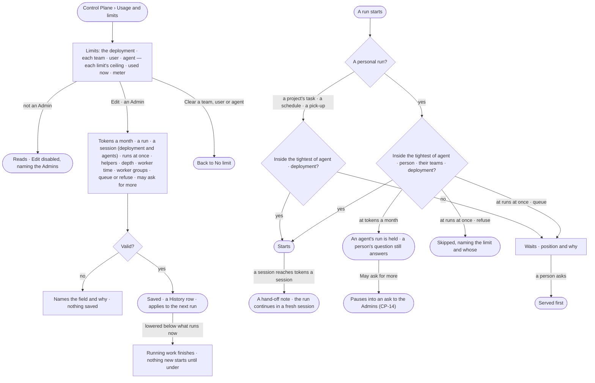

# CP-11 · Set limits for the deployment, a team, a user or an agent

**As** an Admin **I want** to set the deployment's, a team's, a user's or an agent's limits — tokens, runs at once,
helpers and worker time — beside what each uses now, in one place **so that** spend and capacity are the
deployment's to control, and a busy morning is a queue I can read rather than a rate-limit error.

Tasks: [task.md](task.md) · Feature: [CP-F04](../../feature.md)

## Who can

| Lens | Can | Otherwise sees |
|---|---|---|
| Admin | Read every limit with what is used now; set, change or clear the deployment's, a team's, a user's or an agent's limits | — |
| Operator | Operator · Modeller: read every limit, what is used now and its meter ([the role table](../../../../../access/features/AC-F02-access-policies/feature.md#the-role-table)) | *Edit* disabled — *Needs the Admin role — ask {admins}* |

## Flow

## Acceptance criteria

| # | Given | When | Then |
|---|---|---|---|
| CP-11.1 | An Admin | they open *Usage and limits* | the deployment's limits read first, then every team, user and agent with limits of its own, each with tokens a month · tokens a run · tokens a session (the deployment and agents) · runs at once · helpers · helper depth · worker time an hour · worker groups · *at the limit* queue or refuse · *May ask for more* |
| CP-11.2 | An Admin | they set or change a limit of the deployment, a team, a user or an agent and save | it applies from the next run, and reads in Usage and limits |
| CP-11.3 | A new deployment | its limits are read | it runs four at once, queues at that limit, has no monthly token limit and 200,000 tokens a session; no team, user or agent has limits of its own |
| CP-11.4 | A subject at runs at once, set to *queue* | another run starts | it waits, showing its position, what it waits behind, and which limit and whose |
| CP-11.5 | A subject at runs at once, set to *refuse* | a run starts or a schedule fires | it is recorded as skipped — *Skipped — {subject} is at {n} runs at once* |
| CP-11.6 | Runs waiting behind schedules | a person asks a question | the question is served before the waiting schedules |
| CP-11.7 | Runs at once lowered below what is running | it is saved | running work finishes; nothing new starts until the count is under |
| CP-11.8 | A run that makes helpers | the helpers would pass a limit | they wait or are refused like any run, against the parent's agent, person, teams and the deployment, naming the limit and the parent |
| CP-11.9 | A subject at its tokens a month | an agent would run | the run is held — *{subject} has used its {n} tokens this month*; a question a person asks the Assistant still answers within its tokens a run |
| CP-11.10 | An Operator or a Modeller | they open *Usage and limits*, or call a limit's write route | every limit reads; *Edit* is disabled — *Needs the Admin role — ask {admins}* — and the route answers 403 |
| CP-11.11 | An Admin | they save a limit outside its range, or one naming a team, user or agent that does not exist | it is refused — *{field}: {why}* — and nothing is saved |
| CP-11.12 | A limit set, changed or cleared | it saves | History records who changed which subject's limit, old and new, and when (AC-F06) |
| CP-11.13 | A limit row | it is read | each limit reads its ceiling · used now · a meter |
| CP-11.14 | Used now | it is shown | it is the engine's: tokens this month; a run's tokens as the 95th percentile over 30 days of finished runs (*used 41,200 p95 over 30 days*); runs at once; helpers as the largest live tree, naming its run (*used 6 in #212*); Studio derives none |
| CP-11.15 | A personal run — a question, a typed query, a load or a call over MCP a person on two teams starts | it is checked | the tightest of the agent's, the person's, each team's at open and the deployment's limit binds, and a run held or refused names which limit and whose |
| CP-11.16 | A limit with no ceiling set | it is read | it reads *No limit* |
| CP-11.17 | A limit that *May ask for more* | an agent's run reaches its tokens mid-run | the run pauses and asks the Admins in Needs you (CP-14 · AC-15) |
| CP-11.18 | A team, user or agent with limits of its own | an Admin clears it | it returns to *No limit*, and only the deployment's and any other limit that applies bound its runs |
| CP-11.19 | A project's task, a pick-up or a schedule's firing | it is admitted | only the agent's and the deployment's limits bind it, whoever set it going; no person's or team's limit holds or refuses it |
| CP-11.20 | An Admin | they set *Tokens a session* on a team or a user, or clear the deployment's | it is refused — *Tokens a session is set for the deployment and for agents.* · *The deployment always has tokens a session.* — and nothing is saved |
| CP-11.21 | A session that reaches its tokens a session — the agent's, else the deployment's | it is reached | the session ends and the run continues in a fresh session from a hand-off note, same run and number; nothing is asked, and its tokens a run and a month still bind the whole run |

## Screens

| Surface | Lens | First use | Empty after a filter | Loading | Has data | Failed | Agent working or proposing | No access |
|---|---|---|---|---|---|---|---|---|
| Limits — the deployment, teams, users and agents | Admin | settings.usage · Default limits | settings.usage · Nothing matches | settings.usage · Loading | settings.usage | settings.usage · Could not save | — | — |
| Limits — the deployment, teams, users and agents | Operator | settings.usage · Default limits · Read only | settings.usage · Nothing matches | settings.usage · Loading | settings.usage · Read only | settings.usage · Could not load | — | settings.usage · Read only |
| Edit limits | Admin | settings.usage · Edit limits | — | — | settings.usage · Edit limits | settings.usage · Could not save | — | — |
| Edit limits | Operator | — | — | — | — | — | — | settings.usage · Read only |
