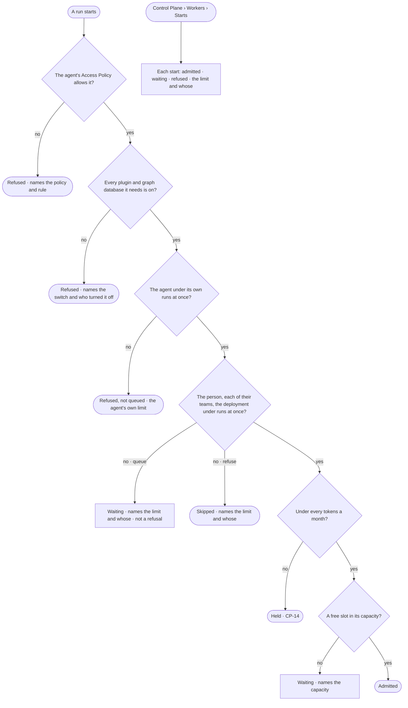

# CP-12 · See why a run started, waits or was refused

**As** an Admin **I want** every start admitted, waiting or refused, with the limit that decided and whose **so that**
letting work in is something I can explain.

Tasks: [task.md](task.md) · Feature: [CP-F04](../../feature.md)

## Who can

| Lens | Can | Otherwise sees |
|---|---|---|
| Admin | Read every start and what decided it | — |
| Operator | Operator · Modeller: read every start and what decided it ([the role table](../../../../../access/features/AC-F02-access-policies/feature.md#the-role-table)) | — |

## Flow

## Acceptance criteria

| # | Given | When | Then |
|---|---|---|---|
| CP-12.1 | Anyone signed in | they open *Starts* | each start reads as admitted, waiting or refused, newest first, with the limit that decided it and whose — agent · user · team · deployment · capacity |
| CP-12.2 | A start the agent's Access Policy does not allow | it is decided | it is refused, naming the policy and its rule (AC-F04) |
| CP-12.3 | A start that needs a plugin or a graph database that is switched off | it is decided | it is refused, naming the switch and who turned it off (CP-F02 · CP-F05) |
| CP-12.4 | An agent at its own runs at once | another of its runs starts | it is refused, not queued — *{agent} is at its {n} runs at once* — and that is the first limit it is told about |
| CP-12.5 | A start at the runs at once of the person behind it, one of their teams or the deployment, set to *queue* | it is decided | it waits, naming the limit and whose; waiting is never a refusal |
| CP-12.6 | No starts yet | the list opens | it says nothing has started |
| CP-12.7 | A start at a tokens a month — the agent's, the person's, a team's or the deployment's | it is decided | it is held, naming the limit and whose (CP-14) |
| CP-12.8 | A step whose named capacity has no free slot | it is decided | it waits, naming that capacity and its slots in use |

## Screens

| Surface | Lens | First use | Empty after a filter | Loading | Has data | Failed | Agent working or proposing | No access |
|---|---|---|---|---|---|---|---|---|
| Starts | Admin | settings.workers · Nothing running | — | settings.workers · Loading | settings.workers · Starts | settings.workers · Could not load | — | — |
| Starts | Operator | settings.workers · Nothing running | — | settings.workers · Loading | settings.workers · Starts | settings.workers · Could not load | — | — |
