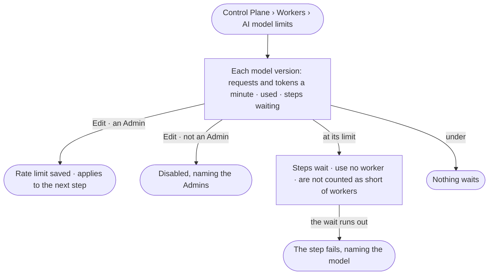

# CP-13 · See each AI model's rate limit and what waits on it

**As** an Admin **I want** each AI model's rate limit for the deployment, how much of it is used and what waits on it
**so that** I do not add workers that would only wait on a model.

Tasks: [task.md](task.md) · Feature: [CP-F04](../../feature.md)

## Who can

| Lens | Can | Otherwise sees |
|---|---|---|
| Admin | Read each AI model's rate limit, use and what waits; set a model's rate limit | — |
| Operator | Operator · Modeller: read each AI model's rate limit, use and what waits ([the role table](../../../../../access/features/AC-F02-access-policies/feature.md#the-role-table)) | *Edit* disabled — *Needs the Admin role — ask {admins}* |

## Flow

## Acceptance criteria

| # | Given | When | Then |
|---|---|---|---|
| CP-13.1 | Anyone signed in | they open *AI model limits* | each offered model version reads its requests and tokens a minute for the deployment, how much is used, and the steps waiting on it |
| CP-13.2 | A model at its limit | a step needs it | the step waits, holds no worker, and is not counted toward workers suggested (CP-08) |
| CP-13.3 | A step waiting on a model | its wait runs out | it fails — *{model} stayed at its rate limit past {wait}* — never as *cannot answer* |
| CP-13.4 | An Admin | they set a model version's requests or tokens a minute | it saves and applies to the next step that calls it; History records who changed it (AC-F06) |
| CP-13.5 | No AI model offered | the view opens | it says so and links to AI models (CP-01) |
| CP-13.6 | An Operator or a Modeller | they open *AI model limits*, or call its write route | every row reads; *Edit* is disabled — *Needs the Admin role — ask {admins}* — and the route answers 403 (CP-11.10) |
| CP-13.7 | A model version with no rate limit set | its row is read | it reads *No limit* |

## Screens

| Surface | Lens | First use | Empty after a filter | Loading | Has data | Failed | Agent working or proposing | No access |
|---|---|---|---|---|---|---|---|---|
| AI model limits | Admin | settings.workers · No AI model | — | settings.workers · Loading | settings.workers · AI model limits | settings.workers · Could not load | — | — |
| AI model limits | Operator | settings.workers · No AI model | — | settings.workers · Loading | settings.workers · AI model limits | settings.workers · Could not load | — | settings.workers · AI model limits · Read only |
| Edit a rate limit | Admin | — | — | — | settings.workers · Edit rate limit | settings.workers · Could not save | — | — |
| Edit a rate limit | Operator | — | — | — | — | — | — | settings.workers · AI model limits · Read only |
