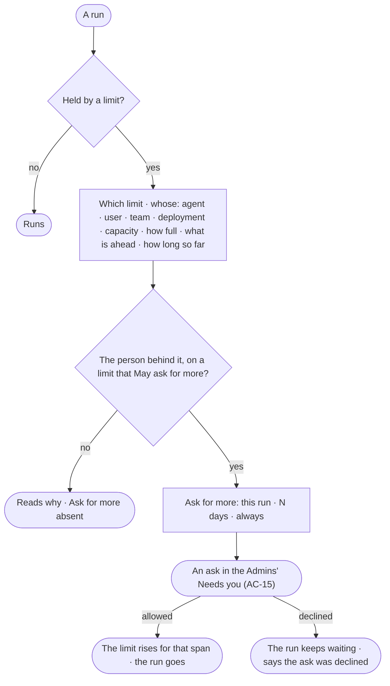

# CP-14 · Know why my run is held and ask for more

**As** an agent builder **I want** a run held by a limit to say which limit, whose it is, how full it is and what is
ahead of it, and to ask for more from there **so that** waiting is never a mystery.

Tasks: [task.md](task.md) · Feature: [CP-F04](../../feature.md)

## Who can

| Lens | Can | Otherwise sees |
|---|---|---|
| Admin | Read why any run is held; allow or decline an ask for more in Needs you; *Ask for more* on a run they are behind | *Ask for more* absent on a run someone else is behind |
| Operator | Operator · Modeller: read why a run is held; *Ask for more* on a run they are behind, when its limit *May ask for more* ([the role table](../../../../../access/features/AC-F02-access-policies/feature.md#the-role-table)) | *Ask for more* absent on anyone else's run, or on a limit that does not take asks |

## Flow

## Acceptance criteria

| # | Given | When | Then |
|---|---|---|---|
| CP-14.1 | A run held by a limit | it is opened | it says which limit — runs at once, tokens a month, an AI model's rate limit, or a capacity's slots — whose it is — the agent's, the person's, a team's or the deployment's — how full it is, and what is ahead of it |
| CP-14.2 | A held run | it is read | it says how long it has waited; waiting is never shown as failed |
| CP-14.3 | The person behind the run, on a limit that *May ask for more* | they press *Ask for more* | they pick this run · N days · always, and an ask reaches every Admin's Needs you (AC-15), naming the run, the limit, whose and how full |
| CP-14.4 | The ask allowed | an Admin allows it | the limit rises for that span — always writes the limit itself — and the run goes |
| CP-14.5 | The ask declined | an Admin declines it | the run keeps waiting and says the ask was declined |
| CP-14.6 | Anyone but the person behind the run, or a limit that does not take asks | they open the held run, or call the ask route | why it is held reads; *Ask for more* is absent, and the route answers 403 — *Only {person} can ask for more for this run.* · *{limit} does not take asks — ask {admins}.* |

## Screens

| Surface | Lens | First use | Empty after a filter | Loading | Has data | Failed | Agent working or proposing | No access |
|---|---|---|---|---|---|---|---|---|
| A held run | Admin | — | — | agents.run · Loading | agents.run · Held by a limit | agents.run · Ask declined | agents.run · Held by a limit | agents.run · Read only |
| A held run | Operator | — | — | agents.run · Loading | agents.run · Held by a limit | agents.run · Ask declined | agents.run · Held by a limit | agents.run · Read only |
