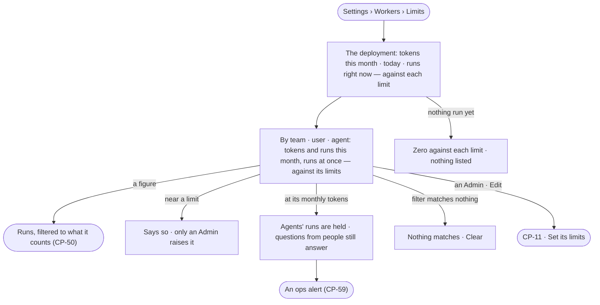

# CP-34 · Read what each team, user and agent spends against its limits

**As** anyone who runs agents **I want** what the deployment and each team, user and agent spends this month and has
running now, each against its limits **so that** I see what we spend before agents stop, and whose spend it is.

Tasks: [task.md](task.md) · Feature: [CP-F04](../../feature.md)

## Who can

| Access | Can | Otherwise sees |
|---|---|---|
| Admin | Read every team's, user's, agent's and the deployment's spend against its limits; change a limit from its row (CP-11) | — |
| Operator | read the same spend against every limit ([the permission catalogue](../../../../../access/features/AC-F02-access-policies/feature.md#the-permission-catalogue)) | *Edit* disabled — *Needs Edit on Deployment settings — ask {who can grant}* |

## Flow

## Acceptance criteria

| # | Given | When | Then |
|---|---|---|---|
| CP-34.1 | Anyone signed in | they open *Usage and limits* | the deployment's tokens this month, tokens today and runs right now read, each against its limit |
| CP-34.2 | Runs this month | the usage is read | *By team*, *By user* and *By agent* list each subject's tokens and runs this month and runs at once, against its own limits, as the engine stored them when each call settled |
| CP-34.3 | A deployment with no runs yet | the usage is read | each meter reads zero against its limit and each list says nothing has run |
| CP-34.4 | Spend near a limit | the usage is read | the meter says so, and that only an Admin raises a limit |
| CP-34.5 | A subject at its tokens a month | an agent would run | the run is held, naming the limit and whose (CP-11.9); a question a person asks still answers |
| CP-34.6 | An Operator | they open *Usage and limits* | everything reads; *Edit* is disabled — *Needs Edit on Deployment settings — ask {who can grant}* |
| CP-34.7 | An Admin | they open *Usage and limits* | each row offers *Edit*, which opens its limits (CP-11) |
| CP-34.8 | The usage cannot load | the page opens | it says it could not load and offers to try again |
| CP-34.9 | A figure — a team's, user's or agent's runs or tokens | it is pressed | Runs opens filtered to the runs it counts (CP-50) |
| CP-34.10 | A team, user or agent | it reaches its tokens a month | an ops alert is raised for it (CP-59), and its row reads *At its limit* |
| CP-34.11 | A filter by team, user or agent | nothing matches | it reads *Nothing matches*, with *Clear* |
| CP-34.12 | A raise allowed from *Ask for more* | its row is read | the grant reads beside the limit it raises — for which run, until when, or always — and who allowed it |
| CP-34.13 | Runs in the deployment | Usage opens | tiles read running · waiting · failed today · tokens today · tokens this month against the deployment's limit · ops alerts open, each as the engine counted it |
| CP-34.14 | Usage | *Group by* is set to User, Agent or Team | one row per person behind a run, agent or team, busiest first, each with running · waiting · failed · tokens · this month against its limit |
| CP-34.15 | A person on two teams behind a run | grouped by Team | the run counts under both teams, and the page reads *A run counts under each team of the person behind it* |
| CP-34.16 | A row with no limit set | it is read | its meter reads *No limit* |
| CP-34.17 | A row at or past its limit | it is read | its meter is marked at the limit and opens Limits for that team, user or agent |
| CP-34.18 | Any count | it is selected | Runs opens filtered to that user, agent or team, that state and that window |
| CP-34.19 | A run of the counts the reader may not read | they open it from a figure | it reads that it ran, its agent, the person behind it, its status and its tokens; its content is withheld (AC-31.2) |
| CP-34.20 | No run yet | Usage opens | tiles read `0` or `—` and *Nothing ran yet — a question, a task or a schedule starts a run* |
| CP-34.21 | A window in which nobody ran anything | the rows are read | *No one ran anything in {window}* and *Clear* |
| CP-34.22 | Runs start and end while it is open | the tiles are read | the counts move in place, at most once a second |
| CP-34.23 | Any figure | it is read | it is in tokens or a count; no cost is shown |

## Screens

| Surface | Access | First use | Empty after a filter | Loading | Has data | Failed | Agent working or proposing | No access |
|---|---|---|---|---|---|---|---|---|
| Usage | Admin | settings.limits · Usage · Nothing run yet | settings.limits · Usage · Nothing matches | settings.limits · Usage · Loading | settings.limits · Usage | settings.limits · Usage · Could not load | settings.limits · Usage · Live | — |
| Usage | Operator | settings.limits · Usage · Nothing run yet | settings.limits · Usage · Nothing matches | settings.limits · Usage · Loading | settings.limits · Usage · Read only | settings.limits · Usage · Could not load | settings.limits · Usage · Live | settings.limits · Usage · Read only |
| Usage · Group by | Admin | — | settings.limits · Usage · No one ran | — | settings.limits · Usage · Group by | — | — | — |
| Usage · Group by | Operator | — | settings.limits · Usage · No one ran | — | settings.limits · Usage · Group by · Read only | — | — | settings.limits · Usage · Read only |
| Near or at a limit | Admin | — | — | — | settings.limits · Usage · Near a limit | settings.limits · Usage · At its limit | — | — |
| Near or at a limit | Operator | — | — | — | settings.limits · Usage · Near a limit | settings.limits · Usage · At its limit | — | settings.limits · Usage · Read only |
