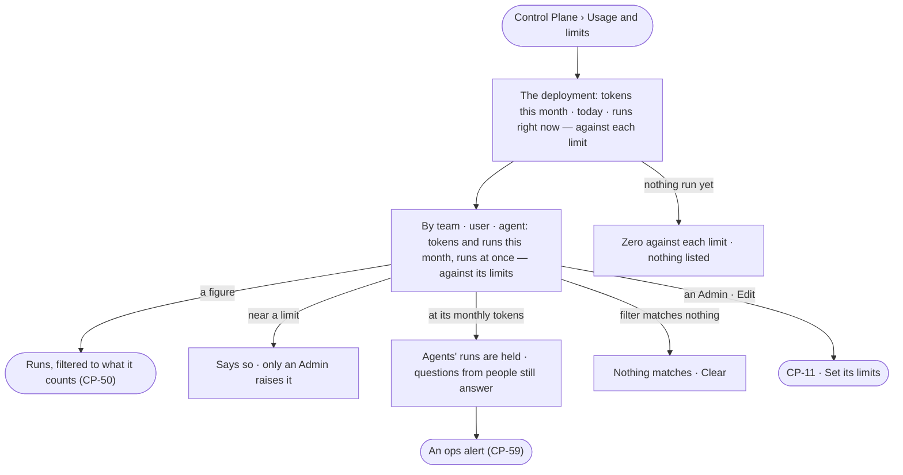

# CP-34 · Read what each team, user and agent spends against its limits

**As** anyone who runs agents **I want** what the deployment and each team, user and agent spends this month and has
running now, each against its limits **so that** I see what we spend before agents stop, and whose spend it is.

Tasks: [task.md](task.md) · Feature: [CP-F04](../../feature.md)

## Who can

| Lens | Can | Otherwise sees |
|---|---|---|
| Admin | Read every team's, user's, agent's and the deployment's spend against its limits; change a limit from its row (CP-11) | — |
| Operator | Operator · Modeller: read the same spend against every limit ([the role table](../../../../../access/features/AC-F02-access-policies/feature.md#the-role-table)) | *Edit* disabled — *Needs the Admin role — ask {admins}* |

## Flow

## Acceptance criteria

| # | Given | When | Then |
|---|---|---|---|
| CP-34.1 | Anyone signed in | they open *Usage and limits* | the deployment's tokens this month, tokens today and runs right now read, each against its limit |
| CP-34.2 | Runs this month | the usage is read | *By team*, *By user* and *By agent* list each subject's tokens and runs this month and runs at once, against its own limits, as the engine stored them when each call settled |
| CP-34.3 | A deployment with no runs yet | the usage is read | each meter reads zero against its limit and each list says nothing has run |
| CP-34.4 | Spend near a limit | the usage is read | the meter says so, and that only an Admin raises a limit |
| CP-34.5 | A subject at its tokens a month | an agent would run | the run is held, naming the limit and whose (CP-11.9); a question a person asks still answers |
| CP-34.6 | An Operator or a Modeller | they open *Usage and limits* | everything reads; *Edit* is disabled — *Needs the Admin role — ask {admins}* |
| CP-34.7 | An Admin | they open *Usage and limits* | each row offers *Edit*, which opens its limits (CP-11) |
| CP-34.8 | The usage cannot load | the page opens | it says it could not load and offers to try again |
| CP-34.9 | A figure — a team's, user's or agent's runs or tokens | it is pressed | Runs opens filtered to the runs it counts (CP-50) |
| CP-34.10 | A team, user or agent | it reaches its tokens a month | an ops alert is raised for it (CP-59), and its row reads *At its limit* |
| CP-34.11 | A filter by team, user or agent | nothing matches | it reads *Nothing matches*, with *Clear* |
| CP-34.12 | A raise allowed from *Ask for more* | its row is read | the grant reads beside the limit it raises — for which run, until when, or always — and who allowed it |

## Screens

| Surface | Lens | First use | Empty after a filter | Loading | Has data | Failed | Agent working or proposing | No access |
|---|---|---|---|---|---|---|---|---|
| Usage | Admin | settings.usage · Nothing run yet | settings.usage · Nothing matches | settings.usage · Loading | settings.usage | settings.usage · Could not load | — | — |
| Usage | Operator | settings.usage · Nothing run yet | settings.usage · Nothing matches | settings.usage · Loading | settings.usage · Read only | settings.usage · Could not load | — | settings.usage · Read only |
| Near or at a limit | Admin | — | — | — | settings.usage · Near a limit | — | — | — |
| Near or at a limit | Operator | — | — | — | settings.usage · Near a limit | — | — | — |
