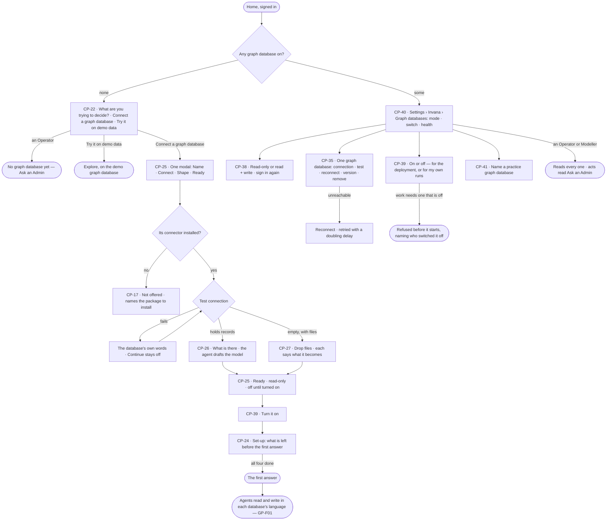
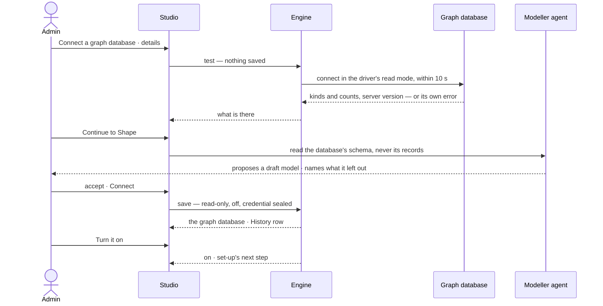

# Graph databases

> The Admin's controls for the graph databases the deployment connects — installing a connector, connecting one with
> its one credential, read-only or read + write, switched on or off, healthy or not, a practice graph database — and
> the steps from a fresh deployment to its first answer. How a connector reads, writes and joins them into the Graph is
> [GP-F01 · Data](../../../graph/features/GP-F01-data/feature.md). The decision it helps make: *which graph databases
> may agents read and write, and is each one working?*

## User journey

Journeys this feature is a step of: [J01 · From a fresh deployment to a first answer](../../../../journeys/J01-from-a-fresh-deployment-to-a-first-answer.md) · [J07 · Ready a deployment](../../../../journeys/J07-ready-a-deployment.md)

## Stories

| ID | Story | Status |
|---|---|---|
| CP-22 | [Start a fresh deployment from a question](stories/CP-22-start-a-fresh-deployment-from-a-question/story.md) | idea |
| CP-25 | [Connect a graph database in one modal of steps](stories/CP-25-connect-a-graph-database-in-one-modal-of-steps/story.md) | idea |
| CP-26 | [Connect a graph database that already holds data](stories/CP-26-connect-a-graph-database-that-already-holds-data/story.md) | idea |
| CP-27 | [Start from files with an empty graph database](stories/CP-27-start-from-files-with-an-empty-graph-database/story.md) | later |
| CP-24 | [See what is left before the first answer](stories/CP-24-see-what-is-left-before-the-first-answer/story.md) | idea |
| CP-38 | [Set a graph database read-only or read + write](stories/CP-38-set-a-graph-database-read-only-or-read-write/story.md) | idea |
| CP-39 | [Switch a graph database on or off](stories/CP-39-switch-a-graph-database-on-or-off/story.md) | idea |
| CP-40 | [See every graph database and its health](stories/CP-40-see-every-graph-database-and-its-health/story.md) | idea |
| CP-35 | [Keep a graph database connected](stories/CP-35-keep-a-graph-database-connected/story.md) | idea |
| CP-41 | [Name a practice graph database](stories/CP-41-name-a-practice-graph-database/story.md) | idea |
| CP-17 | [Install a graph connector and see it offered](stories/CP-17-install-a-graph-connector-and-see-it-offered/story.md) | idea |

## Access

The role each act needs is the one role table's row *Graph databases — connect, mode, switch, health*
([AC-F02 › The role table](../../../access/features/AC-F02-access-policies/feature.md#the-role-table)); this table
names the acts.

| Act | Role | Everyone else sees |
|---|---|---|
| Read every graph database — name, connector, address, database, mode, switch, health, server version, practice; never its credential | Operator · Modeller · Admin | — |
| Connect a graph database · change its connection · test · reconnect · read its types again · declare or accept a server version · remove it | Admin | The list and each graph database read; each act reads *Ask an Admin* |
| Set read-only or read + write | Admin, signing in again for read + write | The mode reads; *Change* reads *Ask an Admin* |
| Turn a graph database on or off for the deployment | Admin | The switch reads, with who set it and when; it reads *Ask an Admin* |
| Turn a graph database off, or back on, for the runs one is behind | Every signed-in person, for themselves | — |
| Name or unname a practice graph database | Admin | *Practice* reads; the act reads *Ask an Admin* |
| Install or remove a connector package | Admin — on the engine's machine, outside Studio | — |
| Read, write or search a graph database | An agent, within the mode and both switches set here ([GP-F01](../../../graph/features/GP-F01-data/feature.md)) | Refused before it starts, naming the rule, the mode or who switched it off |
| Start on a fresh deployment — *Connect a graph database* | Admin | *No graph database yet — Ask an Admin* |
| Try it on demo data | Operator · Modeller · Admin, when a demo graph database is on | — |

## States

| State | What the person sees |
|---|---|
| First use | No graph database on: Home asks *What are you trying to decide?* and offers *Connect a graph database* and, when there is one, *Try it on demo data* |
| Empty after a filter | Graph databases filtered to none: *No graph database matches* and *Clear* |
| Loading | A test says it is testing; Shape says the agent is reading the schema; the list draws its rows and fills health in place |
| Has data | Every graph database with its connector, mode, switch, health and last connected; set-up with each done step checked |
| Failed | A test failed in the database's own words; a name already used; a save refused with the reason; a connector not installed, naming its package |
| Agent working or proposing | The Modeller agent reading the schema and drafting the model, the draft shown for a decision before anything is saved |
| No access | Every graph database reads; each act reads *Ask an Admin*; the credential is never shown |

## Rules

| Rule | Detail |
|---|---|
| A graph database is one connection | One connector, one address, one database, one credential. The Graph is every graph database the deployment has on |
| Its name is a resource segment | Lowercase letters, digits and `_`, unique, fixed once saved — it is the `<graph database>` of `data/<graph database>/<kind>` in every rule |
| A test gates every save | Nothing is saved until the details passed a test — on the first save and on every change to address, user, password, database |
| The connector is fixed once saved | Address, user, password and database stay editable; a different connector is a different graph database |
| The credential is write-only | Sealed like every secret; the user reads back, the password field is blank — *Stored encrypted. Leave blank to keep it* |
| Read-only by default | A new graph database is read-only. Read + write is a second, deliberate act by an Admin who signs in again; both directions are History rows. A write to a read-only graph database is refused before the wire, naming it; every read is a read whatever the mode ([GP-F01](../../../graph/features/GP-F01-data/feature.md)) |
| New starts off | A new graph database is off until an Admin turns it on; nothing reads it while it is off |
| Two switches | The deployment's switch, an Admin's, is a hard off for everyone. A person's own switch narrows only the runs they are behind and never turns on what the deployment has off |
| Off means refused, named | Work that needs a graph database that is off — for the deployment or for the person behind it — is refused before it starts, naming who switched it off; a schedule skips its firing and raises an ops alert; a workflow that depends on it is flagged and its runs refused until it is on |
| Health is honest | Connected · unreachable · degraded, with the last time it connected and its latency; rotated credentials read unreachable, never silence. Work that needs no step on an unreachable graph database keeps answering |
| The server version decides the property types | Detected on connect, or declared by an Admin; a version Invana has not tested keeps the graph database read-only until an Admin accepts it |
| A practice graph database is never the Graph | It stands in for one graph database in an agent's or a skill's tests; no question, board, schedule or workflow reads it |
| Removing never touches the data | Removing a graph database removes Invana's records of it; the database's own data is untouched. It is refused while a rule, a match rule or a workflow names it |
| Set-up is the deployment's | Four required steps — a graph database is connected and on · a model is published · the Graph holds records · an AI model answers. Each is done because its fact exists, whoever made it and from wherever; only a skipped offer is stored |
| Each step opens a gate | *Connected* — reading the graph databases · *Modelled* — loading data and links between models · *Grounded* — answers that cite a record · *Answering* — asking, the Assistant and every agent run. A surface waits on the one gate it needs and names the step that opens it |
| Set-up owns no forms | Each step opens the place that makes its fact — Graph databases, Model, Records, AI models — with its command beside it |
| Agents read the schema, never records, to draft | The draft model comes from the kinds, properties and counts the database reports ([SE-F01](../../../../capabilities/semantics/features/SE-F01-start-a-model/feature.md)) |
| How a connector reads and writes | One package per database, two languages, one shape of answer, declared unsupported acts, the database's own vector index and the join across graph databases are [GP-F01 · Data](../../../graph/features/GP-F01-data/feature.md)'s |
| Leans on | How a connector reads and writes ([GP-F01](../../../graph/features/GP-F01-data/feature.md)) · signing in again ([AC-F01](../../../access/features/AC-F01-sign-in-account-and-sessions/feature.md)) · Access Policies on `data/…` ([AC-F02](../../../access/features/AC-F02-access-policies/feature.md)) · History ([AC-F06](../../../access/features/AC-F06-history/feature.md)) · drafting a model ([SE-F01](../../../../capabilities/semantics/features/SE-F01-start-a-model/feature.md)) · loads ([RC-F02](../../../../capabilities/records/features/RC-F02-bring-records-in/feature.md)) · AI models ([CP-F01](../CP-F01-ai-models/feature.md)) |

## Data touched

| Record | Read or write |
|---|---|
| Graph databases — name, connector, address, database, sealed credential, mode, switch, health, server version, practice | Read · write |
| A person's own switches | Read · write — their own |
| Set-up — derived from the facts; only a skipped offer is stored | Read · write a skip |
| The drafted model ([SE-F01](../../../../capabilities/semantics/features/SE-F01-start-a-model/feature.md)) | Write — a draft, never published here |
| Loads started from files ([RC-F02](../../../../capabilities/records/features/RC-F02-bring-records-in/feature.md)) | Write |
| History rows of every change ([AC-F06](../../../access/features/AC-F06-history/feature.md)) | Write |

## Engine

The low-level design: what this feature stores, serves and refuses. Conventions — naming, errors, lists, events — are
[system-design.md](../../../../system-design.md) §§ 6–8; this section only fills them in.

### Records

| Table | Columns | Notes |
|---|---|---|
| `control_graph_databases` | `name` (unique, `[a-z0-9_]+`, fixed once saved) · `description` · `connector` (its registered name under `invana.connectors`, fixed once saved) · `uri` · `database?` (blank is the connector's default) · `credential_sealed` · `mode` (`read_only` · `read_write`, default `read_only`) · `enabled` (default `false`) · `switched_by_id?` · `switched_at?` · `practice_for_id?` (the graph database a practice one stands in for) · `demo` · `status` (`connected` · `unreachable` · `degraded`) · `last_connected_at?` · `latency_ms?` · `server_version?` · `server_version_source` (`detected` · `declared`) · `compatibility_status` · `version_acknowledged_by_id?` · `created_by_id` · `created_at` · `updated_at` | Every record that belongs to one graph database carries `database_id` and cascades from it |
| `control_graph_database_switches` | `database_id` · `user_id` · `off_at` | A person's own off; a row exists only while it is off. Unique (`database_id`, `user_id`) |
| `control_setup` | `step` (an optional offer) · `skipped_by_id` · `skipped_at` | One row per skipped offer; required steps are never stored |

### Reads

| Record | Owner |
|---|---|
| Who may act and the role table | [AC-F02](../../../access/features/AC-F02-access-policies/feature.md#engine) |
| Signing in again for an act | [AC-F01](../../../access/features/AC-F01-sign-in-account-and-sessions/feature.md#engine) |
| Rules, match rules and workflows that name a graph database | [AC-F02](../../../access/features/AC-F02-access-policies/feature.md#engine) · [SE-F06](../../../../capabilities/semantics/features/SE-F06-links-and-mappings/feature.md#engine) · [AG-F06](../../../../capabilities/agents/features/AG-F06-plans-and-workflows/feature.md#engine) |
| The drafted model, and whether a model is published | [SE-F01](../../../../capabilities/semantics/features/SE-F01-start-a-model/feature.md#engine) · [SE-F02](../../../../capabilities/semantics/features/SE-F02-change-and-publish-a-model/feature.md#engine) |
| Loads — the first that succeeded | [RC-F02](../../../../capabilities/records/features/RC-F02-bring-records-in/feature.md#engine) |
| The default AI model and its last check | [CP-F01](../CP-F01-ai-models/feature.md#engine) |
| How a connector reads, writes and searches; its capabilities by server version; the join | [GP-F01](../../../graph/features/GP-F01-data/feature.md#engine) |
| History — every event this feature writes | [AC-F06](../../../access/features/AC-F06-history/feature.md#engine) |

### Routes

| Route, after `/api/v1/control` | Does | Story |
|---|---|---|
| `GET /graph-databases` | By the list contract — `?q=` name or address · `?f.connector=` · `?f.mode=` · `?f.enabled=` · `?f.status=` · `?f.practice=`. Each: `name` · `description` · `connector` · `language` · `uri` · `database` · `auth_username` · `mode` · `enabled` · `switched_by` · `switched_at` · `my_switch` (`on` · `off`) · `practice_for?` · `demo` · `status` · `last_connected_at` · `latency_ms` · `server_version` · `compatibility_status` | CP-40 |
| `POST /graph-databases/test` | Test details before anything is saved — `{connector, uri, auth, database?}` → `{ok, latency_ms?, server_version?, compatibility_status?, error?, discovered?: {node_labels, edge_labels, counts, indexes, constraints}}`; records nothing | CP-25 · CP-26 · CP-35 |
| `POST /graph-databases` | Connect — `{name, description?, connector, uri, auth, database?, model?}`: tests again, saves it read-only and off, seals the credential, writes the drafted model as a draft. `201` `{graph_database, model_id?, discovered}` | CP-25 · CP-26 |
| `GET /graph-databases/{name}` · `PATCH /graph-databases/{name}` | One graph database · change description, address, user, password or database after a passing test of the same details; a blank password keeps the stored one; takes `password` (signing in again) when the credential changes | CP-35 |
| `DELETE /graph-databases/{name}?confirm=<name>` | Remove Invana's records of it; takes `password` | CP-35 |
| `PUT /graph-databases/{name}/mode` | `{mode}` — `read_write` takes `password` | CP-38 |
| `PUT /graph-databases/{name}/switch` | `{enabled}` — the deployment's switch | CP-39 |
| `PUT /graph-databases/{name}/my-switch` | `{on}` — the caller's own switch | CP-39 |
| `PUT /graph-databases/{name}/practice` | `{practice_for: <name> \| null}` | CP-41 |
| `POST /graph-databases/{name}/ping` | *Reconnect* — try the saved connection again, refresh its status | CP-35 · CP-40 |
| `POST /graph-databases/{name}/introspect` | *Read types again*, in the background | CP-35 |
| `POST /graph-databases/{name}/acknowledge-version` · `PUT /graph-databases/{name}/version` | Accept an untested server version · declare one the connector cannot detect | CP-35 |
| `GET /setup` · `POST /setup/{step}` | The four required steps and the offers, derived on every read — `{step, done, completed_at?, skipped_at?, required, gate?, blocked_by?, broken?}` · `{act: skip · reset}` on an offer | CP-24 |
| `GET /connectors` | Every installed connector — `name` · `language` (`opencypher` · `gremlin`) · `package` · `version` · `state` (`loaded` · `failed`) · `error?` | CP-17 |

### Events

| Event | When |
|---|---|
| `control.graph_databases.create` · `control.graph_databases.update` · `control.graph_databases.delete` | Connected · its connection changed, which reconnects · removed, its name kept in `details` |
| `control.graph_databases.mode` | Read-only ↔ read + write — `{from, to}` |
| `control.graph_databases.switch` · `control.graph_databases.my_switch` | The deployment's switch · a person's own — `{enabled}` |
| `control.graph_databases.practice` | Named or unnamed a practice graph database — `{practice_for}` |
| `control.graph_databases.test` · `control.graph_databases.ping` · `control.graph_databases.introspect` · `control.graph_databases.introspect_completed` | A saved one tested · reconnected · its types read again, started · finished |
| `control.graph_databases.health_checked` · `control.graph_databases.reconnected` · `control.graph_databases.unreachable` | The engine's own check · its own reconnect · a graph database dropped — actor `system`; `unreachable` raises an ops alert |
| `control.graph_databases.version_detected` · `control.graph_databases.version_acknowledge` · `control.graph_databases.version_declare` | A version found · accepted · declared |
| `control.setup.skip` · `control.setup.reset` | An offer skipped · brought back |

### Refusals

| Status | When | Sentence | Criterion |
|---|---|---|---|
| 403 | Any write by a person whose role is not Admin — `role_required` | *This needs an Admin — ask {admins}.* | CP-40.6 · CP-35.13 · CP-38.6 · CP-39.7 · CP-41.5 |
| 401 | Read + write, a credential change or removal without the password, or with a key | *Sign in again to do this.* | CP-38.3 · CP-35.14 |
| 409 | A name another graph database holds | *{name} is already a graph database.* | CP-25.3 |
| 422 | A name with characters outside `[a-z0-9_]`, or a field past its length | *{field}: {why}.* | CP-25.3 |
| 422 | Connecting or saving details that fail their test — `connection_failed`, nothing written | *{the connector's own words}* | CP-25.9 · CP-26.3 · CP-35.6 |
| 409 | Saving details that have not passed a test | *Test the connection to save it.* | CP-35.5 |
| 422 | Changing the connector or the name once saved | *The {field} is fixed once saved.* | CP-35.8 |
| 409 | A write to a read-only graph database, or one on an untested server version, by any path — before the wire | *{name} is read-only — {why}.* | CP-38.5 · CP-35.17 |
| 409 | Work that needs a graph database that is off — `switched_off`, with who and when | *{name} is off — switched off by {person} {when}.* | CP-39.4 · CP-39.5 |
| 409 | Turning on, for oneself, a graph database the deployment has off | *{name} is off for the deployment — ask {admin}.* | CP-39.6 |
| 409 | Removing a graph database a rule, a match rule or a workflow names | *{name} is named by {what} — change {it} first.* | CP-35.12 |
| 422 | Removing with a `confirm` that is not its name | *Type {name} to remove it.* | CP-35.11 |
| 422 | A practice graph database standing in for itself, for a practice one, or for one with another connector | *{name} cannot stand in for {other} — {why}.* | CP-41.4 |
| 409 | A question, board, schedule or workflow step on a practice graph database | *{name} is for practice — it is never asked.* | CP-41.3 |
| 409 | A route whose gate is shut — `setup_incomplete`, with `gate` and `missing` | *{surface} opens when {step}.* | CP-24.6 |
| 422 | Skipping a required step | *{step} is required — it cannot be skipped.* | API only — Studio offers *Skip* only on an offer |
| 503 | *Read types again* while it is not connected | *{name} is not connected — reconnect first.* | CP-35.18 |
| 409 | A graph database whose connector is not installed | *{connector} is not installed — install {package}.* | CP-17.7 |

### CLI

| Command | Does |
|---|---|
| `invana databases list · show · test · add · update · remove --database <name>` | The routes, as the person signed in; `add` and `update` read the password from a prompt, never a flag |
| `invana databases mode <name> read-only · read-write` · `invana databases on · off <name> [--mine]` · `invana databases practice <name> --for <other>` | Mode, switches and practice |
| `invana version` | The engine version and every installed connector — name, language, package version — a failed one named with its package and error |

### Mechanisms

| Mechanism | How |
|---|---|
| Nothing before *Connect* | Testing and drafting write nothing; the one create call saves the graph database, read-only and off, and the draft model in one transaction, or nothing |
| A test | Builds a transient connector, connects in the driver's read mode within 10 seconds and discards it; `error` is the connector's own words, or *Connect timed out after 10s.* A save needs a passing test of the same details |
| The credential | Sealed under the install key like every secret ([system-design § 6](../../../../system-design.md#files-and-encryption)); never in an event, a log, a span or a ledger row |
| Admission | Before a run is dispatched the coordinator checks every graph database its plan names against `enabled`, the person's own switch and `status`; one that is off refuses the run, naming who switched it off ([CP-F03](../CP-F03-workers-and-the-queue/feature.md)) |
| Off, later | Turning a graph database off flags each workflow whose steps name it — its runs refused until it is on — and each schedule skips its next firing with an ops alert to the schedule's creator and the Admins |
| Health | The engine checks each graph database on a fixed interval and on every failure; a lost connection retries with a doubling delay (1 s, 2 s, 4 s …) up to `INVANA_GRAPH_RETRY_MAX_INTERVAL_S` (60); a failed attempt never cancels its own retry |
| Practice | A test run resolves `data/<graph database>/<kind>` for the graph database a practice one stands in for to the practice one; anything else that names a practice graph database is refused |
| Set-up is derived | `GET /setup` composes the steps from the facts on every read; `connected` — a graph database on with a passing last test · `modelled` — a published model · `grounded` — a load succeeded, or a graph database holds records of a published kind · `answering` — the default AI model passed its last check |
| Removing | Removes the graph database and every record that carries its `database_id`; its History rows stay, its name kept |
| How a connector reads and writes | Supported databases, the three layers, registration by entry point — what `GET /connectors` lists — the connector contract, querysets, one shape, vendor differences, capabilities by server version, vector search and conformance are [GP-F01 › Mechanisms](../../../graph/features/GP-F01-data/feature.md#mechanisms). Here an untested server version locks the graph database read-only until an Admin accepts it |

## System impact

| HLD section | Change | NFRs |
|---|---|---|
| § 6 Data and storage | Three tables in Postgres; credentials sealed like every secret | NFR-SEC-2 |
| § 8 APIs and events | The graph databases, their mode, switches, practice and set-up under `/api/v1/control`; `control.graph_databases.*` events | NFR-PERF-3 |
| § 9 Distributed execution | Admission refuses work on a graph database that is off, naming who switched it off | — |
| § 11 Failure modes | An unreachable graph database reads unreachable with when it last connected; work that needs no step on it keeps answering | NFR-REL-3 |
| § 12 Qualities | Security: read-only by default, a write to a read-only graph database refused before the wire, read + write needs the password again | NFR-SEC-4 · NFR-SEC-5 · NFR-SEC-9 |

## Decisions

| Decision | Detail |
|---|---|
| Graph databases are the deployment's | Settings › Invana › Graph databases; one list, Admin acts, everyone reads |
| Connecting is a modal of steps | Name · Connect · Shape · Ready on a step strip; it shows a person's own data back to them and asks for a decision at each step |
| The model is shaped while connecting | The Modeller agent reads the schema and proposes a draft before anything is saved; publishing happens in Model |
| The name is fixed | It is the resource segment every rule names; renaming would silently change what rules reach |
| Read + write needs the password | It widens what agents can do to customer data — a change to access ([NFR-SEC-4](../../../../system-design.md#3-non-functional-requirements)) |
| Reconnecting is an Admin's | It changes nothing the graph database holds, but the one role table gives Operators and Modellers reads only; an unreachable database raises an ops alert to the Admins |
| Demo data is a graph database | The developer setup connects one, marked demo; *Try it on demo data* opens Explore on it. An Admin switches it off or removes it like any other |
| The first-run question carries into the first ask | *What are you trying to decide?* is kept in the browser and put in the Assistant's composer when set-up is done — never sent by itself |
| Connectors need no switch | Installed is offered; a connector reaches a graph database, not the outside, so it is not a plugin |

## Open questions

| Question | Who answers |
|---|---|
| The one role table has no row for a person's own graph database switch; this feature lets every signed-in person narrow their own runs, as the glossary's *On · Off* says. Recommend: add *Graph databases — a person's own switch: Own · Own · Own* beside the plugins' row | Ravi |

## Not building

| Item | Why not |
|---|---|
| Installing a connector from Studio | Installs on premises run only what an Admin installed on the machine |
| Renaming a graph database | Its name is in every rule that reaches it |
| Connection pooling settings in Studio | Tuning belongs to configuration |
| A tour or a set-up page of its own | Each step opens the place that makes its fact; set-up steps aside at the first answer |
| Writing demo data into a person's own database | Demo data lives in its own graph database |
