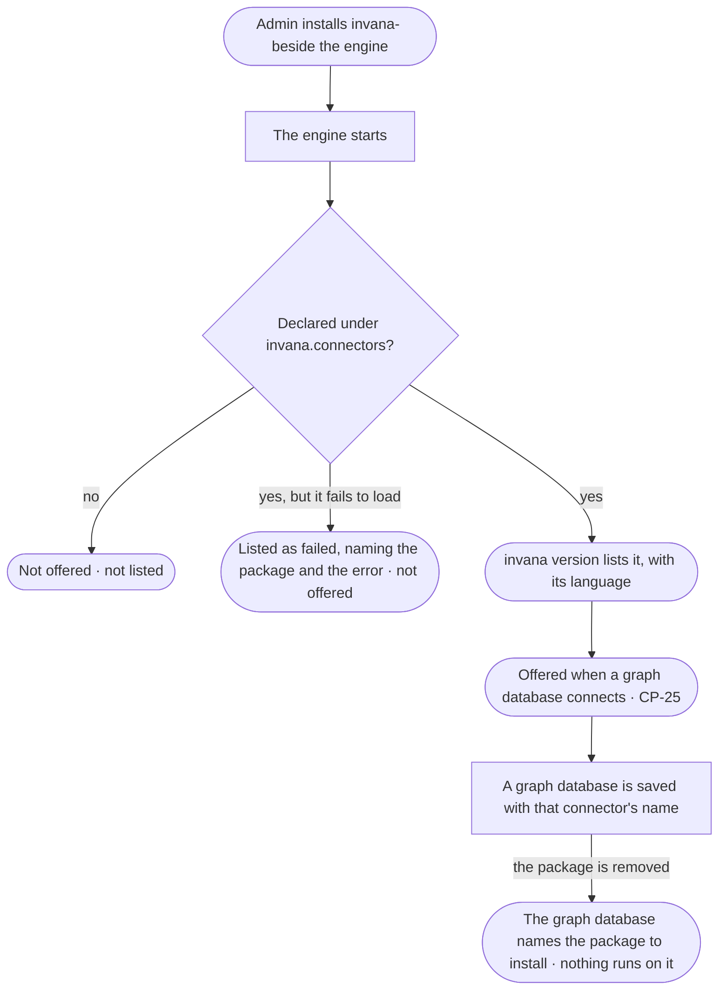

# CP-17 · Install a graph connector and see it offered

**As** an Admin **I want** to install the package for the graph database we run and have it offered by name when I
connect one **so that** the deployment connects to the databases we run, and through no connector we never installed.

Tasks: [task.md](task.md) · Feature: [CP-F05](../../feature.md)

## Who can

| Lens | Can | Otherwise sees |
|---|---|---|
| Admin | Install or remove a connector package on the engine's machine; read which connectors are installed | — |
| Operator | Read which connectors are installed, with their language, in a graph database's details and in `invana version` | Installs nothing — installing happens on the engine's machine, outside Invana |

## Flow

## Acceptance criteria

| # | Given | When | Then |
|---|---|---|---|
| CP-17.1 | A connector package installed beside the engine that declares a connector under the entry-point group `invana.connectors` | the engine starts | the connector is found by its registered name; no list in the engine names it |
| CP-17.2 | Installed connectors | someone runs `invana version` | it lists the engine version and every installed connector — its name, language and package version |
| CP-17.3 | Connecting a graph database (CP-25) | the connector choice draws | it offers every installed connector by name with its language — Neo4j, Memgraph and ArcadeDB in openCypher; JanusGraph, Amazon Neptune, TinkerGraph and ArcadeDB in Gremlin — and only those installed |
| CP-17.4 | A database whose package is not installed | an Admin looks for it while connecting | it is not offered; the step names the package that would add it |
| CP-17.5 | A package whose connector fails to load | the engine starts | the engine starts; `invana version` lists that connector as failed, naming the package and the error, and it is not offered |
| CP-17.6 | A saved graph database | it is stored | it names its connector by the registered name, never by a code path |
| CP-17.7 | A graph database whose connector's package was removed | it is read or a run reaches it | it says the connector is not installed, naming the package; nothing runs against it |
| CP-17.8 | Two packages that register the same name | the engine starts | neither is offered under that name; `invana version` names both packages |
| CP-17.9 | An Operator | they open a graph database's details | they read its connector and language; installing one is not offered anywhere in Invana |

## Screens

| Surface | Lens | First use | Empty after a filter | Loading | Has data | Failed | Agent working or proposing | No access |
|---|---|---|---|---|---|---|---|---|
| The connector choice | Admin | settings.databases.connect · No connector installed | — | — | settings.databases.connect | settings.databases.connect · Connector failed | — | — |
| The connector choice | Operator | — | — | — | — | — | — | — |
