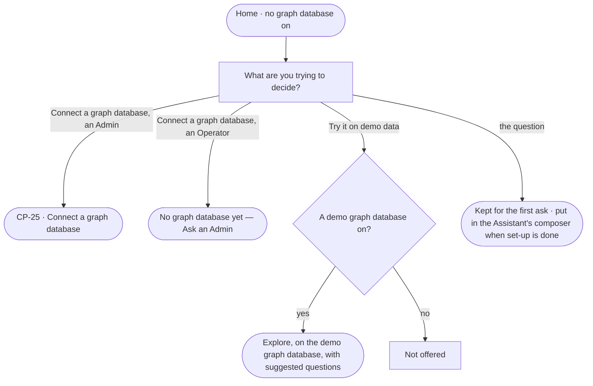

# CP-22 · Start a fresh deployment from a question

**As** the first person on a fresh deployment **I want** to be asked what I am trying to decide and offered the way in
**so that** an empty deployment is a start, not a wall.

Tasks: [task.md](task.md) · Feature: [CP-F05](../../feature.md)

## Who can

| Lens | Can | Otherwise sees |
|---|---|---|
| Admin | Answer the question · *Connect a graph database* · *Try it on demo data* when a demo graph database is on | — |
| Operator | Answer the question · *Try it on demo data* when a demo graph database is on | *Connect a graph database* reads *No graph database yet — Ask an Admin*, naming the Admins |

## Flow

## Acceptance criteria

| # | Given | When | Then |
|---|---|---|---|
| CP-22.1 | A deployment with no graph database on | a person signs in and Home opens | it asks *What are you trying to decide?* and offers *Connect a graph database* and, when a demo graph database is on, *Try it on demo data* |
| CP-22.2 | The question answered | an Admin picks *Connect a graph database* | the connect modal opens (CP-25) |
| CP-22.3 | The question answered | set-up's four steps are done | the Assistant's composer holds the answer, never sent until the person sends it |
| CP-22.4 | A demo graph database on | the person picks *Try it on demo data* | Explore opens on it with suggested questions |
| CP-22.5 | No demo graph database | Home draws | *Try it on demo data* is not offered |
| CP-22.6 | An Operator | they pick *Connect a graph database* | it reads *No graph database yet — Ask an Admin*, naming the Admins |
| CP-22.7 | First use | the person reads it | nothing it offers is experimental, and it promises nothing the deployment does not have |
| CP-22.8 | Home | it cannot read the graph databases | it says what it could not read, with *Try again* |

## Screens

| Surface | Lens | First use | Empty after a filter | Loading | Has data | Failed | Agent working or proposing | No access |
|---|---|---|---|---|---|---|---|---|
| Home | Admin | start.home · First use | — | start.home · Loading | start.home · Demo data | start.home · Could not load | — | — |
| Home | Operator | start.home · First use | — | start.home · Loading | start.home · Demo data | start.home · Could not load | — | start.home · First use · Ask an Admin |
