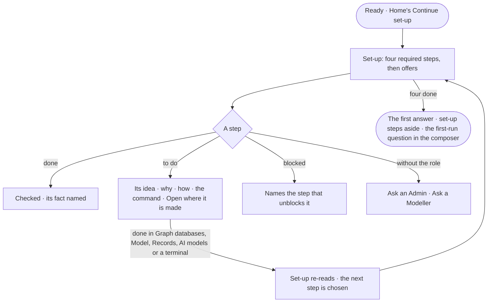

# CP-24 · See what is left before the first answer

**As** an Admin readying a fresh deployment **I want** to see what still stands between it and a first answer, and why
each step matters **so that** I can do it, or hand it to a Modeller or a terminal, without guessing.

Tasks: [task.md](task.md) · Feature: [CP-F05](../../feature.md)

## Who can

| Lens | Can | Otherwise sees |
|---|---|---|
| Admin | Read every step; open each one where its fact is made; skip or bring back an offer | — |
| Operator | Read every step, its idea and its command | Each step's act reads the role it needs — *Ask an Admin* for graph databases and AI models, *Ask a Modeller* for the model and records, naming who holds it |

## Flow

## Acceptance criteria

| # | Given | When | Then |
|---|---|---|---|
| CP-24.1 | A deployment with required steps outstanding | set-up opens | it lists the four required steps — a graph database is connected and on · a model is published · the Graph holds records · an AI model answers — with progress as *2 of 4* |
| CP-24.2 | A step whose fact exists | set-up reads | it is checked, whoever made the fact and from wherever — Studio, the command line or another person |
| CP-24.3 | A step to do | the person selects it | it shows its idea, why it matters, what it opens, two or three moves, the command filled in, and how to tell it worked |
| CP-24.4 | A step to do | the person opens it | the place that makes its fact opens — Graph databases, Model, Records or AI models; set-up has no form of its own |
| CP-24.5 | Bringing records in with no published model | set-up reads | the records step is blocked and names *Publish a model* |
| CP-24.6 | A surface a step shuts | the person opens it | it says which step opens it — *Ask opens when an AI model answers* — with the act that does it |
| CP-24.7 | Offers | set-up reads | they are listed after the required steps with no status, and never counted in progress |
| CP-24.8 | An Admin | they skip an offer, or bring one back | it is skipped or shown again for everyone |
| CP-24.9 | The four required steps done | set-up reads | it steps aside; it stays one click away from Home |
| CP-24.10 | A deployment mid set-up | Home draws | it shows the progress and *Continue set-up* |
| CP-24.11 | A person signing in to a ready deployment | Home opens | they never see set-up |
| CP-24.12 | An Operator | they reach a step's act | it reads the role it needs — *Ask an Admin* or *Ask a Modeller* — naming who holds it |
| CP-24.13 | The AI model failing its check | set-up reads | the step reads not done, and Explore and the console keep working — the step says so |

## Screens

| Surface | Lens | First use | Empty after a filter | Loading | Has data | Failed | Agent working or proposing | No access |
|---|---|---|---|---|---|---|---|---|
| Set-up | Admin | start.setup | — | start.setup · Loading | start.setup · Two of four | start.setup · Could not load | start.setup · Drafting below | — |
| Set-up | Operator | start.setup | — | start.setup · Loading | start.setup · Two of four | start.setup · Could not load | start.setup · Drafting below | start.setup · Ask an Admin |
| Home mid set-up | Admin | — | — | start.home · Loading | start.home · Continue set-up | start.home · Could not load | — | — |
| Home mid set-up | Operator | — | — | start.home · Loading | start.home · Continue set-up | start.home · Could not load | — | start.home · Continue set-up |
