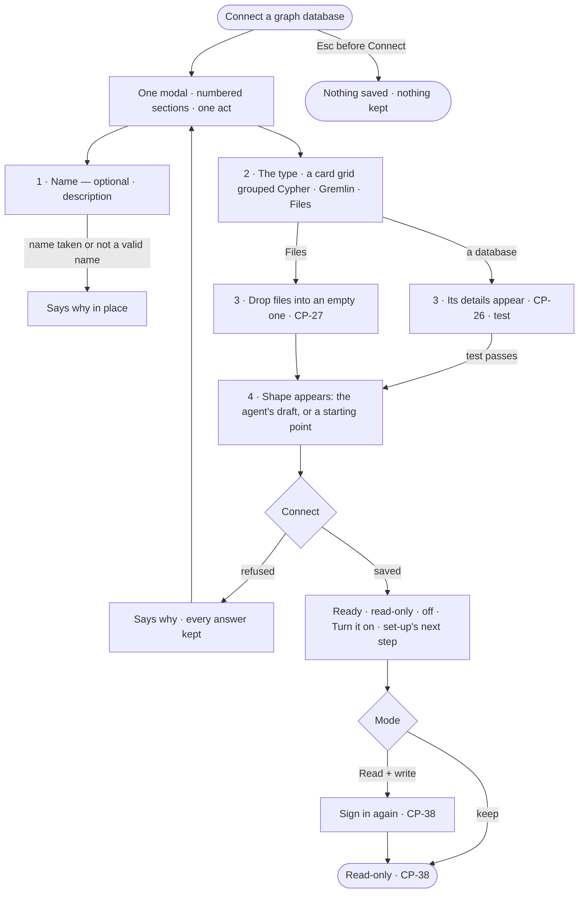

# CP-25 · Connect a graph database in one modal

**As** an Admin **I want** to connect a graph database by naming it, proving the connection and seeing the model the
agent drafts from what is there — on one page **so that** it joins Graph Data with a name people recognise,
read-only and off until I decide otherwise.

Tasks: [task.md](task.md) · Feature: [CP-F05](../../feature.md)

## Who can

| Access | Can | Otherwise sees |
|---|---|---|
| Admin | With Create on `setting/graph-databases`: every section; *Connect* saves the graph database read-only and off | — |
| Operator | — | *Connect a graph database* reads *Ask an Admin*; the modal never opens for them |

## Flow

## Acceptance criteria

| # | Given | When | Then |
|---|---|---|---|
| CP-25.1 | *Connect a graph database* | it opens | one modal on one page of numbered sections — **1** Name (optional) · **2** the type as a card grid grouped *Cypher · Gremlin · Files* — with one act, *Connect*, disabled until the sections it needs are filled; no step strip |
| CP-25.2 | Section 1 | the Admin types a name | it is checked as they type: lowercase letters, digits and `_`, and it says the name is how rules will name it; left blank, the name the engine will give — the type's, made unique (`neo4j`, `neo4j_2`) — shows as its placeholder |
| CP-25.3 | A name another graph database holds, or with other characters | it is typed | section 1 says why and *Connect* stays disabled |
| CP-25.4 | Section 2 | the Admin picks a card | section 3 appears beneath with that type's details — the connection and its test for a database (CP-26), *Drop files* for files into an empty one (CP-27); picking another card replaces section 3 |
| CP-25.5 | The test passed or the files read | section 4, *Shape*, appears and the Admin decides | they accept the agent's draft, change it, or pick an ontology, a starter, a description or blank (SE-F01) |
| CP-25.6 | Any moment before *Connect* | the Admin closes the modal | no graph database, credential or draft is saved |
| CP-25.7 | *Connect* | it succeeds | the graph database is saved read-only and off, its credential sealed, the draft model kept as a draft; History records who connected it |
| CP-25.8 | *Connect* succeeds | Ready replaces the sections, and | it says the graph database is read-only and off, with *Turn it on* (CP-39) and set-up's next step (CP-24) |
| CP-25.9 | *Connect* | the engine refuses — the test fails again, the name was taken meanwhile | it says why and keeps every answer |
| CP-25.10 | Ready | the Admin opens *How it got here* on the draft | it shows the agent's run that drafted it, the schema it read and what it left out |
| CP-25.11 | An Operator | they reach *Connect a graph database* | it reads *Ask an Admin*, naming the Admins |
| CP-25.12 | Ready | the Admin reads the mode | it reads *Read-only* with *Allow writes*, which asks the Admin to sign in again and then sets *Read + write* as CP-38 does; nothing is turned on until *Turn it on* (CP-39) |
| CP-25.13 | The sections of the modal | the Admin moves through them | each section reads its own state as it happens — the type picked, the credential saved sealed, *Testing*, *Connected*, the shape read, Ready — and the same states are the frames of the connect flow's journey |
| CP-25.14 | Ready | the Admin presses *Open* | the graph database's details open, read-only and off |
| CP-25.15 | Any section filled | the Admin presses *Close* | a confirm reads *Discard this connection?*, saying nothing is stored until Ready; *Discard* closes, *Keep going* returns to the section |
| CP-25.16 | A name taken, no connector installed or a connector that failed to load (CP-79) | the Admin picks the type or presses *Connect* | the section says which, names the package that would add it where one is missing, and keeps every answer; *Back* returns to the type picked |
| CP-25.17 | *Allow writes* on Ready | the Admin signs in again | the graph database reads *Read + write* in its details, still off; a wrong password returns to the same *Sign in again* with the message |

## Screens

| Surface | Access | First use | Empty after a filter | Loading | Has data | Failed | Agent working or proposing | No access |
|---|---|---|---|---|---|---|---|---|
| Name and type | Admin | settings.databases · Connect | — | — | settings.databases · Connect · Type picked | settings.databases · Connect · Name taken · No connector installed · Connector failed | — | — |
| Name and type | Operator | — | — | — | — | — | — | settings.databases · Read only |
| Type picked · Cypher form | Admin | — | — | — | settings.databases · Connect · Type picked · Neo4j · Memgraph · ArcadeDB | — | — | — |
| Type picked · Cypher form | Operator | — | — | — | — | — | — | settings.databases · Read only |
| Type picked · Gremlin form | Admin | — | — | — | settings.databases · Connect · Type picked · JanusGraph · Neptune · TinkerGraph · ArcadeDB | — | — | — |
| Type picked · Gremlin form | Operator | — | — | — | — | — | — | settings.databases · Read only |
| 4 · Shape | Admin | settings.databases · Connect · Shape · A starting point | — | settings.databases · Connect · Shape · Reading | settings.databases · Connect · Shape | settings.databases · Connect · Shape · Unreachable | settings.databases · Connect · Shape · Drafting | — |
| 4 · Shape | Operator | — | — | — | — | — | — | settings.databases · Read only |
| Ready | Admin | settings.databases · Connect · Ready | — | — | settings.databases · Connect · Ready | settings.databases · Connect · Ready · Could not connect | settings.databases · Connect · Ready · Drafting below | — |
| Ready | Operator | — | — | — | — | — | — | settings.databases · Read only |
| Ready · Mode | Admin | settings.databases · Connect · Ready · Mode | — | — | settings.databases · Connect · Ready · Mode | settings.databases · Connect · Ready · Could not connect | — | — |
| Ready · Mode | Operator | — | — | — | — | — | — | settings.databases · Read only |
| Ready · Allow writes | Admin | — | — | — | access.signin · Sign in again · Set read + write | access.signin · Sign in again · Set read + write · Wrong password | — | — |
| Ready · Allow writes | Operator | — | — | — | — | — | — | settings.databases · Read only |
| Ready · Read + write | Admin | — | — | — | settings.databases · Detail · Read + write | settings.databases · Detail · Could not change mode | — | — |
| Ready · Read + write | Operator | — | — | — | — | — | — | settings.databases · Read only |
| Ready · Open | Admin | — | — | — | settings.databases · Detail · Read-only | — | — | — |
| Ready · Open | Operator | — | — | — | — | — | — | settings.databases · Read only |
| Close before Connect | Admin | — | — | — | settings.databases · Connect · Discard this connection? | — | — | — |
| Close before Connect | Operator | — | — | — | — | — | — | settings.databases · Read only |
