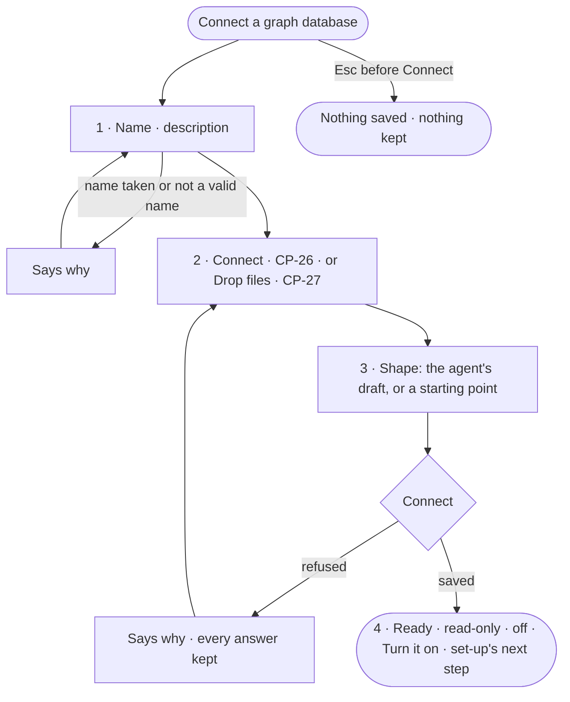

# CP-25 · Connect a graph database in one modal of steps

**As** an Admin **I want** to connect a graph database by naming it, proving the connection and seeing the model the
agent drafts from what is there — one step at a time **so that** it joins the Graph with a name people recognise,
read-only and off until I decide otherwise.

Tasks: [task.md](task.md) · Feature: [CP-F05](../../feature.md)

## Who can

| Lens | Can | Otherwise sees |
|---|---|---|
| Admin | Every step; *Connect* saves the graph database read-only and off | — |
| Operator | — | *Connect a graph database* reads *Ask an Admin*; the modal never opens for them |

## Flow

## Acceptance criteria

| # | Given | When | Then |
|---|---|---|---|
| CP-25.1 | *Connect a graph database* | it opens | one modal with a step strip — Name · Connect · Shape · Ready — on step 1 |
| CP-25.2 | Step 1 | the Admin types a name | it is checked as they type: lowercase letters, digits and `_`, and it says the name is how rules will name it |
| CP-25.3 | A name another graph database holds, or with other characters | they continue | it says why and stays on step 1 |
| CP-25.4 | Step 1 | the Admin picks where the data is | step 2 is *Connect* for a database that holds data or will, *Drop files* for files into an empty one |
| CP-25.5 | Step 3 | the Admin decides | they accept the agent's draft, change it, or pick an ontology, a starter, a description or blank (SE-F01) |
| CP-25.6 | Any step before *Connect* | the Admin closes the modal | no graph database, credential or draft is saved |
| CP-25.7 | *Connect* | it succeeds | the graph database is saved read-only and off, its credential sealed, the draft model kept as a draft; History records who connected it |
| CP-25.8 | Ready | it opens | it says the graph database is read-only and off, with *Turn it on* (CP-39) and set-up's next step (CP-24) |
| CP-25.9 | *Connect* | the engine refuses — the test fails again, the name was taken meanwhile | it says why and keeps every answer |
| CP-25.10 | Ready | the Admin opens *How it got here* on the draft | it shows the agent's run that drafted it, the schema it read and what it left out |
| CP-25.11 | An Operator | they reach *Connect a graph database* | it reads *Ask an Admin*, naming the Admins |

## Screens

| Surface | Lens | First use | Empty after a filter | Loading | Has data | Failed | Agent working or proposing | No access |
|---|---|---|---|---|---|---|---|---|
| 1 · Name | Admin | settings.databases.connect | — | — | settings.databases.connect · Named | settings.databases.connect · Name taken | — | — |
| 1 · Name | Operator | — | — | — | — | — | — | settings.databases · Read only |
| 3 · Shape | Admin | settings.databases.connect.shape · A starting point | — | settings.databases.connect.shape · Reading | settings.databases.connect.shape | settings.databases.connect.shape · Unreachable | settings.databases.connect.shape · Drafting | — |
| 3 · Shape | Operator | — | — | — | — | — | — | — |
| 4 · Ready | Admin | settings.databases.connect.ready | — | — | settings.databases.connect.ready | settings.databases.connect.ready · Could not connect | settings.databases.connect.ready · Drafting below | — |
| 4 · Ready | Operator | — | — | — | — | — | — | — |
