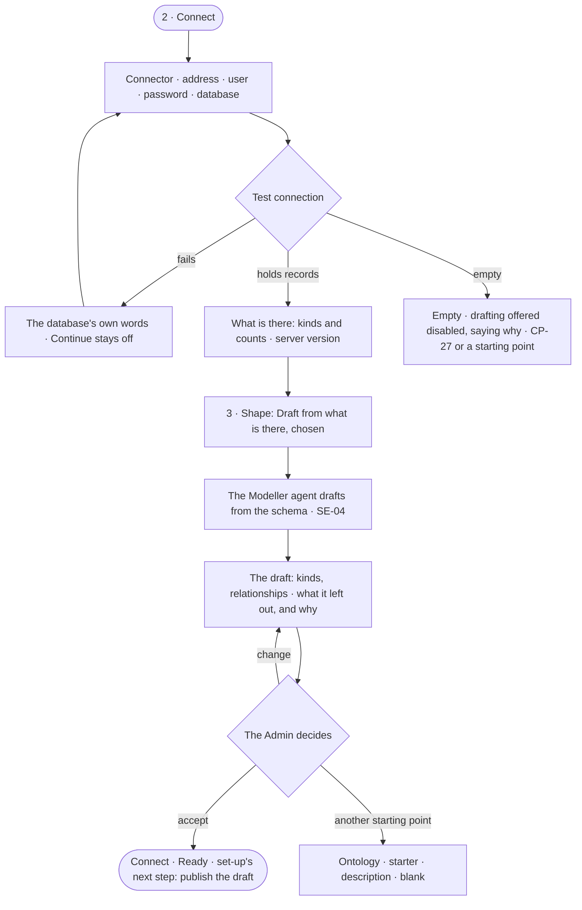

# CP-26 · Connect a graph database that already holds data

**As** an Admin whose team already runs a graph database **I want** to connect it, see what it holds and get a drafted
model to review **so that** our existing data answers questions in minutes, without anything copied out of it.

Tasks: [task.md](task.md) · Feature: [CP-F05](../../feature.md)

## Who can

| Lens | Can | Otherwise sees |
|---|---|---|
| Admin | Pick the connector, give the details, test, accept or change the agent's draft | — |
| Operator | — | The modal never opens for them (CP-25.11) |

## Flow

## Acceptance criteria

| # | Given | When | Then |
|---|---|---|---|
| CP-26.1 | Step 2 · Connect | it draws | the installed connectors with their query languages, then address, user, password and database name |
| CP-26.2 | Connection details | the Admin tests them | it says it is testing; a pass reports what the database holds — kinds and counts — and its server version, with nothing saved |
| CP-26.3 | A failed test | it returns | the database's own error shows under the fields and *Continue* stays off |
| CP-26.4 | Details changed after a pass | the Admin looks for *Continue* | it is off until the test passes again |
| CP-26.5 | A database that holds records | step 3 opens | *Draft from what is there* is chosen, and the Modeller agent drafts the model from the schema, never from records (SE-04) |
| CP-26.6 | An empty database | step 3 opens | *Draft from what is there* is shown disabled — *The database holds nothing yet* — and the other starting points are offered |
| CP-26.7 | The agent's draft | it is shown | it lists the kinds and relationships it drafted and every kind it left out, each with why |
| CP-26.8 | The draft accepted | the Admin connects | the draft is kept unpublished, and set-up's next step is to review and publish it in Model |
| CP-26.9 | A database that holds records of a published kind | it is turned on | set-up counts the records step done |
| CP-26.10 | The password | it is saved | it is sealed and never read back |

## Screens

| Surface | Lens | First use | Empty after a filter | Loading | Has data | Failed | Agent working or proposing | No access |
|---|---|---|---|---|---|---|---|---|
| 2 · Connect | Admin | settings.databases.connect · Connect | — | settings.databases.connect · Testing | settings.databases.connect · Connected | settings.databases.connect · Test failed | — | — |
| 2 · Connect | Operator | — | — | — | — | — | — | — |
| 3 · Shape | Admin | settings.databases.connect.shape · Nothing there yet | — | settings.databases.connect.shape · Reading | settings.databases.connect.shape | settings.databases.connect.shape · Unreachable | settings.databases.connect.shape · Drafting | — |
| 3 · Shape | Operator | — | — | — | — | — | — | — |
