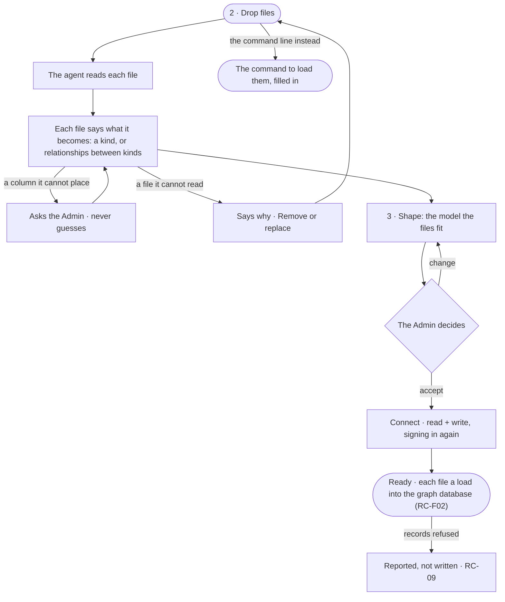

# CP-27 · Start from files with an empty graph database

**As** an Admin with CSV files and an empty graph database **I want** to drop my files, see what each becomes and get a
model they fit **so that** we get from files to a first answer without an engineer.

Tasks: [task.md](task.md) · Feature: [CP-F05](../../feature.md)

## Who can

| Lens | Can | Otherwise sees |
|---|---|---|
| Admin | Drop files, answer the agent's questions, accept or change the model, connect and load | — |
| Operator | — | The modal never opens for them (CP-25.11) |

## Flow

## Acceptance criteria

| # | Given | When | Then |
|---|---|---|---|
| CP-27.1 | Step 2 · Drop files | the Admin drops CSV files | each file shows its name, rows and what it becomes — a kind, or relationships between kinds |
| CP-27.2 | A column the agent cannot place | the file is read | the agent asks what it is, with a recommendation, and does not go on for that file until it is answered |
| CP-27.3 | A file that cannot be read | it is dropped | it says why, with *Remove* and *Replace* |
| CP-27.4 | Step 3 | it opens | the model the files fit is shown before anything is loaded |
| CP-27.5 | The model accepted | the Admin connects | the graph database is saved read + write after they sign in again (CP-38), and each file is a load batch — the Records upload (RC-08) — checked against the model |
| CP-27.6 | Records that do not fit | a load runs | they are rejected record by record, each named, and set-up's records step reads what landed (RC-09) |
| CP-27.7 | Step 2 | the Admin prefers the command line | it shows the command to load the files, filled in for this graph database and model |
| CP-27.8 | A load | the Admin opens *How it got here* | it shows each file, the kind it became, and the records written and refused |

## Screens

| Surface | Lens | First use | Empty after a filter | Loading | Has data | Failed | Agent working or proposing | No access |
|---|---|---|---|---|---|---|---|---|
| 2 · Drop files | Admin | settings.databases.connect.files · No files yet | — | settings.databases.connect.files · Reading | settings.databases.connect.files | settings.databases.connect.files · Cannot read | settings.databases.connect.files · A column asked | — |
| 2 · Drop files | Operator | — | — | — | — | — | — | — |
| 3 · Shape | Admin | — | — | settings.databases.connect.shape · Reading | settings.databases.connect.shape · From files | — | settings.databases.connect.shape · Drafting | — |
| 3 · Shape | Operator | — | — | — | — | — | — | — |
| 4 · Ready | Admin | — | — | settings.databases.connect.ready · Loading below | settings.databases.connect.ready | settings.databases.connect.ready · Records refused | settings.databases.connect.ready · Loading below | — |
| 4 · Ready | Operator | — | — | — | — | — | — | — |
