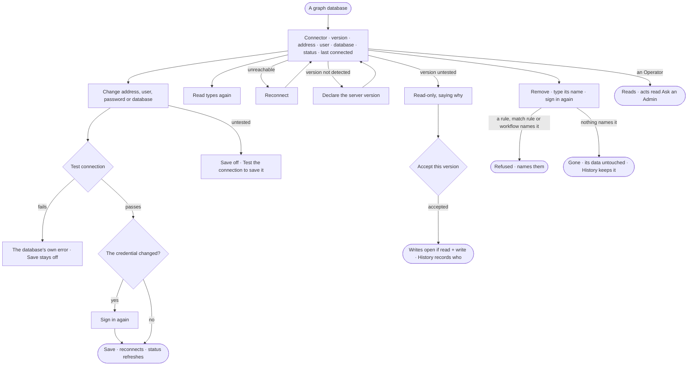

# CP-35 · Keep a graph database connected

**As** an Admin **I want** one graph database's connection in one place — proven to work before anything depends on
it, reconnected when it drops, and removable without touching its data **so that** the Graph rests on connections that
were proven, and nothing is built on one that never was.

Tasks: [task.md](task.md) · Feature: [CP-F05](../../feature.md)

## Who can

| Lens | Can | Otherwise sees |
|---|---|---|
| Admin | Change description, address, user, password or database after a passing test; reconnect; read the types again; declare a server version or accept an untested one; remove it — signing in again for a credential change and for removal | — |
| Operator | Read the graph database — connector, server version, address, user, database, mode, switch, status | The password field is absent; *Save*, *Test connection*, *Reconnect*, *Read types again*, *Declare version*, *Accept this version* and *Remove* read *Ask an Admin* |

## Flow

## Acceptance criteria

| # | Given | When | Then |
|---|---|---|---|
| CP-35.1 | A graph database | it opens | a summary reads — connector and server version, address, status and when it last connected — then address, user, password, database, mode and switch |
| CP-35.2 | A saved graph database | it opens | the user reads back; the password field is blank, saying it is stored encrypted and blank keeps it |
| CP-35.3 | A blank password | the Admin tests or saves | the stored password is used |
| CP-35.4 | A blank database | it reads | it says *connector default*, never an invented name |
| CP-35.5 | A change to address, user, password or database | it has not passed *Test connection* | *Save* is off, saying *Test the connection to save it* |
| CP-35.6 | A test that fails | it returns | the database's own error shows under the fields and *Save* stays off |
| CP-35.7 | A test that passes | the Admin saves | it reconnects; the status reads connector, server version, kind count and mode, in that order |
| CP-35.8 | A saved graph database | the Admin looks for the connector or the name | both are fixed; only description, address, user, password and database change |
| CP-35.9 | A test | it runs | History records who tested it and when |
| CP-35.10 | An unreachable graph database | the Admin presses *Reconnect* | it tries again and the status refreshes, saying when it last connected |
| CP-35.11 | Remove | the Admin types a name that is not this one | it is refused, saying *Type {name} to remove it* |
| CP-35.12 | A graph database a rule, a match rule or a workflow names | the Admin removes it | it is refused, naming each of them |
| CP-35.13 | An Operator or a Modeller | they reach any act | it reads *Ask an Admin*, naming the Admins; the password field is absent |
| CP-35.14 | A credential change or a removal | the Admin sends it | they are asked for their password for this act; a wrong password or a key is refused and nothing changes |
| CP-35.15 | Nothing names it | the Admin removes it, typing its name and signing in again | it is gone from the list and from the Graph; the database's own data is untouched; History keeps who removed it, with its name |
| CP-35.16 | A connector that cannot detect its server version | the Admin declares the version | it is saved, and the property types the model offers follow it, as a detected version would |
| CP-35.17 | A server version Invana has not tested | the graph database reads | it is read-only, saying the version is untested, with *Accept this version* |
| CP-35.18 | A graph database that is not connected | the Admin presses *Read types again* | it is refused, saying it is not connected, with *Reconnect* |
| CP-35.19 | A connected graph database | the Admin presses *Read types again* | its types are read again in the background, and *What the database holds* shows what changed |
| CP-35.20 | An untested version | the Admin accepts it | writes open if it is read + write; History records who accepted it, and when |

## Screens

| Surface | Lens | First use | Empty after a filter | Loading | Has data | Failed | Agent working or proposing | No access |
|---|---|---|---|---|---|---|---|---|
| Connection | Admin | — | — | settings.databases.database · Loading | settings.databases.database | settings.databases.database · Test failed | — | — |
| Connection | Operator | — | — | settings.databases.database · Loading | settings.databases.database · Read only | settings.databases.database · Unreachable · Read only | — | settings.databases.database · Read only |
| Server version | Admin | settings.databases.database · Declare version | — | settings.databases.database · Loading | settings.databases.database · Untested version | settings.databases.database · Test failed | — | — |
| Server version | Operator | — | — | settings.databases.database · Loading | settings.databases.database · Untested version · Read only | settings.databases.database · Unreachable · Read only | — | settings.databases.database · Read only |
| Remove | Admin | — | — | — | settings.databases.database · Remove | settings.databases.database · Named by rules | — | — |
| Remove | Operator | — | — | — | — | — | — | settings.databases.database · Read only |
| Sign in again | Admin | — | — | — | access.sign_in_again | access.sign_in_again · Wrong password | — | — |
| Sign in again | Operator | — | — | — | — | — | — | — |
