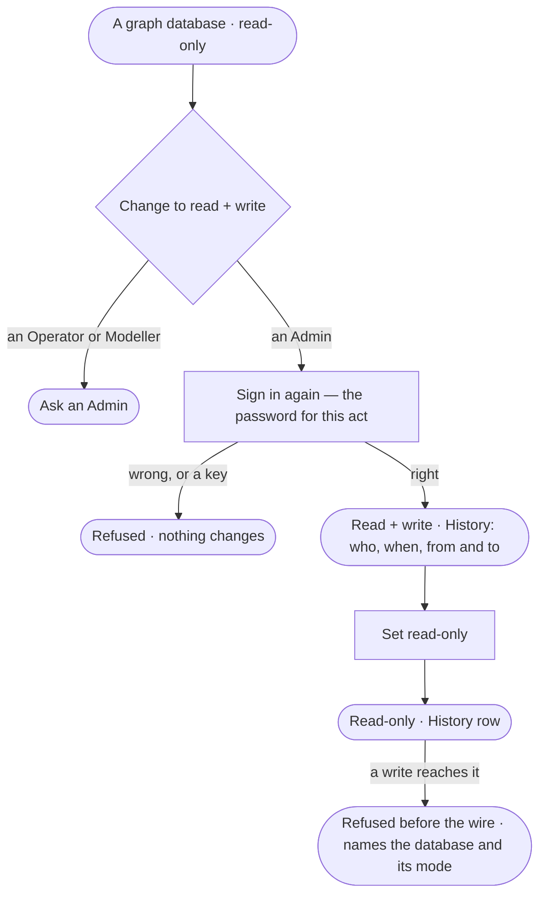

# CP-38 · Set a graph database read-only or read + write

**As** an Admin **I want** each graph database read-only unless I deliberately let agents write to it **so that** no
annotation, load or fix lands in a database whose owners never agreed to it.

Tasks: [task.md](task.md) · Feature: [CP-F05](../../feature.md)

## Who can

| Lens | Can | Otherwise sees |
|---|---|---|
| Admin | Set read + write, signing in again; set read-only | — |
| Operator | Read each graph database's mode, who set it and when | *Change* reads *Ask an Admin*, naming the Admins |

## Flow

## Acceptance criteria

| # | Given | When | Then |
|---|---|---|---|
| CP-38.1 | A new graph database | it is saved | it is read-only |
| CP-38.2 | A read-only graph database | an Admin sets it read + write | they are asked for their password for this act, and the mode changes only after it |
| CP-38.3 | The password wrong, missing, or the act made with a key | the change is sent | it is refused and the mode is unchanged |
| CP-38.4 | A mode change, either way | it is saved | History records who changed it, when, and from what to what |
| CP-38.5 | A read-only graph database | a load, an edit, an annotation, a derived fact or an agent's write reaches it | it is refused before the wire, naming the graph database and its mode |
| CP-38.6 | An Operator or a Modeller | they reach *Change* | it reads *Ask an Admin*, naming the Admins |
| CP-38.7 | Any graph database | the list or its details draw | its mode reads in words — *Read-only* · *Read + write* — with who set it and when |
| CP-38.8 | A read on a read + write graph database | it runs | it still runs in the driver's read mode |

## Screens

| Surface | Lens | First use | Empty after a filter | Loading | Has data | Failed | Agent working or proposing | No access |
|---|---|---|---|---|---|---|---|---|
| Mode | Admin | settings.databases.database · Read-only | — | settings.databases.database · Loading | settings.databases.database · Read + write | settings.databases.database · Could not change mode | — | — |
| Mode | Operator | settings.databases.database · Read-only · Read only | — | settings.databases.database · Loading | settings.databases.database · Read + write · Read only | settings.databases.database · Could not load | — | settings.databases.database · Read + write · Read only |
| Sign in again | Admin | — | — | — | access.sign_in_again | access.sign_in_again · Wrong password | — | — |
| Sign in again | Operator | — | — | — | — | — | — | — |
