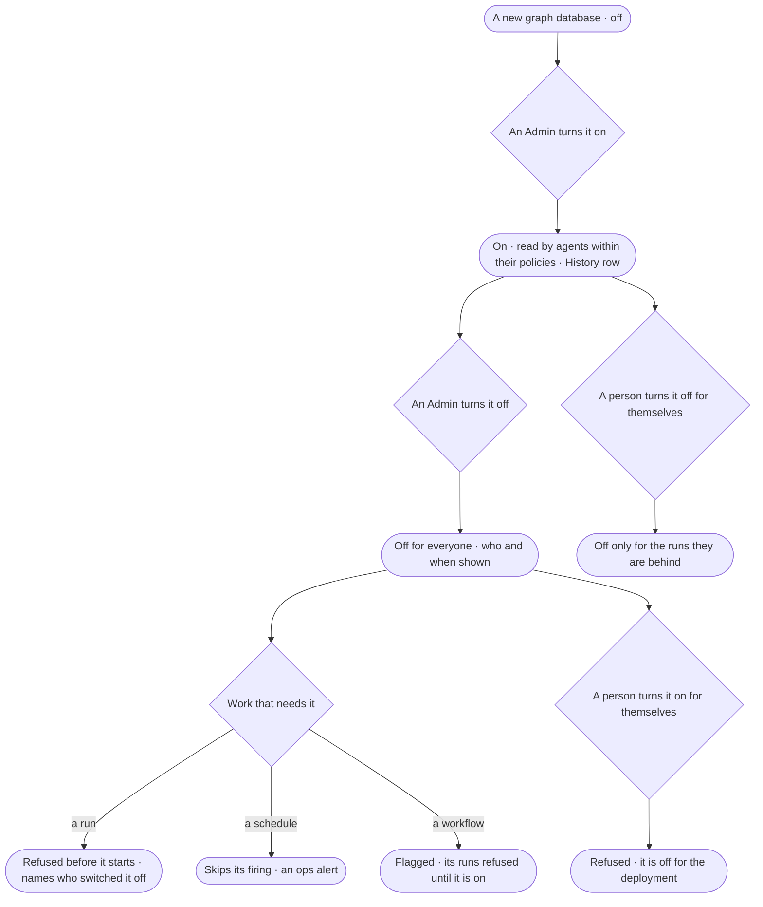

# CP-39 · Switch a graph database on or off

**As** an Admin **I want** to turn a graph database on when it is ready and off when it must not be read — and each
person to turn one off for their own runs **so that** no agent reads a database nobody meant it to, and nobody waits on
a refusal that does not say why.

Tasks: [task.md](task.md) · Feature: [CP-F05](../../feature.md)

## Who can

| Lens | Can | Otherwise sees |
|---|---|---|
| Admin | Turn a graph database on or off for the deployment; turn one off or on for their own runs | — |
| Operator | Turn a graph database off, or back on, for the runs they are behind | The deployment's switch reads, with who set it and when; it reads *Ask an Admin* |

## Flow

## Acceptance criteria

| # | Given | When | Then |
|---|---|---|---|
| CP-39.1 | A new graph database | it is saved | it is off, and nothing reads it |
| CP-39.2 | An Admin | they turn a graph database on or off | it holds for everyone from the next step; History records who and when |
| CP-39.3 | A graph database off | the list draws | it reads *Off*, naming who switched it off and when |
| CP-39.4 | A graph database the deployment has off | a run's plan needs it | the run is refused before it starts, naming who switched it off |
| CP-39.5 | A person who turned a graph database off for themselves | a run they are behind needs it | it is refused before it starts, saying they switched it off, with *Turn it on* |
| CP-39.6 | A graph database the deployment has off | a person turns it on for themselves | it is refused, saying it is off for the deployment and naming the Admin |
| CP-39.7 | An Operator | they reach the deployment's switch | it reads *Ask an Admin*, naming the Admins |
| CP-39.8 | A schedule whose work needs a graph database that is off | it fires | it skips the firing and raises an ops alert to its creator and the Admins |
| CP-39.9 | A workflow whose steps name a graph database that is off | the list of workflows reads | it is flagged, naming the graph database, and its runs are refused until it is on |
| CP-39.10 | A person's own switch | another person's run reads the graph database | it is unaffected |

## Screens

| Surface | Lens | First use | Empty after a filter | Loading | Has data | Failed | Agent working or proposing | No access |
|---|---|---|---|---|---|---|---|---|
| Switches in the list | Admin | settings.databases · New and off | — | settings.databases · Loading | settings.databases | settings.databases · Could not switch | — | — |
| Switches in the list | Operator | settings.databases · New and off · Read only | — | settings.databases · Loading | settings.databases · My switch | settings.databases · Off for the deployment | — | settings.databases · Read only |
