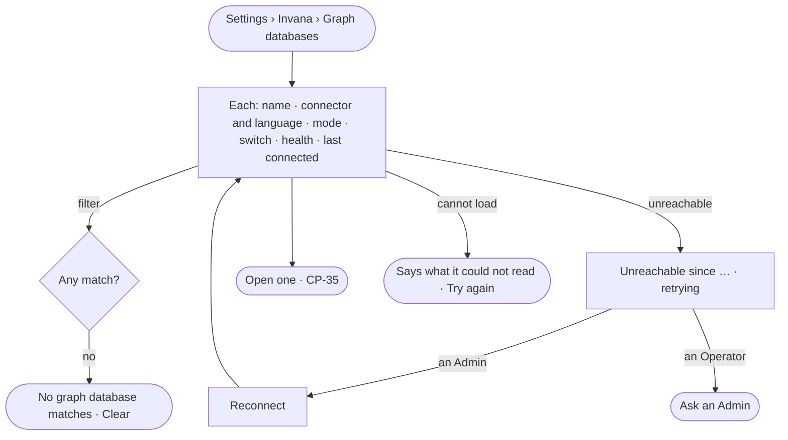

# CP-40 · See every graph database and its health

**As** an Admin **I want** every graph database the deployment connects in one list — its connector, mode, switch and
whether it is answering **so that** I see at a glance what the Graph is made of and which part of it is down.

Tasks: [task.md](task.md) · Feature: [CP-F05](../../feature.md)

## Who can

| Lens | Can | Otherwise sees |
|---|---|---|
| Admin | Read every graph database; reconnect one; open one; *Connect a graph database* | — |
| Operator | Read every graph database — never its credential | *Reconnect* and *Connect a graph database* read *Ask an Admin* |

## Flow

## Acceptance criteria

| # | Given | When | Then |
|---|---|---|---|
| CP-40.1 | Graph databases | the list opens | each row reads its name, connector and language, mode, switch, health — connected · unreachable · degraded — and when it last connected |
| CP-40.2 | A filter on connector, mode, switch, health or practice | it matches nothing | it reads *No graph database matches* with *Clear* |
| CP-40.3 | A graph database whose credentials were rotated outside Invana | the list reads | it reads unreachable, with when it last connected — never silence |
| CP-40.4 | An unreachable graph database | an Admin presses *Reconnect* | it tries again and the status refreshes |
| CP-40.5 | An unreachable graph database | work needs no step on it | that work keeps answering; work that needs it is refused before it starts, naming it |
| CP-40.6 | An Operator or a Modeller | they reach *Reconnect* or *Connect a graph database* | it reads *Ask an Admin*, naming the Admins |
| CP-40.7 | The health of every graph database | it is shown | it comes from the engine's own check; Studio derives nothing |
| CP-40.8 | A graph database becomes unreachable | the engine sees it | an ops alert reaches the Admins |

## Screens

| Surface | Lens | First use | Empty after a filter | Loading | Has data | Failed | Agent working or proposing | No access |
|---|---|---|---|---|---|---|---|---|
| Graph databases | Admin | settings.databases · None yet | settings.databases · No match | settings.databases · Loading | settings.databases | settings.databases · Could not load | — | — |
| Graph databases | Operator | settings.databases · None yet · Read only | settings.databases · No match | settings.databases · Loading | settings.databases · Read only | settings.databases · Could not load | — | settings.databases · Read only |
| An unreachable one | Admin | — | — | — | settings.databases · Unreachable | settings.databases · Unreachable | — | — |
| An unreachable one | Operator | — | — | — | settings.databases · Unreachable · Read only | settings.databases · Unreachable · Read only | — | settings.databases · Unreachable · Read only |
