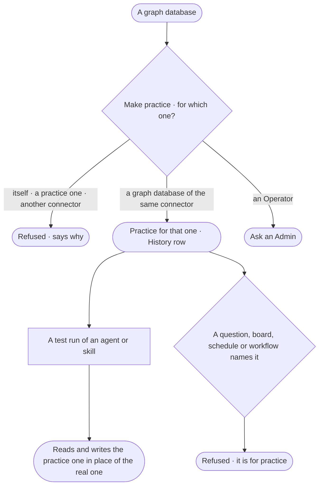

# CP-41 · Name a practice graph database

**As** an Admin **I want** to name a graph database as the practice copy of another **so that** agent builders test
agents and skills against data shaped like the real thing, and no test ever reads or writes the one people ask.

Tasks: [task.md](task.md) · Feature: [CP-F05](../../feature.md)

## Who can

| Lens | Can | Otherwise sees |
|---|---|---|
| Admin | Name a graph database as practice for another, or unname it | — |
| Operator | Read which graph databases are practice, and for which | *Make practice* reads *Ask an Admin*, naming the Admins |

## Flow

## Acceptance criteria

| # | Given | When | Then |
|---|---|---|---|
| CP-41.1 | A graph database of the same connector as another | an Admin makes it practice for that one | it reads *Practice for {name}* in the list; History records who and when |
| CP-41.2 | A practice graph database | an agent's or a skill's test runs | each step on `data/{name}/<kind>` for the graph database it stands in for reads and writes the practice one instead, as the agent's policies allow |
| CP-41.3 | A practice graph database | a question, a board, a schedule or a workflow step names it | it is refused, saying it is for practice |
| CP-41.4 | Practice for itself, for a practice one, or for one of another connector | an Admin saves it | it is refused, saying why |
| CP-41.5 | An Operator or a Modeller | they reach *Make practice* | it reads *Ask an Admin*, naming the Admins |
| CP-41.6 | A practice graph database | the Graph's model and answers are read | it is never part of them |
| CP-41.7 | A practice graph database | an Admin unnames it | it is an ordinary graph database again, off until an Admin turns it on |

## Screens

| Surface | Lens | First use | Empty after a filter | Loading | Has data | Failed | Agent working or proposing | No access |
|---|---|---|---|---|---|---|---|---|
| Practice | Admin | settings.databases.database · Make practice | — | settings.databases.database · Loading | settings.databases · Practice | settings.databases.database · Cannot be practice | — | — |
| Practice | Operator | — | — | settings.databases.database · Loading | settings.databases · Practice · Read only | — | — | settings.databases.database · Read only |
