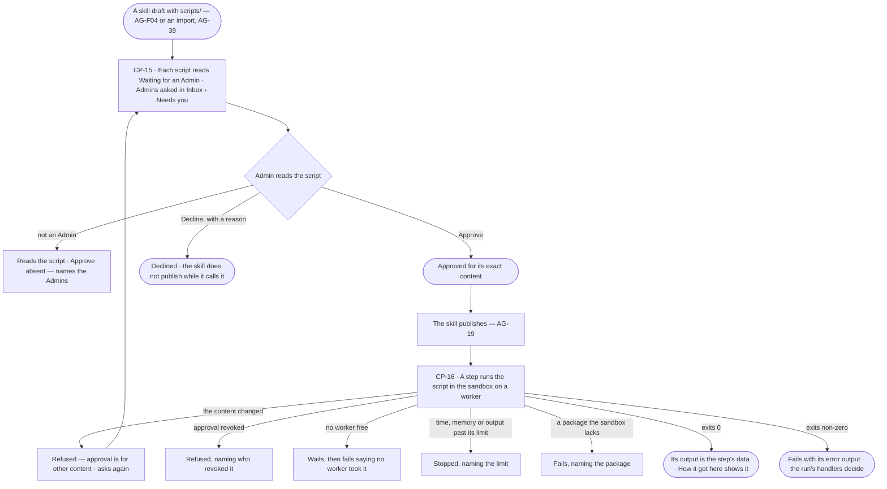
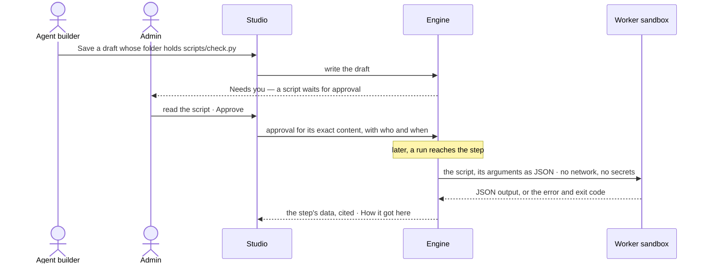

# Skill scripts

> A skill's `scripts/*.py` run exactly as written, in a sandbox on a worker, once an Admin has approved each one — no
> rewrite into a function, no code Invana generates. The decision it helps make: *may this script run on our
> machines, and did it do what the step needed?*

## User journey

## Stories

| ID | Story | Status |
|---|---|---|
| CP-15 | [Approve a skill's script once and let it run unchanged](stories/CP-15-approve-a-skills-script-once-and-let-it-run-unchanged/story.md) | idea |
| CP-16 | [See what a skill's script did and why it stopped](stories/CP-16-see-what-a-skills-script-did-and-why-it-stopped/story.md) | idea |

## Access

| Act | Role ([the role table](../../../access/features/AC-F02-access-policies/feature.md#the-role-table)) | Everyone else sees |
|---|---|---|
| Read a skill's scripts and whether each is approved | Every signed-in person — Operator, Modeller, Admin | — |
| Approve, decline or revoke a script | Admin | *Approve*, *Decline* and *Revoke* are absent; the script reads *Waiting for an Admin*, naming the Admins |
| Add or change a script in a skill's draft | Modeller · Admin, as [AG-F04](../../../../capabilities/agents/features/AG-F04-skills/feature.md) says | As AG-F04 |
| Read a script step on a run — its arguments, output, exit and limits | Whoever may read the run's content ([AC-31](../../../access/features/AC-F09-what-left-the-platform/stories/AC-31-keep-a-runs-content-to-those-who-may-read-it/story.md)) | That the step ran, its status and its time — arguments and output withheld |

## States

| State | What the person sees |
|---|---|
| First use | A skill with no `scripts/` shows no Scripts list; Inbox › Needs you holds no script asks |
| Empty after a filter | — |
| Loading | The Scripts list holds its rows; a script step reads *Running in the sandbox…* |
| Has data | Each script with its approval — approved by whom and when, waiting, declined with the reason — and its content; a script step with its arguments, output, exit code, time and memory |
| Failed | A declined or revoked script names who and why; a stopped step names the limit; a missing package is named |
| Agent working or proposing | A script step running in the sandbox |
| No access | Scripts read; approval acts are absent, naming the Admins; a script step on a run whose content the reader may not read shows only that it ran and its status |

## Rules

| Rule | Detail |
|---|---|
| Run as written | A script runs byte for byte as the skill folder holds it; Invana never rewrites, wraps or generates code |
| One approval per content | An Admin approves a script's exact content once; every skill version carrying the same content keeps it; a changed byte waits for approval again |
| No approval, no run | A script waiting, declined or revoked never runs; a skill whose plan calls one does not publish, and a published one whose approval is revoked refuses that step |
| Sandboxed on a worker | It runs on a worker (CP-F03), never in the engine serving Studio: no network, no secrets, no graph connection; it reads its arguments and its own skill folder, writes only a scratch folder dropped when it ends |
| Bounded | Time, memory and output size are capped by the install; past a cap the script is stopped, naming it |
| Python the worker runs | The standard library and the packages the sandbox carries; an import of anything else fails, naming the package |
| JSON in, JSON out | Arguments arrive as JSON on standard input; the output is the JSON it prints; anything else on standard output fails the step |
| Output is data | What a script returns is cited by the step, never obeyed as an instruction |
| A step, like any step | A skill's plan calls a script as a step, or a guided skill offers it as a tool; either way the agent runs it with Run on `skill/<name>` and its policies decide ([AC-F04](../../../access/features/AC-F04-what-an-agent-may-touch/feature.md)) |
| A script needs nothing | It reads no data and reaches nothing, so its function declares no needs ([CP-F02](../CP-F02-plugins-and-outside-tools/feature.md#rules)); a script that needs data gets it as arguments from an earlier step |
| Every run records it | The script's content fingerprint, its arguments, output, exit code, time and memory are kept on the step |
| Leans on | Skills (AG-F04) · import (AG-F08) · workers (CP-F03) · asks in the Inbox (AC-F05) · History (AC-F06) · run privacy (AC-31) |

## Data touched

| Record | Read or write |
|---|---|
| A skill version's folder — its `scripts/` | Read |
| Script approvals — content fingerprint, state, by whom, when, reason | Write (Admin) · read |
| A script step on a run — fingerprint, arguments, output, exit code, time, memory, the limit that stopped it | Write · read |
| Asks for approval in Inbox › Needs you (AC-F05) | Write · read |
| History rows of every approve, decline and revoke (AC-F06) | Write |

## Engine

The low-level design: what this feature stores, serves and refuses. Conventions — naming, errors, lists, events — are
[system-design.md](../../../../system-design.md) §§ 6–8; this section only fills them in.

### Records

| Table | Columns | Notes |
|---|---|---|
| `control_script_approvals` | `fingerprint` (sha256 of the script's bytes, the key) · `state` (`waiting` · `approved` · `declined` · `revoked`) · `path` · `first_skill_version_id` · `added_by_id` · `decided_by_id?` · `decided_at?` · `reason?` | Install-wide, one row per content: every skill version carrying the same bytes reads the same row |

### Reads

| Record | Owner |
|---|---|
| A skill version's folder and its `scripts/`, publishing and *Run a test* | [AG-F04](../../../../capabilities/agents/features/AG-F04-skills/feature.md#engine) |
| An imported skill folder | [AG-F08](../../../../capabilities/agents/features/AG-F08-portable-agents-and-skills/feature.md#engine) |
| The step row a script runs as, its `result` and the run's trace | [CP-F10](../CP-F10-runs-and-how-the-agents-are-doing/feature.md#engine) |
| The asks every Admin gets | [AC-F05](../../../access/features/AC-F05-asks-and-approvals/feature.md#engine) |
| Workers carrying the `code` label | [CP-F03](../CP-F03-workers-and-the-queue/feature.md#engine) |
| History rows of every approve, decline and revoke | [AC-F06](../../../access/features/AC-F06-history/feature.md#engine) |

### Routes

| Route, after `/api/v1/agents/skills/{name}` | Does | Story |
|---|---|---|
| `GET /scripts?version=` | The version's scripts — `path` · `fingerprint` · `state` · who decided and when · `reason` · `content` | CP-15 |

| Route, after `/api/v1/control/scripts` | Does | Story |
|---|---|---|
| `GET /{fingerprint}` | One script's content, its approval and the skill versions that carry it | CP-15 |
| `POST /{fingerprint}/approve` · `POST /{fingerprint}/decline` · `POST /{fingerprint}/revoke` | Approve · decline `{reason}` · revoke `{reason}` | CP-15 |

### Events

| Event | When |
|---|---|
| `control.scripts.ask` | A new fingerprint waits; an ask goes to every Admin |
| `control.scripts.approve` · `control.scripts.decline` · `control.scripts.revoke` | An Admin decides, with the reason for a decline or revoke |

### Refusals

| Status | When | Sentence | Criterion |
|---|---|---|---|
| 403 | Approve, decline or revoke by anyone but an Admin | *Only an Admin approves scripts — {admins}.* | CP-15.10 |
| 409 | Publishing a version whose plan calls a script not approved | *{path} is {state} — it cannot publish until an Admin approves it.* | CP-15.4 · CP-15.7 |
| step refused | A script waiting, declined, revoked, or whose bytes differ from what was approved — in a run or *Run a test* | *{path} is not approved: {state}{, by whom}.* | CP-15.8 · CP-16.7 · CP-16.10 |
| step failed | A script past the time, memory or output cap | *Stopped at the {cap} cap — {value}.* | CP-16.4 |
| step failed | An import the sandbox does not carry | *The sandbox has no {package}.* | CP-16.5 |
| step failed | A network connection or a write outside the scratch folder | *The sandbox denied {act}.* | CP-16.6 |
| step failed | A non-zero exit, or standard output that is not JSON | *Exited {code}: {error output}.* | CP-16.3 |

### CLI

| Command | Does |
|---|---|
| — | No command of its own |

### Mechanisms

| Mechanism | How |
|---|---|
| A new script asks | Saving or importing a skill version fingerprints each `scripts/*.py`; a fingerprint with no row writes one `waiting` and one AC-F05 ask per Admin; the first answer closes them all |
| A script step | The function `skill.script` — `bound none` · `needs []` · `resources code` — args `path` · `input`; its queue is `tools.code`. Before dispatch the fingerprint of the bytes the version holds must be `approved` |
| Who reads a step | The step's arguments and output are run content: read as [AC-F09](../../../access/features/AC-F09-what-left-the-platform/feature.md#engine) allows; anyone else reads that it ran, its status and its time |
| The sandbox | A process on a `code` worker: Python 3.14 and the install's fixed packages; no network, no secrets, no graph connection; reads its arguments as JSON on standard input and its own skill folder; writes only a scratch folder dropped when it ends |
| Caps | `INVANA_SCRIPT_TIMEOUT_S` (60) · `INVANA_SCRIPT_MEMORY_MB` (512) · `INVANA_SCRIPT_OUTPUT_KB` (1,024), set once for the install and read on every script step |
| What it returns | Exit 0 with JSON on standard output is the step's output; anything else fails the step with the exit code and the error output |
| What a step records | On the step's `result`: `script` (`path` · `fingerprint`) · `input` · `output` · `exit_code` · `time_ms` · `memory_mb` · `stopped_by?` (the cap and its value) · the worker |
| Revoke | Sets `revoked`; a step dispatched after it is refused; a step already running finishes |

## System impact

| HLD section | Change | NFRs |
|---|---|---|
| § 6 Data and storage | One install-wide table of approvals by fingerprint | — |
| § 9 Distributed execution | Script steps run only on workers labelled `code`, in a sandbox | — |
| § 12 Qualities | Security: outside code runs only once an Admin approved its exact bytes, isolated from the network, secrets and the graph | — |

## Decisions

| Decision | Detail |
|---|---|
| Approval lives on the skill's sheet | A *Scripts* list on the skill's folder, each script readable in full, with *Approve* and *Decline* for an Admin |
| Admins are asked | A script waiting for approval is an ask in Inbox › Needs you for every Admin; the first answer settles it |
| The sandbox is the install's | Its caps and its packages are set once for the install and read on every script step |
| A fingerprint, not a version | Approval keys on the script's content, so moving it between skill versions unchanged asks nothing |
| Not built yet | Approvals, the sandbox and script steps have no engine yet |

## Open questions

| Question | Who answers |
|---|---|
| Which packages does the sandbox carry beyond the standard library — none (recommended for the first build), or a list Ravi names? | Ravi |
| May an Admin allow network for one script? Recommend: no — a script that needs the outside is a tool plugin (CP-F02) | Ravi |

## Not building

| Item | Why not |
|---|---|
| Turning a script into a function | It runs unchanged; a library's functions are AG-F08 |
| Languages other than Python | The skill folders Invana reads carry Python; one sandbox is enough |
| Network, secrets or a graph connection inside the sandbox | A script that reaches out is a tool plugin, governed as one |
| Installing packages per script | Installs on premises run only what an Admin approved; the sandbox's packages are fixed |
| Approving all of a skill's scripts at once | Each script is code an Admin reads |
| Running scripts in the engine | Outside code runs on workers |
