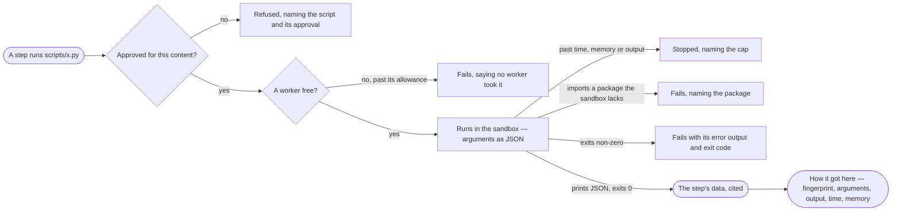

# CP-16 · See what a skill's script did and why it stopped

**As** an agent builder **I want** every script step of a run to show what went in, what came out and why it stopped
**so that** I can tell a script that is wrong from a sandbox that held it back, and fix the right one.

Tasks: [task.md](task.md) · Feature: [CP-F06](../../feature.md)

## Who can

| Lens | Can | Otherwise sees |
|---|---|---|
| Admin | Read every script step on any run; run a test of a draft that calls a script | — |
| Operator | Read the script steps of a run whose content they may read — one they are behind, or of an agent they own (AC-31) | *Run a test* disabled — *Needs the Modeller role — ask Priya or Lee*; with the Modeller role, as Admin for their own drafts. On any other run a script step shows only that it ran, its status and its time |

## Flow

## Acceptance criteria

| # | Given | When | Then |
|---|---|---|---|
| CP-16.1 | An approved script | a step runs it | it runs on a worker in the sandbox, its arguments on standard input as JSON, with no network, no secrets and no graph connection |
| CP-16.2 | A script that prints JSON and exits 0 | it ends | its output is the step's data, cited by the step, never followed as an instruction |
| CP-16.3 | A script that exits non-zero, or prints something that is not JSON | it ends | the step fails with the exit code and its error output; the run's handlers decide what follows |
| CP-16.4 | A script past the install's time, memory or output cap | it runs | it is stopped, and the step names the cap and the value |
| CP-16.5 | A script that imports a package the sandbox does not carry | it runs | the step fails, naming the package |
| CP-16.6 | A script that opens a network connection or writes outside its scratch folder | it runs | the act is denied by the sandbox, and the step names what was denied |
| CP-16.7 | A script whose approval is waiting, declined or revoked, or whose content differs from what was approved | a step would run it | it is refused before it runs, naming the script and its approval |
| CP-16.8 | No worker free | a script step waits past its allowance | it fails, saying no worker took it |
| CP-16.9 | Any script step | the person opens *How it got here* | it shows the script's name and content fingerprint, its arguments, output, exit code, time and memory, and the worker that ran it |
| CP-16.10 | A builder with a draft that calls a script | they press *Run a test* (AG-20) | the script runs in the same sandbox, under the same approval; an unapproved script refuses the test, naming it |
| CP-16.11 | An Operator | they open a run whose content they may read, or any other run | every script step reads in full on the first; on the second each script step shows only that it ran, its status and its time (AC-31) |

## Screens

| Surface | Lens | First use | Empty after a filter | Loading | Has data | Failed | Agent working or proposing | No access |
|---|---|---|---|---|---|---|---|---|
| A script step on a run | Admin | — | — | agents.run · Loading | agents.run · Script step | agents.run · Script stopped | agents.run · Script running | — |
| A script step on a run | Operator | — | — | agents.run · Loading | agents.run · Script step | agents.run · Script stopped | agents.run · Script running | agents.run · Content withheld |
| A refused script step | Admin | — | — | — | agents.run · Script refused | agents.run · Script refused | — | — |
| A refused script step | Operator | — | — | — | agents.run · Script refused | agents.run · Script refused | — | agents.run · Content withheld |
| A test that runs a script | Admin | — | — | agents.skill · Loading | agents.skill · Tests | agents.skill · Script refused | agents.skill · Testing | — |
| A test that runs a script | Operator | — | — | agents.skill · Loading | agents.skill · Tests | agents.skill · Script refused | agents.skill · Testing | agents.skill · Tests |
