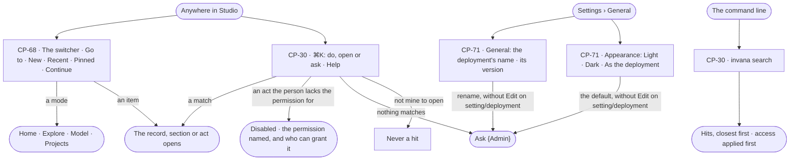

# Find your way — the switcher, ⌘K and search

> The switcher to change mode, start something and pick up where one left off — each person's recent and pinned items
> kept by the engine; ⌘K to do, open or ask anything; and one search for the command line — all showing only what the
> person may open. The frame every surface sits in — the header, the leftNav, the footer, overlays — is
> [design-language.md](../../../../design-language.md#2-the-layout).
> The decision it helps make: *where is the thing I need, and can I act on it?*

## User journey

Journeys this feature is a step of: [J05 · Join a team](../../../../journeys/J05-join-a-team.md)

## Stories

| ID | Story | Status |
|---|---|---|
| CP-30 | [Do, open or ask anything from ⌘K](stories/CP-30-do-open-or-ask-anything-from-k/story.md) | idea |
| CP-68 | [Switch mode and pick up where I left off](stories/CP-68-switch-mode-and-pick-up-where-i-left-off/story.md) | idea |
| CP-71 | [Name the deployment and pick how Studio looks](stories/CP-71-name-the-deployment-and-pick-how-studio-looks/story.md) | idea |

## Access

| Act | Permission ([the permission catalogue](../../../access/features/AC-F02-access-policies/feature.md#the-permission-catalogue)) | Everyone else sees |
|---|---|---|
| Find with ⌘K or `invana search` | None — every signed-in person; hits are only what the person may open | A record they may not open is never a hit |
| Run an act from ⌘K | The permission the act's feature names | The act listed disabled, naming the permission |
| Ask the Assistant from ⌘K | Run on `agent/assistant` | Absent |
| Open the switcher; read, search, pin and unpin one's own recent items | None — one's own | Another person's recent and pinned items are absent |
| Read the deployment's name and version · pick one's own theme | None — every signed-in person | — |
| Rename the deployment · set its default theme | Edit on `setting/deployment` | The rows read; the act reads *Ask {Admin}* |
| Start a conversation, a board or a project from the switcher | The permission each create's feature names | Listed disabled, naming the permission |

## States

| State | What the person sees |
|---|---|
| First use | ⌘K with nothing typed lists the open mode's sections and acts, and recent records. The switcher with nothing opened yet: *Nothing yet — what you open shows here* |
| Empty after a filter | ⌘K matches nothing: *Nothing found* and *Ask the Assistant* |
| Loading | ⌘K and the switcher open at once; each group and Recent fill as their lists arrive |
| Has data | ⌘K's hits grouped by where they live; the switcher's Continue cards, Pinned row and Recent by kind |
| Failed | A group ⌘K could not read says so in its place; the others still match |
| Agent working or proposing | — ⌘K shows no agent work of its own |
| No access | An act the person lacks the permission for is listed disabled, naming the permission and who can grant it |

## Rules

| Rule | Detail |
|---|---|
| ⌘K reads only what may be opened | Every list it reads is scoped by the engine to the person: the agents granted to them; a project's name is a hit for everyone, opening it reads as far as their default agent may Read it |
| ⌘K ranks names | Exact, then prefix, then contains; meaning-based matches wait for a vector index and then show as *Related* |
| ⌘K never sends | *Ask the Assistant* puts the text in the composer and focuses it; the person still sends it before any tokens are spent |
| Help lives in ⌘K | Help, Shortcuts and What's new are ⌘K entries and avatar-menu items, never a header or leftNav item |
| Recent is the person's own | Kept by the engine per person, across devices; opening a conversation, board, project, model, query or run records it; an item the person may not open now is left out on read |
| Pinned is a star | Any recent item can be starred; pins are the person's own and never reorder Recent |
| Before set-up | Until set-up starts, the switcher's modes and New are disabled, reading *Opens when set-up starts* ([CP-22](../CP-F05-graph-databases/stories/CP-22-start-a-fresh-deployment-from-a-question/story.md)) |
| The records in Graph Data are found by asking | A customer or an order is reached through Explore and the Assistant, not ⌘K |
| Leans on | The permission catalogue and the policies each person holds ([AC-F02](../../../access/features/AC-F02-access-policies/feature.md)) · the person's own settings ([AC-F01](../../../access/features/AC-F01-sign-in-account-and-sessions/feature.md)) |

## Data touched

| Record | Read or write |
|---|---|
| The lists each mode and summoner serves — boards, conversations, models and kinds, agents, skills, workflows, projects and tasks, recent runs, graph databases | Read |
| The person's permissions and who can grant each | Read |
| The person's recent and pinned items | Write · read |

## Engine

The low-level design: what this feature stores, serves and refuses. Conventions — naming, errors, lists, events — are
[system-design.md](../../../../system-design.md) §§ 6–8; this section only fills them in.

### Records

| Table | Columns | Notes |
|---|---|---|
| `control_recents` | `user_id` · `kind` (`conversation` · `board` · `project` · `model` · `query` · `run`) · `target_id` · `opened_at` | One row per person and item, its `opened_at` moved on each open; unique (`user_id`, `kind`, `target_id`); the newest 100 per person and kind are kept |
| `control_pins` | `user_id` · `kind` · `target_id` · `pinned_at` | Unique (`user_id`, `kind`, `target_id`); cascades when the item is deleted |

### Reads

| Record | Owner |
|---|---|
| The lists each mode serves — ⌘K matches them in the browser | Each mode's own feature |
| The reader's permissions and who can grant each | [AC-F02](../../../access/features/AC-F02-access-policies/feature.md#engine) · [AC-F03](../../../access/features/AC-F03-directory/feature.md#engine) |
| The agents the reader may use | [AC-F03](../../../access/features/AC-F03-directory/feature.md#engine) |
| Projects and reading one through the default agent | [PJ-F01](../../../../capabilities/projects/features/PJ-F01-projects-and-tasks/feature.md#engine) |
| Conversations and their last answer · boards and their saved layout · queries | [EX-F03](../../../../capabilities/explore/features/EX-F03-ask-a-question/feature.md#engine) · [EX-F01](../../../../capabilities/explore/features/EX-F01-the-board-and-its-canvas/feature.md#engine) |
| A project's progress | [PJ-F01](../../../../capabilities/projects/features/PJ-F01-projects-and-tasks/feature.md#engine) |
| Runs and their status | [CP-F10](../CP-F10-runs-and-how-the-agents-are-doing/feature.md#engine) |
| Models · agents · skills · projects · graph databases — the names search reads | [SE-F02](../../../../capabilities/semantics/features/SE-F02-change-and-publish-a-model/feature.md#engine) · [AG-F01](../../../../capabilities/agents/features/AG-F01-build-an-agent/feature.md#engine) · [AG-F04](../../../../capabilities/agents/features/AG-F04-skills/feature.md#engine) · [PJ-F01](../../../../capabilities/projects/features/PJ-F01-projects-and-tasks/feature.md#engine) · [CP-F05](../CP-F05-graph-databases/feature.md#engine) |

### Routes

| Route, after `/api/v1/control` | Does | Story |
|---|---|---|
| `GET /recents` | The reader's recent items by the list contract — `?kind=` · `?q=` on the name — newest first: `kind` · `id` · `name` · `state` · `opened_at` · `pinned`; items the reader may not open now are left out | CP-68 |
| `POST /recents` | Record an open `{kind, id}` — Studio calls it when a person opens one of the six kinds | CP-68 |
| `GET /recents/continue` | The three cards: `conversation {id, name, snippet}` · `board {id, name, layout}` · `project {id, name, done, total}` — each absent when never opened | CP-68 |
| `GET /pins` · `PUT /pins/{kind}/{id}` · `DELETE /pins/{kind}/{id}` | The reader's pins, newest first · star one · unstar one | CP-68 |
| `GET /search?q=&limit=` | Name search across what the reader may open: `{query, hits[{kind, id, name, product?, match}]}` — `kind` `model` · `agent` · `skill` · `workflow` · `project` · `graph_database`; `product` `explore` · `model` · `agents` · `projects` · `control`; `match` `exact` · `prefix` · `contains`. `limit` 20, at most 50 | CP-30 |

### Events

| Event | When |
|---|---|
| `control.pins.create` · `control.pins.delete` | A person stars or unstars an item |
| — | Recording a recent writes no event: it is a reading aid, not an act |

### Refusals

| Status | When | Sentence | Criterion |
|---|---|---|---|
| 404 | Recording or pinning an item the reader may not open, or that does not exist | *Not found.* | CP-68.9 |
| 422 | A `kind` outside the six | *kind: one of {kinds}.* | API only — Studio sends only the six |
| 422 | `q` empty after trimming, or over 200 characters | *Search needs 1 to 200 characters.* | API only — the command line trims and checks before it calls; ⌘K never calls it |
| — | An act the reader lacks the permission for is the permission check's `403` ([AC-F02](../../../access/features/AC-F02-access-policies/feature.md#refusals)) | — | CP-30.8 |

### CLI

| Command | Does |
|---|---|
| `invana search "<text>"` | One line per hit — kind, name, id — closest first |

### Mechanisms

| Mechanism | How |
|---|---|
| Access before match | Each name query is handed what the reader may open — the agents granted to them — before it matches; every project's name is a hit |
| Ranking | Exact, then prefix, then contains on the name, case-insensitive; ties by name |
| Not searched | Runs, schedules, findings and branches — a run is found through Runs, not by name |
| ⌘K | Matches in the browser over the lists each mode already serves, read once per opening; it never calls the search route |
| Who to ask | A disabled act names its permission and who can grant it from the permission catalogue and the Directory; a permission nobody can grant reads *Ask an Admin* |
| Recording a recent | An upsert on (`user_id`, `kind`, `target_id`) setting `opened_at`; past 100 a person and kind, the oldest row goes in the same transaction |
| Access on read | Each recent and pin is checked against what the reader may open when listed — the owning feature's read check — and left out, not shown as withheld |
| Continue | The newest conversation, board and project in `control_recents`; the snippet is the conversation's last answer's first line, the layout the board's saved positions for Studio to draw, the progress the project's done and total tasks as PJ-F01 counts them |

## System impact

| HLD section | Change | NFRs |
|---|---|---|
| § 6 Data and storage | Two small tables in Postgres — recents and pins, per person | — |
| § 8 APIs and events | One search route, for the command line; the recents and pins routes for the switcher | NFR-PERF-3 |
| § 12 Qualities | Privacy: access is applied before a name is matched — an agent not granted to the reader is never a hit; a project's content is never matched, only its name | NFR-SEC-1 |

## Decisions

| Decision | Detail |
|---|---|
| The switcher moves between modes | The *☰ Invana {Mode} ▾* control — the wordmark names the mode — opens one dropdown: Go to, New and the person's Recent — never Settings, Help or a graph switcher |
| New holds the three things people start most | Conversation, board and project; connecting a graph database is Settings' and Home's before set-up |
| Recent is the engine's | Kept per person in the engine so it follows them across devices; never browser storage |
| ⌘K is the one door | *Do, open or ask anything* — acts, records and sections in one palette, with no products to switch between |
| ⌘K matches in the browser | It reads the lists each mode already serves, once per opening, and matches as the person types; a record with no address of its own opens its section |
| The command line searches in the engine | One engine search applies the access first, then ranks by name as ⌘K does |
| Settings opens on General and Appearance | General holds the deployment's name and version; Appearance the person's theme and, for an Admin, the deployment's default. The avatar menu's *Appearance* opens the same rows |
| Ask is the last ⌘K entry | Whenever something is typed and the Assistant is among the agents the person may use |
| Without the permission reads, never hides | An act is disabled with the permission it needs and who can grant it |

## Open questions

| Question | Who answers |
|---|---|
| What else Settings › General holds beyond the name and version — recommend nothing more until a story needs it | Ravi, at the spec review |

## Not building

| Item | Why not |
|---|---|
| ⌘K over the records in Graph Data | That is the graph databases', through Explore and the Assistant |
| Search history or saved searches | Not asked for |
| Another person's recent items, or shared pins | Recent and Pinned are a person's own trail |
