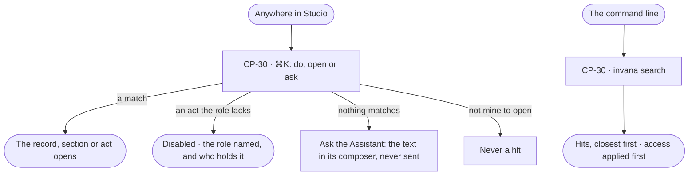

# Find your way — ⌘K and search

> ⌘K to do, open or ask anything, and one search for the command line — both showing only what the person may open.
> The frame every surface sits in — modes, summoners, crumbs, theme — is [design-language.md](../../../../design-language.md#the-frame).
> The decision it helps make: *where is the thing I need, and can I act on it?*

## User journey

Journeys this feature is a step of: [J05 · Join a team](../../../../journeys/J05-join-a-team.md)

## Stories

| ID | Story | Status |
|---|---|---|
| CP-30 | [Do, open or ask anything from ⌘K](stories/CP-30-do-open-or-ask-anything-from-k/story.md) | idea |

## Access

| Act | Role | Everyone else sees |
|---|---|---|
| Find with ⌘K or `invana search` | Operator · Modeller · Admin; hits are only what the person may open | A record they may not open is never a hit |
| Run an act from ⌘K | The role the act's feature names ([AC-F02 › The role table](../../../access/features/AC-F02-access-policies/feature.md#the-role-table)) | The act listed disabled, naming the role |
| Ask the Assistant from ⌘K | A person who may use the Assistant | Absent |

## States

| State | What the person sees |
|---|---|
| First use | ⌘K with nothing typed lists the open mode's sections and acts, and recent records |
| Empty after a filter | ⌘K matches nothing: *Nothing found* and *Ask the Assistant* |
| Loading | ⌘K opens at once and fills each group as its list arrives |
| Has data | ⌘K's hits grouped by where they live |
| Failed | A group ⌘K could not read says so in its place; the others still match |
| Agent working or proposing | — ⌘K shows no agent work of its own |
| No access | An act the person's role lacks is listed disabled, naming the role and who holds it |

## Rules

| Rule | Detail |
|---|---|
| ⌘K reads only what may be opened | Every list it reads is scoped by the engine to the person: the agents they may use, the private projects they are on |
| ⌘K ranks names | Exact, then prefix, then contains; meaning-based matches wait for a vector index and then show as *Related* |
| ⌘K never sends | *Ask the Assistant* puts the text in the composer and focuses it; the person still sends it before any tokens are spent |
| The Graph's own records are found by asking | A customer or an order is reached through Explore and the Assistant, not ⌘K |
| Leans on | The role table and who holds each role ([AC-F02](../../../access/features/AC-F02-access-policies/feature.md)) · the person's own settings ([AC-F01](../../../access/features/AC-F01-sign-in-account-and-sessions/feature.md)) |

## Data touched

| Record | Read or write |
|---|---|
| The lists each mode and summoner serves — boards, conversations, models and kinds, agents, skills, workflows, projects and tasks, recent runs, graph databases | Read |
| The person's role and who holds each role | Read |

## Engine

The low-level design: what this feature stores, serves and refuses. Conventions — naming, errors, lists, events — are
[system-design.md](../../../../system-design.md) §§ 6–8; this section only fills them in.

### Records

| Table | Columns | Notes |
|---|---|---|
| — | — | No table of its own |

### Reads

| Record | Owner |
|---|---|
| The lists each mode serves — ⌘K matches them in the browser | Each mode's own feature |
| The reader's role and who holds each role | [AC-F02](../../../access/features/AC-F02-access-policies/feature.md#engine) · [AC-F03](../../../access/features/AC-F03-directory/feature.md#engine) |
| The agents the reader may use | [AC-F03](../../../access/features/AC-F03-directory/feature.md#engine) |
| Private projects the reader is not on | [PJ-F01](../../../../capabilities/projects/features/PJ-F01-projects-and-tasks/feature.md#engine) |
| Models · agents · skills · projects · graph databases — the names search reads | [SE-F02](../../../../capabilities/semantics/features/SE-F02-change-and-publish-a-model/feature.md#engine) · [AG-F01](../../../../capabilities/agents/features/AG-F01-build-an-agent/feature.md#engine) · [AG-F04](../../../../capabilities/agents/features/AG-F04-skills/feature.md#engine) · [PJ-F01](../../../../capabilities/projects/features/PJ-F01-projects-and-tasks/feature.md#engine) · [CP-F05](../CP-F05-graph-databases/feature.md#engine) |

### Routes

| Route, after `/api/v1/control` | Does | Story |
|---|---|---|
| `GET /search?q=&limit=` | Name search across what the reader may open: `{query, hits[{kind, id, name, product?, match}]}` — `kind` `model` · `agent` · `skill` · `workflow` · `project` · `graph_database`; `product` `explore` · `model` · `agents` · `projects` · `control`; `match` `exact` · `prefix` · `contains`. `limit` 20, at most 50 | CP-30 |

### Events

| Event | When |
|---|---|
| — | No event of its own; finding writes nothing |

### Refusals

| Status | When | Sentence | Criterion |
|---|---|---|---|
| 422 | `q` empty after trimming, or over 200 characters | *Search needs 1 to 200 characters.* | API only — the command line trims and checks before it calls; ⌘K never calls it |
| — | An act the reader's role does not hold is the role check's `403` ([AC-F02](../../../access/features/AC-F02-access-policies/feature.md#refusals)) | — | CP-30.8 |

### CLI

| Command | Does |
|---|---|
| `invana search "<text>"` | One line per hit — kind, name, id — closest first |

### Mechanisms

| Mechanism | How |
|---|---|
| Access before match | Each name query is handed what the reader may open — the agents they may use, the private projects they are on — before it matches |
| Ranking | Exact, then prefix, then contains on the name, case-insensitive; ties by name |
| Not searched | Runs, schedules, findings and branches — a run is found through Runs, not by name |
| ⌘K | Matches in the browser over the lists each mode already serves, read once per opening; it never calls the search route |
| Who to ask | A disabled act names its role and who holds it from the role table and the Directory; a role nobody holds reads *Ask an Admin* |

## System impact

| HLD section | Change | NFRs |
|---|---|---|
| § 8 APIs and events | One search route, for the command line | NFR-PERF-3 |
| § 12 Qualities | Privacy: access is applied before a name is matched — an agent the reader may not use or a private project they are not on is never a hit | NFR-SEC-1 |

## Decisions

| Decision | Detail |
|---|---|
| ⌘K is the one door | *Do, open or ask anything* — acts, records and sections in one palette, with no products to switch between |
| ⌘K matches in the browser | It reads the lists each mode already serves, once per opening, and matches as the person types; a record with no address of its own opens its section |
| The command line searches in the engine | One engine search applies the access first, then ranks by name as ⌘K does |
| Ask is the last ⌘K entry | Whenever something is typed and the Assistant is among the agents the person may use |
| Without the role reads, never hides | An act is disabled with the role it needs and who holds it |

## Open questions

| Question | Who answers |
|---|---|
| — | — |

## Not building

| Item | Why not |
|---|---|
| ⌘K over the Graph's own records | That is the graph databases', through Explore and the Assistant |
| Search history or saved searches | Not asked for |
