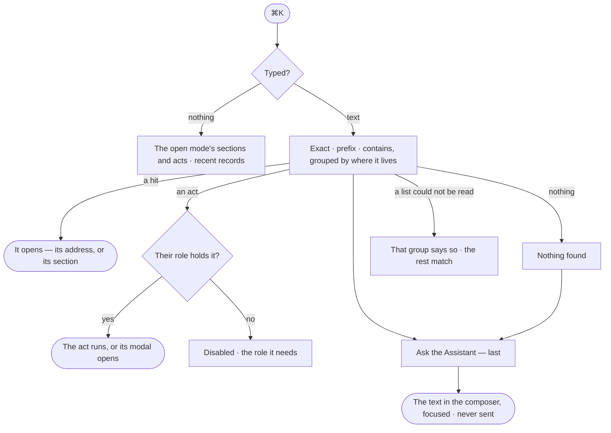

# CP-30 · Do, open or ask anything from ⌘K

**As** an analyst **I want** ⌘K to jump to any board, model, agent, skill, workflow, project, task or graph database,
run an act, or ask the Assistant **so that** I reach anything without the nav — and never see what I may not open.

Tasks: [task.md](task.md) · Feature: [CP-F07](../../feature.md)

## Who can

| Lens | Can | Otherwise sees |
|---|---|---|
| Admin | Find every record they may open, run any act, ask the Assistant | — |
| Operator | Find every record they may open, run the acts their role allows, ask the Assistant when it is among the agents they may use | A record they may not open is never a hit; an act their role lacks is listed disabled, naming the role it needs |

## Flow

## Acceptance criteria

| # | Given | When | Then |
|---|---|---|---|
| CP-30.1 | Nothing typed | ⌘K opens | it lists the open mode's sections and acts, and recent records |
| CP-30.2 | Text typed | ⌘K matches | boards and conversations, models and kinds, agents, skills, workflows, projects and tasks, the last runs and the graph databases — grouped by where each lives, exact then prefix then contains |
| CP-30.3 | A project the person's default agent may not Read | they search its name | it is a hit by name; opening it reads its head, the rest *Withheld — your agent may not read `project/{key}`* |
| CP-30.4 | An agent the person may not use | they search its name | it is never a hit |
| CP-30.5 | A hit with no address of its own | the person picks it | its section opens with it selected |
| CP-30.6 | Conversations and runs with one title | they are listed | each carries its age beside its kind |
| CP-30.7 | An act the person's role holds | they pick it | it runs, or its modal opens |
| CP-30.8 | An act the person's role lacks | it is listed | it is disabled, naming the role it needs |
| CP-30.9 | Text typed, the Assistant among the agents the person may use | the list draws | *Ask the Assistant* is the last entry; picking it puts the text in the composer and focuses it, never sending |
| CP-30.10 | Nothing matches | the list draws | it says *Nothing found*, with *Ask the Assistant* |
| CP-30.11 | A list ⌘K could not read | it matches | that group says it could not be read; the others still match |
| CP-30.12 | No graph database on yet | ⌘K opens | it lists Home's set-up and Settings; *Ask the Assistant* says it opens when set-up is done |
| CP-30.13 | A person at the command line | they run `invana search "<text>"` | each hit reads its kind, name and id, closest first — the records ⌘K finds; a project is a hit by its name only |

## Screens

| Surface | Lens | First use | Empty after a filter | Loading | Has data | Failed | Agent working or proposing | No access |
|---|---|---|---|---|---|---|---|---|
| ⌘K | Admin | shell.command · Nothing typed | shell.command · Nothing found | shell.command · Loading | shell.command | shell.command · A group failed | — | — |
| ⌘K | Operator | shell.command · Nothing typed | shell.command · Nothing found | shell.command · Loading | shell.command | shell.command · A group failed | — | shell.command · Act disabled |
