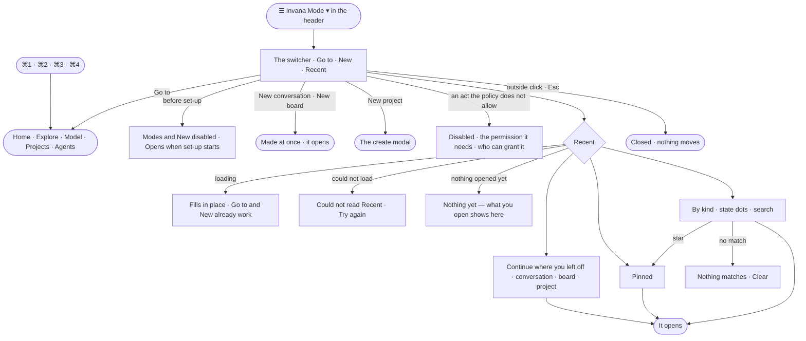

# CP-68 · Switch mode and pick up where I left off

**As** an analyst **I want** one place that moves me between Home, Explore, Model, Projects and Agents, starts something new
and shows what I was last working on **so that** I get back to my decision in one click instead of hunting for it.

Tasks: [task.md](task.md) · Feature: [CP-F07](../../feature.md)

## Who can

| Access | Can | Otherwise sees |
|---|---|---|
| Admin | Open the switcher; go to any mode, Agents included; start a conversation, a board or a project; read, search, pin and open their own recent items | — |
| Operator | The same, on their own recent items: every mode, Agents included; *New project* as their Access Policies allow | An act their Access Policies do not allow is listed disabled, naming the permission it needs and who can grant it; another person's recent items are never shown |

## Flow

## Acceptance criteria

| # | Given | When | Then |
|---|---|---|---|
| CP-68.1 | Any screen | the person clicks the *☰ Invana {Mode} ▾* control — *Invana Explore*, *Invana Model*, *Invana Projects*, plain *Invana* on Home | the switcher opens anchored to it, about 1180 px wide, no scrim; outside click or Esc closes it |
| CP-68.2 | The switcher | *Go to* is read | Home · Explore ⌘1 · Model ⌘2 · Projects ⌘3 · Agents ⌘4, for everyone; picking one switches the mode and closes the switcher; ⌘1–⌘4 switch from any screen; inside a mode, each act responds to the person's Access Policies |
| CP-68.3 | The switcher | *New* is read | Conversation · Board · Project — nothing else; a conversation or a board is made at once and opens; a project opens its create modal |
| CP-68.4 | The switcher | it is read | it holds no Settings, no Help, no *Connect a graph database* and no graph switcher |
| CP-68.5 | Items the person opened | *Recent* is read | their own conversations, boards, projects, models, queries and runs, newest first, grouped by kind, each with a state dot; tabs All · Conversations · Boards · Projects · Models · Queries · Runs filter them |
| CP-68.6 | Recent | the person types in its search | it narrows to names that contain the text; with none, *Nothing matches* and *Clear* |
| CP-68.7 | An item in Recent | the person stars it | it joins the *Pinned* row for that person only, on every device, until they unstar it |
| CP-68.8 | A last conversation, board and project | *Continue where you left off* is read | three cards: the conversation with a snippet of its last answer, the board with a preview, the project with its progress as the engine counts it; a kind the person never opened draws no card |
| CP-68.9 | An item deleted, or one the person may not open now | Recent or Pinned is read | it is not listed |
| CP-68.10 | A person who has opened nothing | the switcher opens | Recent reads *Nothing yet — what you open shows here*; Go to and New work |
| CP-68.11 | Recent still loading | the switcher opens | Go to and New draw at once and work; Recent fills in place |
| CP-68.12 | The engine cannot read Recent | the switcher opens | Recent says it could not be read, with *Try again*; Go to and New still work |
| CP-68.13 | A deployment before set-up starts | the switcher opens | Explore, Model, Projects, Agents and New are disabled, reading *Opens when set-up starts*; Home works |
| CP-68.14 | An act in New the person's Access Policies do not allow | it is listed | it is disabled, naming the permission it needs and who can grant it; the engine refuses it too |
| CP-68.15 | A person opens a conversation, board, project, model, query or run anywhere in Studio | they next open the switcher | it heads Recent |

## Screens

| Surface | Access | First use | Empty after a filter | Loading | Has data | Failed | Agent working or proposing | No access |
|---|---|---|---|---|---|---|---|---|
| The switcher | Admin | shell.switcher · Nothing yet | shell.switcher · Nothing matches | shell.switcher · Loading | shell.switcher | shell.switcher · Could not load | — | — |
| The switcher | Operator | shell.switcher · Nothing yet | shell.switcher · Nothing matches | shell.switcher · Loading | shell.switcher | shell.switcher · Could not load | — | shell.switcher · Act disabled |
| The switcher before set-up | Admin | shell.switcher · Before set-up | — | — | — | — | — | — |
| The switcher before set-up | Operator | shell.switcher · Before set-up | — | — | — | — | — | — |
