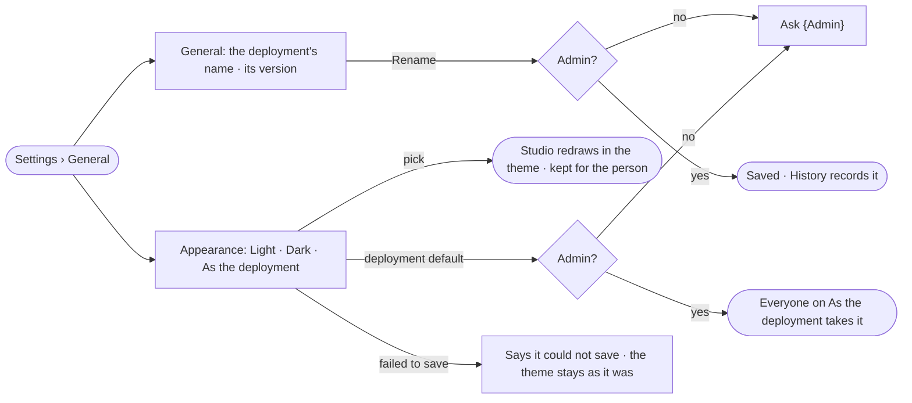

# CP-71 · Name the deployment and pick how Studio looks

**As** an Admin **I want** the deployment's name and version in one place, and everyone able to pick a light or dark
Studio from the deployment's default **so that** people know which deployment they are in and work in the theme that
suits them.

Tasks: [task.md](task.md) · Feature: [CP-F07](../../feature.md)

## Who can

| Access | Can | Otherwise sees |
|---|---|---|
| Admin | Rename the deployment; set the deployment's default theme; pick their own theme | — |
| Operator | Read the deployment's name and version; pick their own theme; a Modeller the same | *Rename* and the default theme read, their acts reading *Ask {Admin}* |

## Flow

## Acceptance criteria

| # | Given | When | Then |
|---|---|---|---|
| CP-71.1 | A deployment | a person opens Settings › General | the deployment's name and the version it runs read on preference rows |
| CP-71.2 | An Admin | they rename the deployment | the new name is saved, reads in General and on the sign-in page, and the change is a row in History |
| CP-71.3 | An Operator | they open General | the name and version read; *Rename* reads *Ask {Admin}*, and the engine refuses a rename the same way |
| CP-71.4 | Any person | they pick Light, Dark or *As the deployment* in Settings › Appearance or the avatar menu | Studio and every canvas redraw in that theme on the next frame, and the choice follows the person to another device |
| CP-71.5 | An Admin | they set the deployment's default theme | every person on *As the deployment* takes it on their next load |
| CP-71.6 | An Operator | they open Appearance | they pick their own theme; the deployment's default reads *Ask {Admin}* |
| CP-71.7 | A theme choice the engine could not save | it fails | the row says it could not save and why; the theme stays as it was |

## Screens

| Surface | Access | First use | Empty after a filter | Loading | Has data | Failed | Agent working or proposing | No access |
|---|---|---|---|---|---|---|---|---|
| General | Admin | settings.general · Default name | — | settings.general · Loading | settings.general | settings.general · Could not save | — | — |
| General | Operator | settings.general · Default name | — | settings.general · Loading | settings.general · Read only | settings.general · Could not load | — | settings.general · Read only |
| Appearance | Admin | settings.appearance · As the deployment | — | settings.appearance · Loading | settings.appearance | settings.appearance · Could not save | — | — |
| Appearance | Operator | settings.appearance · As the deployment | — | settings.appearance · Loading | settings.appearance | settings.appearance · Could not save | — | settings.appearance · Default read only |
| About | Admin | — | — | settings.about · Loading | settings.about | settings.about · Could not load | — | — |
| About | Operator | — | — | settings.about · Loading | settings.about | settings.about · Could not load | — | — |
