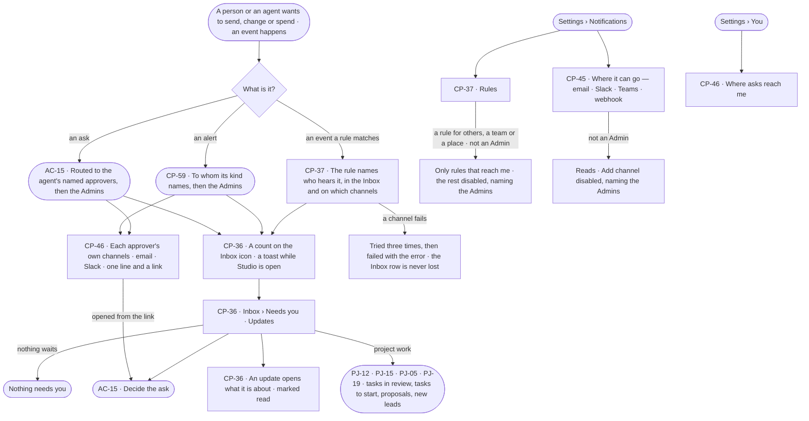

# The Inbox — what needs me, and notifications

> Every ask that waits on a person (AC-F05), every open ops alert sent to them (CP-F11) and everything else that
> should reach them arrives in one Inbox for the deployment, by rules people write, and leaves Invana on the channels an
> Admin sets up and each person chooses. The decision it helps make: *what needs me first?*

## User journey

Journeys this feature is a step of: [J03 · Give an agent work and decide on the result](../../../../journeys/J03-give-an-agent-work-and-decide-on-the-result.md) · [J04 · Build an agent and improve it from what runs teach](../../../../journeys/J04-build-an-agent-and-improve-it-from-what-runs-teach.md) · [J06 · Set what an agent may touch](../../../../journeys/J06-set-what-an-agent-may-touch.md) · [J08 · Watch agent workloads and act on an alert](../../../../journeys/J08-watch-agent-workloads-and-act-on-an-alert.md)

## Stories

| ID | Story | Status |
|---|---|---|
| CP-36 | [See what needs me in one inbox](stories/CP-36-see-what-needs-me-in-one-inbox/story.md) | idea |
| CP-37 | [Say which events reach whom, and where](stories/CP-37-say-which-events-reach-whom-and-where/story.md) | idea |
| CP-45 | [Set up where asks and alerts can go](stories/CP-45-set-up-where-asks-and-alerts-can-go/story.md) | idea |
| CP-46 | [Choose where my asks and alerts reach me](stories/CP-46-choose-where-my-asks-and-alerts-reach-me/story.md) | idea |

## Access

The role × feature table is [AC-F02 › The role table](../../../access/features/AC-F02-access-policies/feature.md#the-role-table)
(*Inbox and notifications*: Operator Acts · Modeller Acts · Admin Acts); this is what it means here.

| Act | Role | Everyone else sees |
|---|---|---|
| Read one's own Inbox — Needs you and Updates | Operator · Modeller · Admin | — |
| Decide an ask | As AC-F05 | As AC-F05 |
| Read rules and channels | Operator · Modeller · Admin | — |
| Write, change or remove a notification rule that reaches only oneself | Operator · Modeller · Admin, for their own rules | Another person's rule reads; its switch and *Edit* are disabled, naming its creator and the Admins |
| Write a notification rule that reaches other people, a team, a role or a channel | Admin | Those recipients disabled — *Needs the Admin role — ask {admins}* |
| Add, test or remove a channel | Admin, in a session, with the password again | *Add channel*, *Test* and *Remove* disabled — *Needs the Admin role — ask {admins}* |
| Choose where one's own asks and alerts reach one | Every signed-in person, for themselves | Another person's choices are absent |
| Answer project work in Needs you — accept or send back a task in review, start a task an agent asks to pick up, accept or reject an agent's proposal, read a new lead | Operator · Modeller · Admin, on a project they can see ([PJ-F01](../../../../capabilities/projects/features/PJ-F01-projects-and-tasks/feature.md) · [PJ-F03](../../../../capabilities/projects/features/PJ-F03-branches-findings-and-decisions/feature.md) · [PJ-F06](../../../../capabilities/projects/features/PJ-F06-alerts/feature.md)) | Work on a project their default agent may not Read lists its line, its content *Withheld*; *Accept* and *Send back* are its reviewers', a proposal's *Accept* its members' |

## States

| State | What the person sees |
|---|---|
| First use | Needs you: *Nothing needs you*, as good news. Updates with no rule written: *Nothing needs you*, with *New rule* — failures reach a person only through a rule. Rules: *No rules yet*, with *New rule* |
| Empty after a filter | Needs you or Updates filtered by product, kind or *Unread* with no match: *Nothing matches*, with *Clear filters* |
| Loading | The Inbox opens at once with rows loading in place; its count is the last one read |
| Has data | Needs you — asks first, nearest deadline first (AC-F05); Updates newest first, unread marked. Rules one row each; channels with their masked target and *ready* |
| Failed | The list could not load, saying why, with *Try again*. A channel that failed a send names the error on its delivery |
| Agent working or proposing | An agent's ask in Needs you, as AC-F05 shows it |
| No access | An ask routed to someone else reads, as AC-F05 says. Rules and channels read; a rule for others and every channel write are disabled for everyone but an Admin, naming the Admins |

## Rules

| Rule | Detail |
|---|---|
| One Inbox for the deployment | Each person has one Inbox; there is no other place an ask, an alert or an update waits |
| One list of what waits | Needs you holds every ask a person, an agent or a run makes of a person — access · budget · delegation · send · question · more than a policy allows (AC-14) · a person's act set to Ask — a held delivery of a finished run, a breaking model publish, project work — a task in review, to its author and the person behind its run (PJ-12); *Start this task?* (PJ-15), an agent's open proposal (PJ-05) and a new lead (PJ-19), each to the project's members — and each open alert sent to the reader ([CP-F11](../CP-F11-ops-alerting/feature.md)). The Inbox icon and the header carry one count: unread updates + asks waiting on the reader + runs waiting on the reader's answer + open ops alerts sent to the reader |
| An alert leaves Needs you when it closes | It reads closed, naming what closed it, and moves to Updates |
| A stopped run tells the person behind it | When someone else stops a run, the person behind it gets an update naming who stopped it ([CP-58](../CP-F10-runs-and-how-the-agents-are-doing/stories/CP-58-stop-a-run-that-should-not-go-on/story.md)) |
| Questions lead Needs you | A question asked back of the person sits first: it holds a run until it is answered. Then every other ask and each open ops alert, oldest first |
| Only asks toast | A new ask or question for the reader shows a toast with *Review*; updates never toast |
| Rules read what happened | A rule matches events after they are written, never slowing or failing a write. A rule never matches its own notifications, deliveries or reminders, so it cannot feed itself |
| In the Inbox, and out | *In app* is not a channel: every ask, rule and schedule writes to the Inbox. Channels — email · Slack · Microsoft Teams · webhook — are what leaves Invana, set up by an Admin |
| Channels reach places and people | A rule sends to a channel — a mail address, a Slack or Teams channel, a webhook. An ask, reminder, escalation or alert for a person also goes to the channels that person turned on — email to their account address, a Slack direct message |
| A channel carries a line and a link | One line — what it is, the agent, who it waits on, the time left — and a link into Studio; never an ask's content, a record or a run's output. The one exception is a schedule's delivery ([AG-F07](../../../../capabilities/agents/features/AG-F07-schedules/feature.md)), which sends what its creator chose on purpose, as a send held to its ask and recorded in *What left the platform* |
| Decisions are made signed in | A link opens the ask in Studio, recording the channel it was opened from; replies, reactions and buttons in a channel decide nothing ([AC-F05](../../../access/features/AC-F05-asks-and-approvals/feature.md#rules)) |
| Channel secrets are write-only | Sealed under the install key, never read back; the read shows a masked target; setting one asks for the password again |
| Addresses are checked | A channel address that is not `https`, or resolves to a loopback, link-local or the deployment's own address, is refused, at add and at every delivery |
| A failed send retries | Three tries, then *failed* with the error; the Inbox row is written first and never depends on a channel |
| Recipients resolve when a rule matches | Named users still active, members of named teams, people with a named role, *the person behind the run* and *the agent's named approvers*. An event about a run reaches only those who may read it in a line and a link, never its content ([AC-31](../../../access/features/AC-F09-what-left-the-platform/stories/AC-31-keep-a-runs-content-to-those-who-may-read-it/story.md)) |
| A person's own rules | A rule an Operator or a Modeller writes reaches only them, in the Inbox and on their own channels; rules for others, teams, roles or a channel are an Admin's |
| Alerts are CP-F11's | Every alert — its kinds, History alerts, whom it reaches and what closes it — is [CP-F11](../CP-F11-ops-alerting/feature.md#the-alert-kinds)'s; the Inbox holds it in Needs you and delivers it |
| Leans on | Runs and stopping (CP-F10) · ops alerts (CP-F11) · project work in Needs you (PJ-F01 · PJ-F03 · PJ-F06) · suggested changes (AG-F09) · schedules and their deliveries (AG-F07) · asks and approvals (AC-F05) · History (AC-F06) · users, teams and roles (AC-F03) |

## Data touched

| Record | Read or write |
|---|---|
| Notifications — one Inbox row per person, read or not, its target | Write · read |
| Deliveries — one send to one channel, exactly what was sent, status, tries, the error | Write · read |
| Notification rules · channels | Write · read |
| Runs waiting on the reader's answer (CP-F10) | Read |
| History rows of every decision and every rule change (AC-F06) | Write |

## Engine

The low-level design: what this feature stores, serves and refuses. Conventions — naming, errors, lists, events — are
[system-design.md](../../../../system-design.md) §§ 6–8; this section only fills them in.

### Records

| Table | Columns | Notes |
|---|---|---|
| `control_notifications` | `user_id` · `kind` (`event` · `approval` · `reminder` · `expired` · `delivery` · `ops_alert` · `run_stopped`) · `title` · `body` (a line, never content) · `event_id?` · `rule_id?` · `approval_id?` · `ops_alert_id?` · `run_id?` · `target_kind?` · `target_id?` · `read_at?` · `done_at?` · `created_at` | One Inbox row. Unique (`user_id`, `event_id`, `rule_id`) |
| `control_notification_rules` | `name` · `events[]` · `match{}` (an optional finished run's status, agent or ops alert kind) · `user_ids[]` · `team_ids[]` · `roles[]` · `behind` (the person behind the run) · `agent_approvers` (the agent's named approvers) · `in_app` · `channel_ids[]` · `enabled` · `created_by_id` | Unique (`created_by_id`, `name`). A rule whose only recipient is its creator is theirs; any other recipient or a channel needs an Admin |
| `control_channels` | `name` (unique) · `kind` (`email` · `slack` · `teams` · `webhook`) · `target` (masked when read) · `secret_sealed?` · `ready` · `not_ready_why?` · `created_by_id` · `created_at` | Created, its secret replaced, and removed — never otherwise updated |
| `control_channel_choices` | `user_id` · `kind` (`email` · `slack`) · `on` · `slack_user_id?` · `changed_at` | A person's own; unique (`user_id`, `kind`) |
| `control_deliveries` | `channel_id` · `user_id?` (a person's own delivery) · `rule_id?` · `event_id?` · `firing_id?` · `approval_id?` · `notification_id?` · `status` (`pending` · `held` · `sent` · `failed`) · `payload` (exactly what is sent) · `attempts` · `error?` · `sent_at?` | One send to one channel |
| `control_notification_cursors` | `name` · `event_id` · `created_at` | How far the clock has matched the event store |

### Reads

| Record | Owner |
|---|---|
| The event store a rule matches | [AC-F06](../../../access/features/AC-F06-history/feature.md#engine) |
| Asks waiting on the reader, and the ask a held delivery waits for | [AC-F05](../../../access/features/AC-F05-asks-and-approvals/feature.md#engine) |
| Runs waiting on the reader's answer, the person behind a run, and a stop | [CP-F10](../CP-F10-runs-and-how-the-agents-are-doing/feature.md#engine) |
| Schedules, their firings, the deliveries they make, and the shared clock | [AG-F07](../../../../capabilities/agents/features/AG-F07-schedules/feature.md#engine) |
| Project work in Needs you — tasks and their results | [PJ-F01](../../../../capabilities/projects/features/PJ-F01-projects-and-tasks/feature.md#engine) |
| Project work in Needs you — agents' proposals | [PJ-F03](../../../../capabilities/projects/features/PJ-F03-branches-findings-and-decisions/feature.md#engine) |
| Project work in Needs you — new leads | [PJ-F06](../../../../capabilities/projects/features/PJ-F06-alerts/feature.md#engine) |
| A project's members and reviewers | [PJ-F01](../../../../capabilities/projects/features/PJ-F01-projects-and-tasks/feature.md#engine) |
| Users, teams and their roles — who a rule's recipients are | [AC-F03](../../../access/features/AC-F03-directory/feature.md#engine) |
| An agent's named approvers — a rule's *the agent's named approvers* | [AC-F05](../../../access/features/AC-F05-asks-and-approvals/feature.md#engine) |
| Open alerts sent to the reader, and their closing | [CP-F11](../CP-F11-ops-alerting/feature.md#engine) |

### Routes

| Route, after `/api/v1/control` | Does | Story |
|---|---|---|
| `GET /notifications` | The reader's Inbox — `?view=needs_you · updates` · `?product=` · `?kind=` · `?unread=true` — with `count` (unread updates + asks waiting on the reader + runs waiting on their answer + open ops alerts sent to them) | CP-36 |
| `POST /notifications/read` | Mark rows read — `{ids[]}` or `{all: true}` | CP-36 |
| `GET /notifications/rules` · `POST /notifications/rules` | Notification rules, each with `may_edit` · write one | CP-37 |
| `GET /notifications/rules/{id}` · `PATCH /notifications/rules/{id}` · `DELETE /notifications/rules/{id}` | Read · change, switch on or off · remove one | CP-37 |
| `GET /channels` · `POST /channels` | Channels with `ready` or why not, by the list contract · add one `{name, kind, target, secret?, sender?, password}` after a passing test; the secret is never read back | CP-45 |
| `PUT /channels/{name}/secret` · `POST /channels/{name}/test` · `DELETE /channels/{name}` | Replace its secret `{secret, password}` · send a test to the caller · remove `{password}` | CP-45 |
| `GET /channels/mine` · `PUT /channels/mine/{kind}` | The caller's own choices — `email` · `slack`, each `on` and `available` with why not · `{on}` | CP-46 |

### Events

| Event | When |
|---|---|
| `control.notification_rules.create` · `control.notification_rules.update` · `control.notification_rules.delete` | A rule is written · changed · removed |
| `control.channels.create` · `control.channels.secret` · `control.channels.delete` | A channel is added · its secret replaced · removed — never the secret |
| `control.channels.choice` | A person turns one of their own channels on or off — `{kind, on}` |
| `control.deliveries.fail` | A delivery fails for good — `{channel_id, attempts, error}` |

### Refusals

| Status | When | Sentence | Criterion |
|---|---|---|---|
| 422 | A rule with no recipient, naming a channel that does not exist, or matching an event a rule may not match | *{field}: {why}.* | CP-37.5 · CP-37.6 |
| 403 | A rule reaching anyone but its creator, or naming a channel, a team or a role, by anyone but an Admin; changing another person's rule | *Needs the Admin role — ask {admins}.* | CP-37.18 |
| 409 | Removing a channel a rule or a schedule names | *{rules and schedules} use this channel.* | CP-37.13 · CP-45.9 · AG-42.17 |
| 403 | Adding, testing, replacing or removing a channel by anyone but an Admin | *This needs an Admin — ask {admins}.* | CP-45.11 |
| 401 | A channel change without the password, with a wrong one, or with a key | *Enter your password again to do this.* | CP-45.10 |
| 422 | A channel address that is not `https`, or resolves to a loopback, link-local or the deployment's own address | *{address} resolves to {ip}, which is refused.* | CP-45.6 |
| 422 | A channel whose test fails — nothing saved | *{kind}: {what the service answered}.* | CP-45.7 |
| 409 | Turning on Slack direct messages with no Slack channel, or for an email Slack does not know | *Slack is not set up — ask {admins}.* · *Not found in Slack.* | CP-46.2 · CP-46.3 |
| 404 | Reading another person's channel choices | *Not found.* | CP-46.10 |
| 422 | A rules file with a refused rule — nothing in it applied | *{rule} · {field}: {why}.* | CP-37.17 |

### CLI

| Command | Does |
|---|---|
| `invana notifications rules apply --file <yaml>` | Creates each rule, or replaces the one of its name, with the checks of *New rule*; all or nothing |

### Mechanisms

| Mechanism | How |
|---|---|
| Rules read the record | On the shared clock tick ([AG-F07](../../../../capabilities/agents/features/AG-F07-schedules/feature.md#mechanisms)) the matcher reads the event store after its cursor, taken `FOR UPDATE SKIP LOCKED`, after commit — a write is never slowed or failed by a rule |
| No rule feeds itself | Notification, delivery and reminder events and rule and channel changes are never matched |
| Recipients resolve at match | Named users still active · members of named teams · people with a named role · *the person behind the run* · *the agent's named approvers*, as they are now |
| The Inbox row first | Each recipient's row is written before any delivery, and never depends on a channel |
| A person's own deliveries | An ask, reminder, escalation or expiry ([AC-F05](../../../access/features/AC-F05-asks-and-approvals/feature.md#mechanisms)) and an alert naming a person write their Inbox row, then one delivery per channel in their `control_channel_choices` that is `on` — email to their account address through the email channel, a Slack direct message to `slack_user_id` |
| The payload | `{kind, title, agent?, waits_on?, deadline?, link}` — the link is Studio's address of the ask or alert with `?from=<channel kind>`; nothing else. Opening it records `opened_from` on the ask |
| Deliveries | Each pending delivery is tried once a tick; the third failure leaves it `failed` with the error and writes `control.deliveries.fail`. A `held` delivery waits for its ask. A deleted channel fails its delivery at once. There is no backoff and no auto-disable — an Admin fixes or removes the channel |
| Channel bodies | Email: through the channel's own mail server, user and sealed password, from its sender, STARTTLS · Slack: a Slack app's sealed bot token — `chat.postMessage` to a channel a rule names or to a person's direct message; a person is matched once by `users.lookupByEmail` on their account email · Teams: the payload as a message card to the channel's incoming webhook · Webhook: the payload as JSON, signed `X-Invana-Signature: sha256=<hmac>` when it has a secret |
| The address check | Every channel host is resolved at add and at each delivery; loopback, link-local and the deployment's own addresses are refused, and the connection goes to the address checked |
| A channel's test | Adding a channel sends one test to the adding Admin — an email to them, a Slack `auth.test`, a Teams message, a webhook ping — and saves only when it passes |
| Alerts | CP-F11's checker writes an `ops_alert` row in *Needs you* per recipient, then their own deliveries; its close sets `done_at` and moves the row to Updates |
| The count | Unread notifications + asks waiting on the reader + runs waiting on their answer + open alerts sent to them; a run held on an ask counts once, as the ask |
| Read state | Per row, `read_at` |

## System impact

| HLD section | Change | NFRs |
|---|---|---|
| § 6 Data and storage | Six tables in Postgres; channel secrets sealed under the install key | — |
| § 7 Components | The notification matcher and the delivery sender run on the shared clock | — |
| § 8 APIs and events | The Inbox, rules and channels routes under `/api/v1/control` and `control.notification_rules.*` · `control.channels.*` events | — |
| § 9 Distributed execution | The cursor taken `FOR UPDATE SKIP LOCKED` and unique Inbox rows keep two engine processes from matching an event twice | — |
| § 11 Failure modes and the outside boundary | Email, Slack, Teams and webhooks: a channel down fails its delivery after three tries; the Inbox row never depends on it | — |
| § 12 Qualities | Security: webhook bodies signed, channel secrets sealed and write-only, addresses checked, decisions only signed in; Privacy: a delivery carries a line and a link, never content | NFR-SEC-2 |

## Decisions

| Decision | Detail |
|---|---|
| Needs you is the one queue | Every ask, every held send and project work wait in one list; there is no queue per product |
| Rules live in Settings › Notifications | Notification rules and channels sit in one place, *What reaches whom* over *Where it can go* |
| Anyone writes rules for themselves | A rule that reaches only its creator needs no one's yes; reaching other people, a team, a role or a place is an Admin's |
| Channels are the Admin's | A channel holds a credential, so adding, testing and removing one is an Admin's act with the password again; reading them is everyone's |
| A person picks their own channels | Asks and alerts for a person follow that person's choices; Teams and webhooks reach a place, so they are a rule's, never a person's |
| One line and a link | A channel never carries content, so no channel needs to be trusted with what a run read, and every decision is made signed in |
| Updates are notifications | The Inbox's Updates are the reader's notifications; Needs you never holds an update |

## Open questions

| Question | Who answers |
|---|---|
| — | — |

## Not building

| Item | Why not |
|---|---|
| An inbox per product | One Inbox, filtered by product |
| Deciding from a channel — buttons, replies, reactions | A channel carries a link; the decision is a signed-in act ([AC-F05](../../../access/features/AC-F05-asks-and-approvals/feature.md#not-building)) |
| Teams direct messages | A Teams incoming webhook reaches a channel; messaging a person needs a Teams bot, not built |
| Content in an ask, alert or notification delivery | It is a line and a link; content stays behind the sign-in |
| Digests and quiet hours | A schedule is how routine reading recurs |
| Rules on an answer's value | That is a monitoring product |
| Escalation chains and on-call rotations | A rule names its people; paging policy is another product's job |
