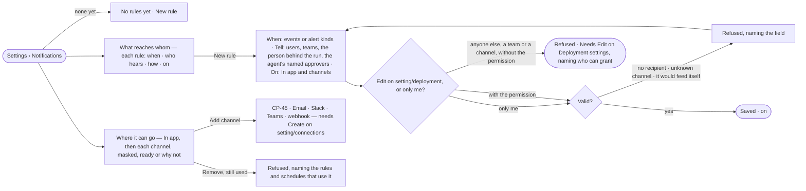

# CP-37 · Say which events reach whom, and where

**As** an Admin **I want** rules that say which events and alerts reach whom — in the Inbox, by email, Slack, Teams or
webhook **so that** failures and slowdowns find the right person without anyone watching.

Tasks: [task.md](task.md) · Feature: [CP-F08](../../feature.md)

## Who can

| Access | Can | Otherwise sees |
|---|---|---|
| Admin | Read, write, switch off and delete every rule; with Edit on `setting/deployment`, name any user, team, *the person behind the run*, *the agent's named approvers* or channel | — |
| Operator | read every rule and channel; write, switch and delete their own rules that reach only themselves ([the permission catalogue](../../../../../access/features/AC-F02-access-policies/feature.md#the-permission-catalogue)) | Other recipients, a team, a channel, *Add channel* and another person's switch and *Edit* disabled — *Needs Edit on Deployment settings — ask {who can grant}*, naming the rule's creator |

## Flow

## Acceptance criteria

| # | Given | When | Then |
|---|---|---|---|
| CP-37.1 | No rules | anyone opens Settings › Notifications | it reads *No rules yet*, with *New rule* |
| CP-37.2 | Rules | the list is read | one row each: *when* (the events and the status they match) · who hears · how (Inbox and each channel) · an on switch |
| CP-37.3 | *New rule* | a person picks events, an optional status for a finished run (any · failed · succeeded), recipients and where it goes | the rule saves, on, and matches events written from then on |
| CP-37.4 | Recipients | a rule names them | they can be users by name, teams, *the person behind the run* or *the agent's named approvers*, resolved when it matches; a user who is not active then is skipped |
| CP-37.5 | A rule with no recipient, or naming a channel that does not exist | it is saved | it is refused, naming the field |
| CP-37.6 | The events offered | a rule is written | notifications, deliveries, reminders and rule and channel changes are not offered, so a rule cannot feed itself |
| CP-37.9 | A matching event | a rule is on | each recipient gets an Inbox row within one tick, and each channel a delivery |
| CP-37.10 | A channel that is down | a delivery is sent | it is tried three times, then reads *failed* with the error; the Inbox row is there regardless |
| CP-37.11 | A rule | where it goes is chosen | *In app* and each channel an Admin set up (CP-45) are offered — email, Slack, Teams, webhook — a channel that is not ready named with why |
| CP-37.12 | A rule naming a channel | it matches | each channel gets one delivery carrying the event's line and a link, never record content (CP-45.8) |
| CP-37.13 | A channel a rule or schedule uses | it is removed | it is refused, naming the rules and schedules that use it (CP-45.9) |
| CP-37.15 | A rule or channel change | it is saved | it is a History row (AC-F06) |
| CP-37.16 | An Operator | they open Settings › Notifications | rules and channels read; they may write rules that reach only themselves; other recipients, teams, channels, *Add channel* and another person's switch and *Edit* are disabled, naming the permission |
| CP-37.17 | An Admin at the command line | they apply a rules file — one rule or a list | each rule is created, or replaces the rule of its name, with the same checks as *New rule*; a refused rule names its field and nothing in the file is half-applied |
| CP-37.18 | Anyone without Edit on `setting/deployment` | they save a rule that reaches anyone but themselves, or names a team or a channel, or change another person's rule | it is refused — *Needs Edit on Deployment settings — ask {who can grant}* — and nothing is saved |
| CP-37.19 | An alert (CP-59) | an Admin writes a rule matching its kind and naming a channel | each alert of that kind is delivered to that place as a line and a link, beside the Inbox rows CP-59 writes |
| CP-37.20 | A rule an Operator wrote for themselves | it matches | it reaches them in the Inbox and on the channels they turned on (CP-46) |
| CP-37.21 | A person with Edit on `setting/deployment` | *New rule* picks the trigger *A History row matches*, what was done, what it touched, allowed or refused and why, optionally a count in a window, and who to tell | it saves, on; when a new History row matches, or the count is reached inside the window, each recipient is told (CP-59.21) |
| CP-37.22 | A new rule on a History row | rows that match it were written before it existed | it does not fire for them; *Last fired* reads *never* until a new row matches |
| CP-37.23 | A rule on a History row | it has nothing to match or no recipient and is saved | *{field}: {why}*; nothing is saved |
| CP-37.24 | An Operator | they read the rules on a History row | each reads; its switch, *Edit* and *A History row matches* are disabled — *Needs Edit on Deployment settings — ask {who can grant}*; the route answers 403 with the same sentence |
| CP-37.25 | A rule on a History row written, changed, switched or removed | it is saved | History holds a row naming it and who |

## Screens

| Surface | Access | First use | Empty after a filter | Loading | Has data | Failed | Agent working or proposing | No access |
|---|---|---|---|---|---|---|---|---|
| What reaches whom — rules | Admin | settings.notifications · No rules yet | — | settings.notifications · Loading | settings.notifications | settings.notifications · Could not load | — | — |
| What reaches whom — rules | Operator | settings.notifications · No rules yet | — | settings.notifications · Loading | settings.notifications · Read only | settings.notifications · Could not load | — | settings.notifications · Read only |
| New rule | Admin | settings.notifications · New rule | — | — | settings.notifications · New rule · Filled | settings.notifications · New rule · Rule refused | — | — |
| New rule | Operator | settings.notifications · New rule · Just me | — | — | settings.notifications · New rule · Just me · Filled | settings.notifications · New rule · Rule refused | — | settings.notifications · Read only |
| A rule — edit | Admin | — | — | — | settings.notifications · Rule | settings.notifications · Rule refused | — | — |
| A rule — edit | Operator | — | — | — | settings.notifications · Rule · Just me | settings.notifications · Rule refused | — | settings.notifications · Read only |
| Where it can go — channels | Admin | settings.notifications · In app only | — | settings.notifications · Loading | settings.notifications | settings.notifications · Channel failed | — | — |
| Where it can go — channels | Operator | settings.notifications · In app only | — | settings.notifications · Loading | settings.notifications · Read only | settings.notifications · Channel failed | — | settings.notifications · Read only |
| New rule · History row | Admin | — | — | — | settings.notifications · New rule · History row | settings.notifications · New rule · Rule refused | — | — |
| New rule · History row | Operator | — | — | — | — | — | — | settings.notifications · Read only |
| Save the rule | Admin | — | — | settings.notifications · Saving | settings.notifications · Rule saved | settings.notifications · New rule · Rule refused | — | — |
| Save the rule | Operator | — | — | — | settings.notifications · New rule · Just me · Saved | — | — | settings.notifications · Read only |
