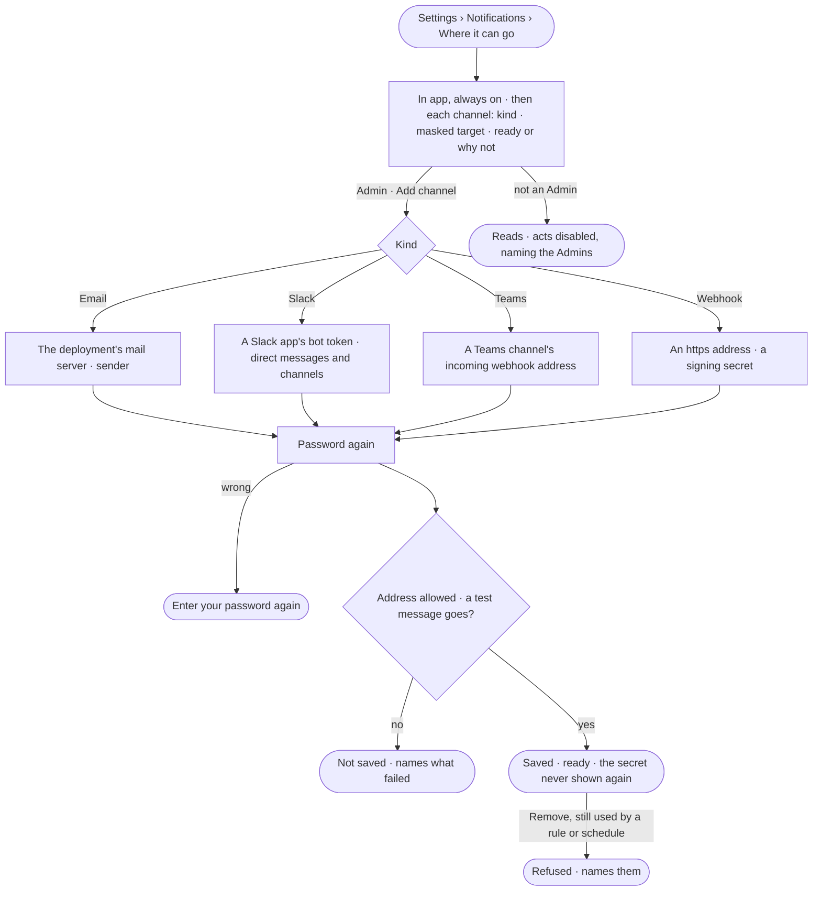

# CP-45 · Set up where asks and alerts can go

**As** an Admin **I want** to set up the deployment's channels — email, Slack, Microsoft Teams and webhooks — and see
whether each is ready
**so that** asks and alerts reach people where they already work, and nothing a channel carries leaks what a run read.

Tasks: [task.md](task.md) · Feature: [CP-F08](../../feature.md)

## Who can

| Lens | Can | Otherwise sees |
|---|---|---|
| Admin | Add, test and remove a channel; replace its secret — each with the password again | — |
| Operator | Read every channel — its kind, masked target and whether it is ready | *Add channel*, *Test* and *Remove* are disabled — *Needs the Admin role — ask Priya or Lee*. A secret never reads back to anyone |

## Flow

## Acceptance criteria

| # | Given | When | Then |
|---|---|---|---|
| CP-45.1 | A signed-in person | they open *Where it can go* | *In app* reads first, always on; then each channel — name · kind · masked target · *Ready* or why not |
| CP-45.2 | An Admin | they add an email channel with the deployment's mail server, its user, password and sender, and their own password | a test message goes to the Admin; it saves and reads ready; the mail password is sealed and never shown again |
| CP-45.3 | An Admin | they add a Slack channel with a Slack app's bot token | it saves once Slack accepts the token; it can post to a Slack channel a rule names and message a person directly (CP-46) |
| CP-45.4 | An Admin | they add a Teams channel with a Teams channel's incoming webhook address | a test message posts there; it saves; it reaches that Teams channel, never one person |
| CP-45.5 | An Admin | they add a webhook with an `https` address and an optional signing secret | it saves; every delivery carries a signature of its body the receiver can check |
| CP-45.6 | An address that is not `https`, or resolves to a loopback, link-local or the deployment's own address | a channel is added, or later a delivery is sent | it is refused, naming the address it resolved to |
| CP-45.7 | A test that fails — the server, Slack or Teams refuses | a channel is added | nothing is saved, and the reason reads in place |
| CP-45.8 | Any delivery — an ask, a reminder, an alert, a notification | it is sent | it carries one line — what it is, the agent, who it waits on, the time left — and a link into Studio; never an ask's content, a record or a run's output. A schedule's delivery sends what its creator chose, as a send held to its ask (AG-F07) |
| CP-45.9 | A channel a rule or schedule uses | an Admin presses *Remove* | it is refused, naming the rules and schedules that use it |
| CP-45.10 | A channel change | it is made without the password, with a wrong one, or with a key | it is refused — *Enter your password again to do this* |
| CP-45.11 | An Operator | they open *Where it can go* | every channel reads; *Add channel*, *Test* and *Remove* are disabled, naming the Admins; through the API they are refused |
| CP-45.12 | A channel added, replaced or removed | it is done | History records who and when, never a secret |

## Screens

| Surface | Lens | First use | Empty after a filter | Loading | Has data | Failed | Agent working or proposing | No access |
|---|---|---|---|---|---|---|---|---|
| Where it can go | Admin | settings.notifications · In app only | — | settings.notifications · Loading | settings.notifications · Channels | settings.notifications · Channel failed | — | — |
| Where it can go | Operator | settings.notifications · In app only · Read only | — | settings.notifications · Loading | settings.notifications · Channels · Read only | settings.notifications · Channel failed | — | settings.notifications · Channels · Read only |
| Add channel | Admin | settings.notifications · Add channel | — | settings.notifications · Testing channel | settings.notifications · Channel ready | settings.notifications · Channel test failed | — | — |
| Add channel | Operator | — | — | — | — | — | — | settings.notifications · Channels · Read only |
| Password again | Admin | — | — | access.sign_in_again · Checking | access.sign_in_again | access.sign_in_again · Wrong password | — | — |
| Password again | Operator | — | — | — | — | — | — | — |
